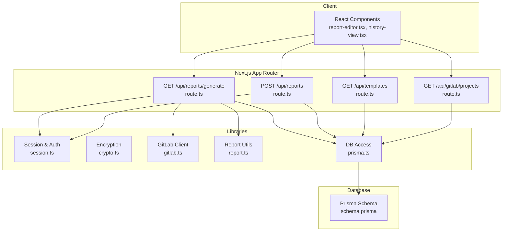
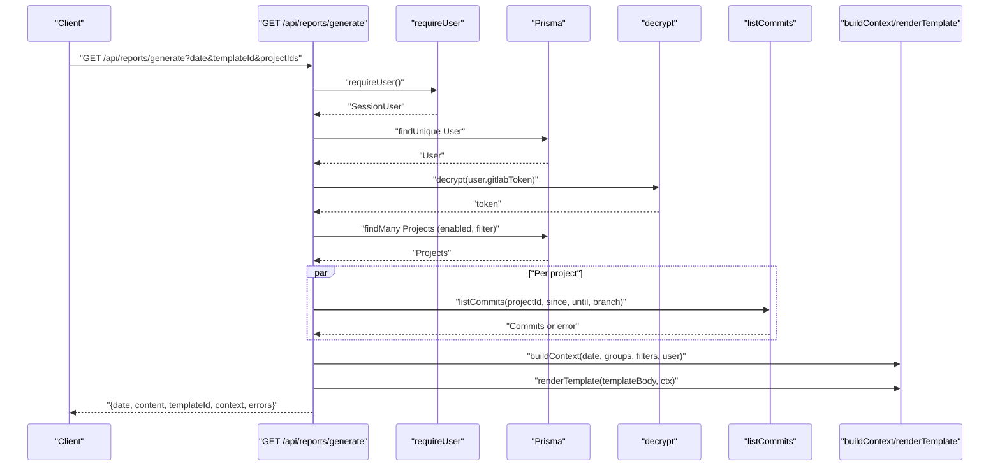
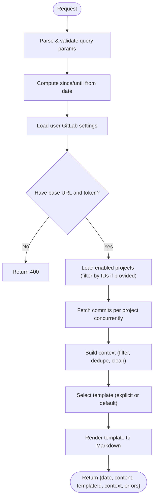
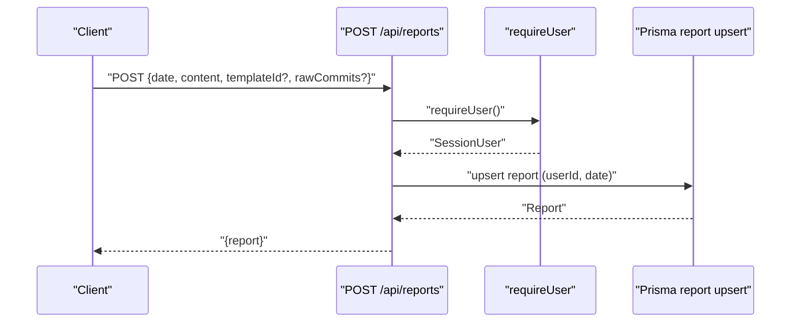
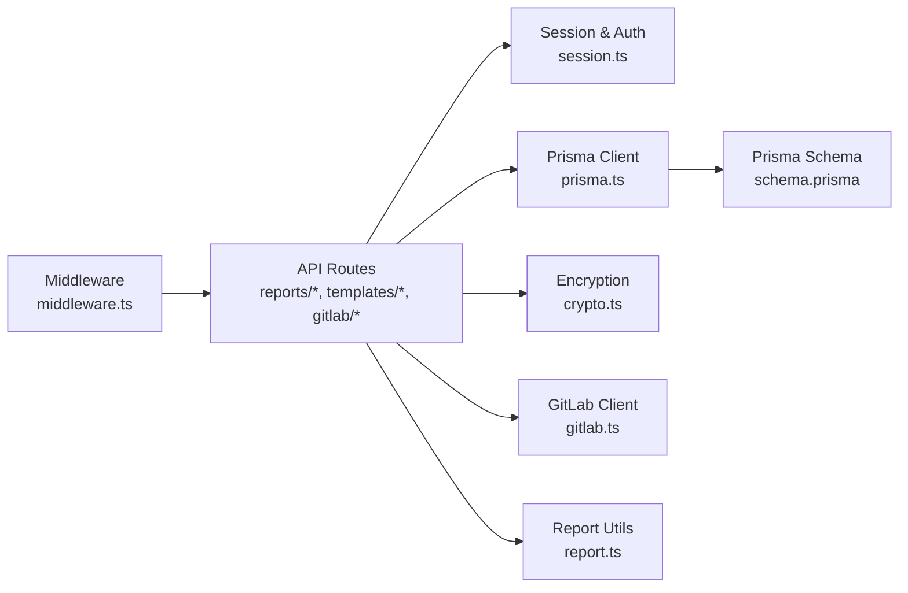

# Report Generation API

<cite>
**Referenced Files in This Document**
- [route.ts](file://app/api/reports/generate/route.ts)
- [route.ts](file://app/api/reports/route.ts)
- [report.ts](file://lib/report.ts)
- [gitlab.ts](file://lib/gitlab.ts)
- [prisma.ts](file://lib/prisma.ts)
- [schema.prisma](file://prisma/schema.prisma)
- [session.ts](file://lib/session.ts)
- [crypto.ts](file://lib/crypto.ts)
- [middleware.ts](file://middleware.ts)
- [report-editor.tsx](file://components/report-editor.tsx)
- [history-view.tsx](file://components/history-view.tsx)
</cite>

## Table of Contents
1. [Introduction](#introduction)
2. [Project Structure](#project-structure)
3. [Core Components](#core-components)
4. [Architecture Overview](#architecture-overview)
5. [Detailed Component Analysis](#detailed-component-analysis)
6. [Dependency Analysis](#dependency-analysis)
7. [Performance Considerations](#performance-considerations)
8. [Troubleshooting Guide](#troubleshooting-guide)
9. [Conclusion](#conclusion)
10. [Appendices](#appendices)

## Introduction
This document provides comprehensive API documentation for the report generation endpoints. It covers:
- GET /api/reports/generate: generates a daily report by fetching GitLab commits, applying filters, building a template context, and rendering Markdown content.
- POST /api/reports: saves a generated report to the database.
- Supporting APIs and internal architecture: template management, GitLab integration, session and authentication, database schema, and encryption.

It also documents authentication, parameter validation, error handling, response formats, rate limiting considerations, security, input sanitization, performance optimization, and client integration patterns.

## Project Structure
The report generation feature spans API routes, shared libraries, and database models:
- API routes under app/api handle HTTP endpoints.
- Shared libraries under lib implement GitLab client, report rendering, session handling, encryption, and database access.
- Database schema under prisma defines User, Project, Report, and Template entities.

**Diagram sources**
- [route.ts](file://app/api/reports/generate/route.ts)
- [route.ts](file://app/api/reports/route.ts)
- [report.ts](file://lib/report.ts)
- [gitlab.ts](file://lib/gitlab.ts)
- [prisma.ts](file://lib/prisma.ts)
- [schema.prisma](file://prisma/schema.prisma)
- [session.ts](file://lib/session.ts)
- [crypto.ts](file://lib/crypto.ts)
- [report-editor.tsx](file://components/report-editor.tsx)
- [history-view.tsx](file://components/history-view.tsx)

**Section sources**
- [route.ts](file://app/api/reports/generate/route.ts)
- [route.ts](file://app/api/reports/route.ts)
- [report.ts](file://lib/report.ts)
- [gitlab.ts](file://lib/gitlab.ts)
- [prisma.ts](file://lib/prisma.ts)
- [schema.prisma](file://prisma/schema.prisma)
- [session.ts](file://lib/session.ts)
- [crypto.ts](file://lib/crypto.ts)
- [report-editor.tsx](file://components/report-editor.tsx)
- [history-view.tsx](file://components/history-view.tsx)

## Core Components
- Authentication and session:
  - NextAuth-based JWT session with middleware protection.
  - Route wrappers enforce user presence and convert thrown errors to HTTP responses.
- GitLab integration:
  - Server-only client to fetch current user, validate token, list projects, and list commits with pagination and timeouts.
- Report generation pipeline:
  - Validates and parses query parameters.
  - Loads user GitLab settings and project filters.
  - Fetches commits per project with concurrency and per-project error handling.
  - Builds a typed context and renders Markdown via Handlebars.
- Persistence:
  - Upsert saved reports keyed by user and date.
  - Templates and projects are managed per user.

**Section sources**
- [session.ts](file://lib/session.ts)
- [middleware.ts](file://middleware.ts)
- [gitlab.ts](file://lib/gitlab.ts)
- [report.ts](file://lib/report.ts)
- [route.ts](file://app/api/reports/generate/route.ts)
- [route.ts](file://app/api/reports/route.ts)
- [prisma.ts](file://lib/prisma.ts)
- [schema.prisma](file://prisma/schema.prisma)

## Architecture Overview
High-level flow for report generation and saving:

**Diagram sources**
- [route.ts](file://app/api/reports/generate/route.ts)
- [session.ts](file://lib/session.ts)
- [prisma.ts](file://lib/prisma.ts)
- [crypto.ts](file://lib/crypto.ts)
- [gitlab.ts](file://lib/gitlab.ts)
- [report.ts](file://lib/report.ts)

## Detailed Component Analysis

### GET /api/reports/generate
- Purpose: Generate a Markdown report for a given date by aggregating GitLab commits across configured projects.
- Authentication: Requires a valid session; unauthorized requests receive a 401.
- Query parameters:
  - date: Optional; defaults to today (YYYY-MM-DD). Validation ensures ISO date format.
  - templateId: Optional; selects a user-specific template by ID or falls back to default.
  - projectIds: Optional; comma-separated project IDs to filter which projects contribute to the report.
- Processing steps:
  - Parse and validate query parameters.
  - Determine time range (since/until) based on date.
  - Load user GitLab base URL and token; error if missing.
  - Resolve project list (enabled and optionally filtered by IDs).
  - For each project, fetch commits within the time window and branch; collect errors per project.
  - Select template (explicit or default) and build a typed context.
  - Render Markdown content using Handlebars; on template failure, return a fallback message.
- Response fields:
  - date: The report date.
  - content: Generated Markdown.
  - templateId: The template used (may be null).
  - context: Internal context passed to the template renderer (useful for debugging).
  - errors: Array of project-level errors encountered during commit retrieval.
- Error handling:
  - 400: Invalid date format or missing GitLab configuration.
  - 404: User not found.
  - 500: Internal server error; thrown responses are normalized by the error wrapper.
- Example request:
  - GET /api/reports/generate?date=2025-01-01&templateId=abc&projectIds=pid1,pid2
- Example response:
  - {
      "date": "2025-01-01",
      "content": "# 2025-01-01 Daily Report\n\n...",
      "templateId": "abc",
      "context": { /* typed context */ },
      "errors": []
    }

**Diagram sources**
- [route.ts](file://app/api/reports/generate/route.ts)
- [report.ts](file://lib/report.ts)
- [gitlab.ts](file://lib/gitlab.ts)

**Section sources**
- [route.ts](file://app/api/reports/generate/route.ts)
- [report.ts](file://lib/report.ts)
- [gitlab.ts](file://lib/gitlab.ts)
- [session.ts](file://lib/session.ts)
- [crypto.ts](file://lib/crypto.ts)

### POST /api/reports
- Purpose: Save or update a report for a given date.
- Authentication: Requires a valid session; unauthorized requests receive a 401.
- Request body:
  - date: Required; ISO date (YYYY-MM-DD).
  - content: Required; Markdown content string.
  - templateId: Optional; template identifier or null.
  - rawCommits: Optional; raw commit data payload.
- Processing:
  - Parse and validate body.
  - Upsert report record keyed by user and date.
- Response:
  - Returns the persisted report object.
- Error handling:
  - 400: Invalid date format.
  - 500: Internal server error.

**Diagram sources**
- [route.ts](file://app/api/reports/route.ts)
- [session.ts](file://lib/session.ts)
- [prisma.ts](file://lib/prisma.ts)

**Section sources**
- [route.ts](file://app/api/reports/route.ts)
- [prisma.ts](file://lib/prisma.ts)
- [schema.prisma](file://prisma/schema.prisma)

### Supporting APIs and Utilities

#### GET /api/reports
- Purpose: Retrieve reports for a specific date or month, or recent reports.
- Query parameters:
  - date: Optional; returns a single report for the date.
  - month: Optional; returns reports for the month.
- Response:
  - date query: { report }
  - month query: { reports: [{ id, date, updatedAt }] }
  - no query: recent reports with limit and ordering.

**Section sources**
- [route.ts](file://app/api/reports/route.ts)

#### GET /api/reports?delete
- Purpose: Delete reports for a specific date.
- Query parameter:
  - date: Required; ISO date (YYYY-MM-DD).
- Response:
  - { ok: true }

**Section sources**
- [route.ts](file://app/api/reports/route.ts)

#### Template Management
- GET /api/templates: Lists user templates; creates default template if none exists.
- POST /api/templates: Create a template; setting isDefault clears previous default.
- PATCH /api/templates: Update template; setting isDefault clears previous default.
- DELETE /api/templates?id: Delete a template owned by the user.

**Section sources**
- [route.ts](file://app/api/templates/route.ts)
- [report.ts](file://lib/report.ts)

#### GitLab Integration
- GET /api/gitlab/projects: List user’s projects.
- PATCH /api/gitlab/projects: Enable/disable a project or set default branch.
- POST /api/gitlab/validate-token: Validate and persist GitLab token and user info; optionally refresh project cache.

**Section sources**
- [route.ts](file://app/api/gitlab/projects/route.ts)
- [route.ts](file://app/api/gitlab/validate-token/route.ts)
- [gitlab.ts](file://lib/gitlab.ts)
- [crypto.ts](file://lib/crypto.ts)

## Dependency Analysis
- Authentication and routing:
  - Middleware enforces authentication for protected pages.
  - Route handlers wrap logic with error normalization and require a session user.
- Data access:
  - Prisma client is globally initialized and used for all database operations.
- External services:
  - GitLab client performs server-side requests with timeouts and pagination.
- Encryption:
  - GitLab tokens are stored encrypted and decrypted only on the server.

**Diagram sources**
- [middleware.ts](file://middleware.ts)
- [session.ts](file://lib/session.ts)
- [prisma.ts](file://lib/prisma.ts)
- [crypto.ts](file://lib/crypto.ts)
- [gitlab.ts](file://lib/gitlab.ts)
- [report.ts](file://lib/report.ts)
- [schema.prisma](file://prisma/schema.prisma)

**Section sources**
- [middleware.ts](file://middleware.ts)
- [session.ts](file://lib/session.ts)
- [prisma.ts](file://lib/prisma.ts)
- [crypto.ts](file://lib/crypto.ts)
- [gitlab.ts](file://lib/gitlab.ts)
- [report.ts](file://lib/report.ts)
- [schema.prisma](file://prisma/schema.prisma)

## Performance Considerations
- Concurrency:
  - Commit fetching per project is executed concurrently; each project fetch paginates up to a capped number of pages to prevent excessive load.
- Caching and persistence:
  - Project metadata is cached in the database after token validation; subsequent requests avoid redundant GitLab calls.
- Rendering:
  - Template compilation is performed per request; consider caching compiled templates if templates are static and frequently reused.
- Pagination limits:
  - GitLab client caps pagination pages to protect against long-running queries.
- Network timeouts:
  - Requests to GitLab are aborted after a fixed timeout to avoid hanging.
- Database indexing:
  - Unique and indexed fields (e.g., user-date composite on reports) optimize lookups and upserts.

**Section sources**
- [gitlab.ts](file://lib/gitlab.ts)
- [route.ts](file://app/api/reports/generate/route.ts)
- [schema.prisma](file://prisma/schema.prisma)

## Troubleshooting Guide
- Authentication failures:
  - 401 Unauthorized: No active session; ensure the client sends session cookies or bearer tokens as required by the NextAuth configuration.
  - 403 Forbidden: Admin-only checks (not used in report endpoints).
- Validation errors:
  - 400 Bad Request: Invalid date format, missing GitLab configuration, or malformed request body.
- GitLab integration:
  - 500 Internal Server Error: GitLab API errors are normalized; inspect the errors array returned by GET /api/reports/generate for per-project failures.
- Saving reports:
  - 500 Internal Server Error: Database upsert failures; retry after checking connectivity and schema consistency.
- Rate limiting:
  - The application does not implement explicit API rate limiting. Consider adding rate limiting at the ingress or per-route to protect GitLab API usage and database throughput.

**Section sources**
- [session.ts](file://lib/session.ts)
- [route.ts](file://app/api/reports/generate/route.ts)
- [route.ts](file://app/api/reports/route.ts)

## Conclusion
The report generation API provides a robust pipeline to aggregate GitLab commits, apply configurable filters, and render Markdown reports. It integrates securely with NextAuth, Prisma, and GitLab, with clear validation, error handling, and response formatting. Clients can generate and save reports via straightforward HTTP endpoints, and the system supports customization through templates and project filtering.

## Appendices

### API Definitions

- GET /api/reports/generate
  - Query parameters:
    - date: string (optional; YYYY-MM-DD)
    - templateId: string (optional)
    - projectIds: string (optional; comma-separated)
  - Response: { date, content, templateId, context, errors }
  - Errors: 400, 401, 404, 500

- POST /api/reports
  - Body: { date, content, templateId?, rawCommits? }
  - Response: { report }
  - Errors: 400, 401, 500

- GET /api/reports
  - Query parameters:
    - date: string (optional; YYYY-MM-DD)
    - month: string (optional; YYYY-MM)
  - Response:
    - date: { report }
    - month: { reports: [{ id, date, updatedAt }] }
    - none: recent reports

- DELETE /api/reports
  - Query parameters:
    - date: string (required; YYYY-MM-DD)
  - Response: { ok: true }

- GET /api/templates
  - Response: { templates: Template[] }

- POST /api/templates
  - Body: { name, body, isDefault? }
  - Response: { template }

- PATCH /api/templates
  - Body: { id, name?, body?, isDefault? }
  - Response: { template }

- DELETE /api/templates?id
  - Response: { ok: true }

- GET /api/gitlab/projects
  - Response: { projects: Project[] }

- PATCH /api/gitlab/projects
  - Body: { id, enabled?, defaultBranch? }
  - Response: { project }

- POST /api/gitlab/validate-token
  - Body: { baseUrl, token? }
  - Response: { ok: true, user, warning? }

### Security and Input Sanitization
- Authentication:
  - Session-based via NextAuth; middleware protects pages.
- Secrets:
  - GitLab token stored encrypted; decryption occurs server-side only.
- Input validation:
  - Zod schemas validate query parameters and request bodies.
- Output:
  - Template rendering uses non-escaped mode; sanitize content if integrating external user-generated templates.

**Section sources**
- [session.ts](file://lib/session.ts)
- [crypto.ts](file://lib/crypto.ts)
- [route.ts](file://app/api/reports/generate/route.ts)
- [route.ts](file://app/api/reports/route.ts)
- [report.ts](file://lib/report.ts)

### Client Integration Examples
- React usage patterns:
  - Generate report: Build query parameters and call GET /api/reports/generate; handle errors and display content.
  - Save report: POST /api/reports with { date, content, templateId? }.
  - Load existing report: GET /api/reports?date=YYYY-MM-DD.
  - Calendar view: Use monthly listing and per-day loading for history.

**Section sources**
- [report-editor.tsx](file://components/report-editor.tsx)
- [history-view.tsx](file://components/history-view.tsx)