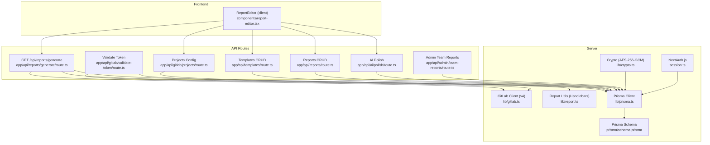
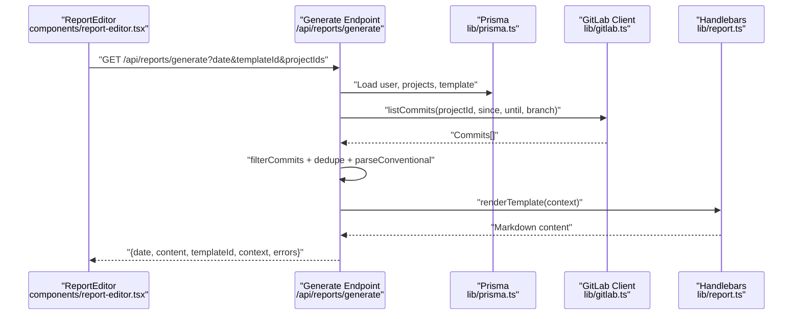
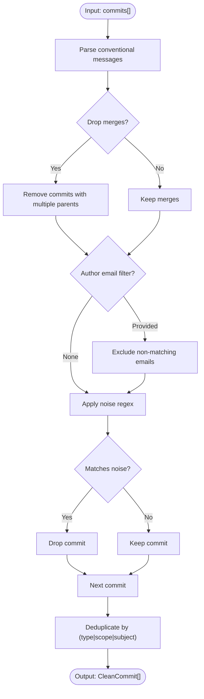
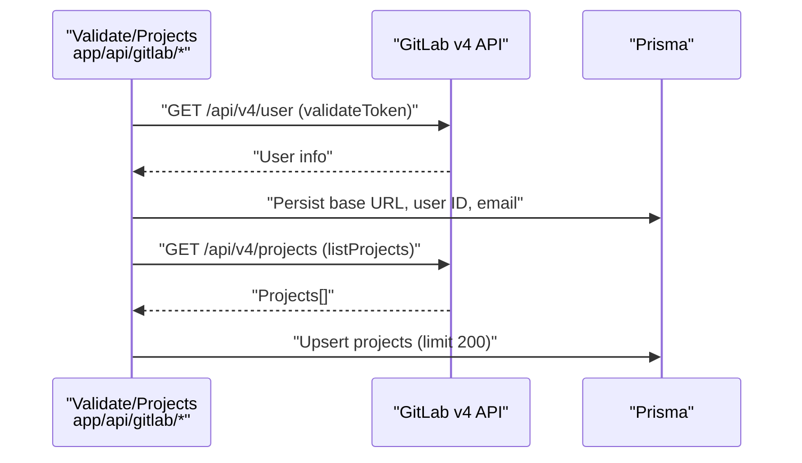
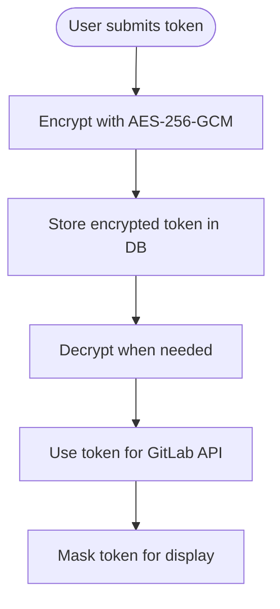
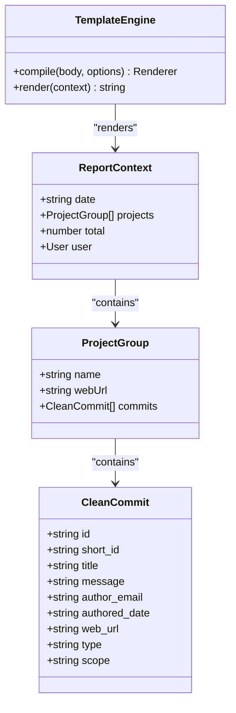
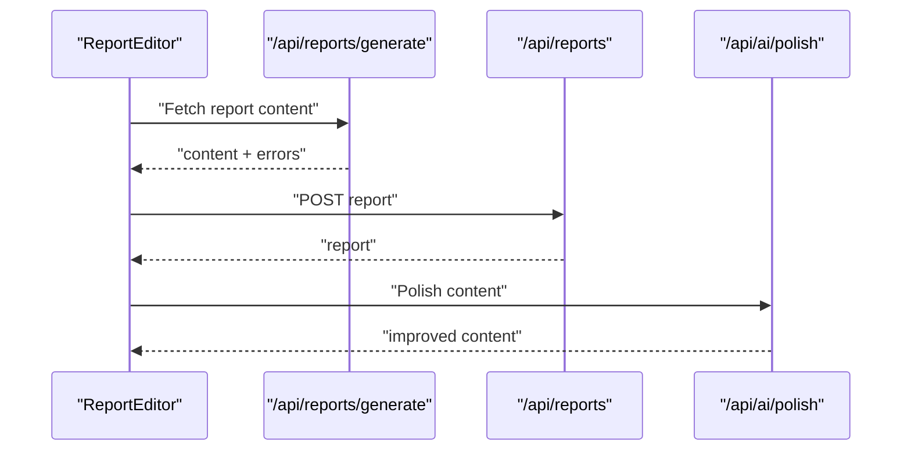
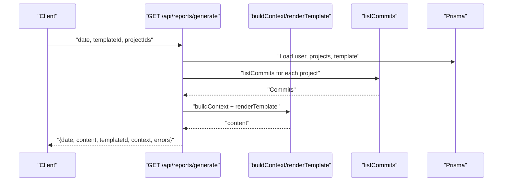
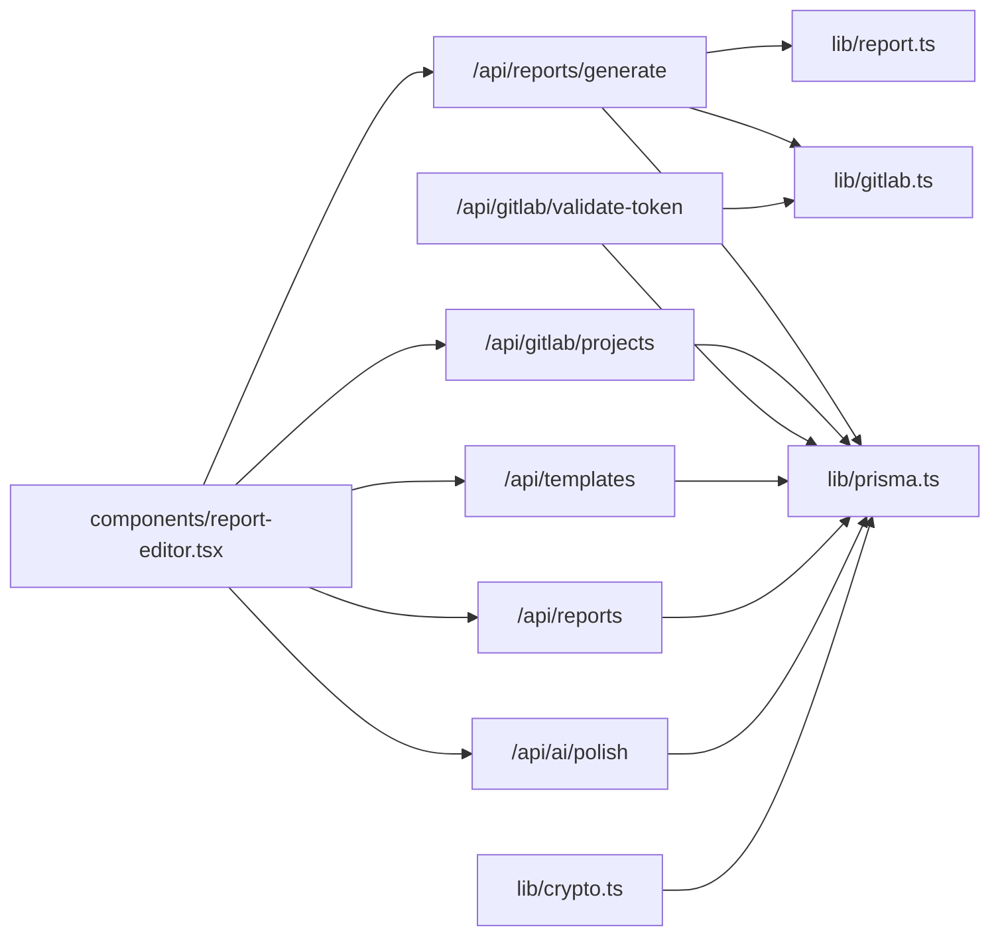

# Report Generation System

<cite>
**Referenced Files in This Document**
- [README.md](file://README.md)
- [package.json](file://package.json)
- [lib/report.ts](file://lib/report.ts)
- [lib/gitlab.ts](file://lib/gitlab.ts)
- [lib/crypto.ts](file://lib/crypto.ts)
- [lib/prisma.ts](file://lib/prisma.ts)
- [prisma/schema.prisma](file://prisma/schema.prisma)
- [app/api/reports/generate/route.ts](file://app/api/reports/generate/route.ts)
- [app/api/reports/route.ts](file://app/api/reports/route.ts)
- [app/api/gitlab/projects/route.ts](file://app/api/gitlab/projects/route.ts)
- [app/api/gitlab/validate-token/route.ts](file://app/api/gitlab/validate-token/route.ts)
- [app/api/templates/route.ts](file://app/api/templates/route.ts)
- [app/api/ai/polish/route.ts](file://app/api/ai/polish/route.ts)
- [app/api/admin/team-reports/route.ts](file://app/api/admin/team-reports/route.ts)
- [components/report-editor.tsx](file://components/report-editor.tsx)
- [lib/utils.ts](file://lib/utils.ts)
</cite>

## Table of Contents
1. [Introduction](#introduction)
2. [Project Structure](#project-structure)
3. [Core Components](#core-components)
4. [Architecture Overview](#architecture-overview)
5. [Detailed Component Analysis](#detailed-component-analysis)
6. [Dependency Analysis](#dependency-analysis)
7. [Performance Considerations](#performance-considerations)
8. [Troubleshooting Guide](#troubleshooting-guide)
9. [Conclusion](#conclusion)
10. [Appendices](#appendices)

## Introduction
This document explains the end-to-end report generation system that reads GitLab commits and produces daily reports. It covers the complete workflow from GitLab commit fetching to report rendering, including automated commit aggregation, conventional commit parsing, filtering, server-side GitLab API integration, token encryption, and project configuration management. It also documents the template-based rendering system using Handlebars, the markdown editor with real-time preview, and the report generation API endpoint with request/response formats and error handling. Finally, it includes examples of template syntax, commit filtering patterns, integration with GitLab REST API v4, and performance optimization strategies for large commit histories.

## Project Structure
The system is a Next.js 14 App Router application with TypeScript, using Prisma for MySQL persistence, NextAuth.js for authentication, and Handlebars for templating. The frontend is a React client that communicates with server-side route handlers.

**Diagram sources**
- [components/report-editor.tsx:1-284](file://components/report-editor.tsx#L1-L284)
- [app/api/reports/generate/route.ts:1-133](file://app/api/reports/generate/route.ts#L1-L133)
- [app/api/reports/route.ts:1-90](file://app/api/reports/route.ts#L1-L90)
- [app/api/templates/route.ts:1-96](file://app/api/templates/route.ts#L1-L96)
- [app/api/gitlab/projects/route.ts:1-42](file://app/api/gitlab/projects/route.ts#L1-L42)
- [app/api/gitlab/validate-token/route.ts:1-81](file://app/api/gitlab/validate-token/route.ts#L1-L81)
- [app/api/ai/polish/route.ts:1-63](file://app/api/ai/polish/route.ts#L1-L63)
- [app/api/admin/team-reports/route.ts:1-34](file://app/api/admin/team-reports/route.ts#L1-L34)
- [lib/report.ts:1-159](file://lib/report.ts#L1-L159)
- [lib/gitlab.ts:1-149](file://lib/gitlab.ts#L1-L149)
- [lib/crypto.ts:1-46](file://lib/crypto.ts#L1-L46)
- [lib/prisma.ts:1-14](file://lib/prisma.ts#L1-L14)
- [prisma/schema.prisma:1-80](file://prisma/schema.prisma#L1-L80)

**Section sources**
- [README.md:1-86](file://README.md#L1-L86)
- [package.json:1-47](file://package.json#L1-L47)

## Core Components
- Conventional commit parsing and filtering pipeline:
  - Parses conventional commit messages and deduplicates entries.
  - Filters merge commits, author emails, and noise via regex.
- GitLab integration:
  - Validates tokens, lists projects, and paginates commits with safety caps.
  - Enforces server-side-only API calls and timeouts.
- Encryption:
  - AES-256-GCM encryption/decryption for GitLab tokens at rest.
- Template engine:
  - Handlebars compilation with default template and error fallback.
- Frontend editor:
  - Real-time markdown preview, project selection, and AI polish integration.
- Persistence:
  - Users, projects, reports, and templates stored in MySQL via Prisma.

**Section sources**
- [lib/report.ts:29-159](file://lib/report.ts#L29-L159)
- [lib/gitlab.ts:45-149](file://lib/gitlab.ts#L45-L149)
- [lib/crypto.ts:7-46](file://lib/crypto.ts#L7-L46)
- [components/report-editor.tsx:19-284](file://components/report-editor.tsx#L19-L284)
- [prisma/schema.prisma:16-79](file://prisma/schema.prisma#L16-L79)

## Architecture Overview
The system orchestrates a client-driven workflow:
- The client loads configuration (templates and projects), optionally loads an existing report, and triggers generation.
- The generation endpoint validates the user, resolves GitLab base URL and token, fetches commits per project, builds a report context, renders with a template, and returns content plus any per-project errors.
- The editor supports saving, copying, and AI polish.

**Diagram sources**
- [components/report-editor.tsx:67-91](file://components/report-editor.tsx#L67-L91)
- [app/api/reports/generate/route.ts:23-132](file://app/api/reports/generate/route.ts#L23-L132)
- [lib/gitlab.ts:120-148](file://lib/gitlab.ts#L120-L148)
- [lib/report.ts:52-144](file://lib/report.ts#L52-L144)

## Detailed Component Analysis

### Conventional Commit Parsing and Filtering
- Conventional commit parsing extracts type, scope, and subject from the first line of commit messages.
- Merge detection uses parent IDs.
- Filtering supports dropping merges, author email matching, and noise regex exclusion.
- Deduplication keeps the first occurrence of identical (type, scope, lowercase subject).

**Diagram sources**
- [lib/report.ts:31-105](file://lib/report.ts#L31-L105)

**Section sources**
- [lib/report.ts:29-105](file://lib/report.ts#L29-L105)

### GitLab API Integration (Server-Side)
- All GitLab API calls are executed server-side with a configurable timeout and no-store caching.
- Pagination is capped to prevent excessive load.
- Token validation ensures the provided credentials work and fetches user email for filtering.
- Project listing caches metadata per user.

**Diagram sources**
- [app/api/gitlab/validate-token/route.ts:13-80](file://app/api/gitlab/validate-token/route.ts#L13-L80)
- [lib/gitlab.ts:82-111](file://lib/gitlab.ts#L82-L111)

**Section sources**
- [lib/gitlab.ts:45-149](file://lib/gitlab.ts#L45-L149)
- [app/api/gitlab/validate-token/route.ts:13-80](file://app/api/gitlab/validate-token/route.ts#L13-L80)
- [app/api/gitlab/projects/route.ts:6-42](file://app/api/gitlab/projects/route.ts#L6-L42)

### Token Encryption and Storage
- GitLab personal access tokens are encrypted with AES-256-GCM before being persisted.
- Decryption is performed only on the server during runtime.
- Token masking displays a safe preview in the UI.

**Diagram sources**
- [lib/crypto.ts:17-45](file://lib/crypto.ts#L17-L45)
- [app/api/gitlab/validate-token/route.ts:31-38](file://app/api/gitlab/validate-token/route.ts#L31-L38)

**Section sources**
- [lib/crypto.ts:7-46](file://lib/crypto.ts#L7-L46)
- [prisma/schema.prisma:22-26](file://prisma/schema.prisma#L22-L26)

### Template-Based Rendering with Handlebars
- Default template renders a simple markdown report grouped by project.
- Templates are stored per user and can be toggled as default.
- Compilation failure is handled gracefully with a fallback error message.

**Diagram sources**
- [lib/report.ts:22-159](file://lib/report.ts#L22-L159)

**Section sources**
- [lib/report.ts:137-159](file://lib/report.ts#L137-L159)
- [app/api/templates/route.ts:7-25](file://app/api/templates/route.ts#L7-L25)

### Markdown Editor, Real-Time Preview, and Content Editing
- The editor uses a markdown component with live preview.
- It supports generating content from commits, saving to persistent storage, copying to clipboard, and AI polish via an external LLM.
- Project selection controls which repositories contribute to the generated report.

**Diagram sources**
- [components/report-editor.tsx:67-164](file://components/report-editor.tsx#L67-L164)
- [app/api/reports/generate/route.ts:23-132](file://app/api/reports/generate/route.ts#L23-L132)
- [app/api/reports/route.ts:55-76](file://app/api/reports/route.ts#L55-L76)
- [app/api/ai/polish/route.ts:10-62](file://app/api/ai/polish/route.ts#L10-L62)

**Section sources**
- [components/report-editor.tsx:19-284](file://components/report-editor.tsx#L19-L284)

### Report Generation API Endpoint
- Endpoint: GET /api/reports/generate
- Query parameters:
  - date: YYYY-MM-DD (optional, defaults to today)
  - templateId: template identifier (optional)
  - projectIds: comma-separated project IDs (optional)
- Response fields:
  - date, content, templateId, context, errors
- Behavior:
  - Validates user, loads projects, fetches commits, filters and cleans commits, renders with template, and returns combined errors per project.

**Diagram sources**
- [app/api/reports/generate/route.ts:23-132](file://app/api/reports/generate/route.ts#L23-L132)
- [lib/report.ts:115-144](file://lib/report.ts#L115-L144)
- [lib/gitlab.ts:120-148](file://lib/gitlab.ts#L120-L148)

**Section sources**
- [app/api/reports/generate/route.ts:14-30](file://app/api/reports/generate/route.ts#L14-L30)
- [app/api/reports/generate/route.ts:108-131](file://app/api/reports/generate/route.ts#L108-L131)

### Additional APIs and Workflows
- Reports CRUD: GET /api/reports (supports date/month queries), POST to save/update, DELETE to remove.
- Templates CRUD: GET (auto-create default if none), POST, PATCH, DELETE.
- GitLab Projects: GET list, PATCH to enable/disable and set default branch.
- AI Polish: POST to improve content via an OpenAI-compatible LLM.
- Admin Team Reports: GET to list who submitted reports for a given date.

**Section sources**
- [app/api/reports/route.ts:9-90](file://app/api/reports/route.ts#L9-L90)
- [app/api/templates/route.ts:7-96](file://app/api/templates/route.ts#L7-L96)
- [app/api/gitlab/projects/route.ts:6-42](file://app/api/gitlab/projects/route.ts#L6-L42)
- [app/api/ai/polish/route.ts:10-62](file://app/api/ai/polish/route.ts#L10-L62)
- [app/api/admin/team-reports/route.ts:6-33](file://app/api/admin/team-reports/route.ts#L6-L33)

## Dependency Analysis
- Client depends on route handlers for data and actions.
- Route handlers depend on:
  - Session utilities for authentication and permissions
  - Prisma for persistence
  - GitLab client for API calls
  - Report utilities for parsing, filtering, and rendering
  - Crypto for token encryption/decryption
- Prisma schema defines relations among User, Project, Report, and Template.

**Diagram sources**
- [components/report-editor.tsx:39-53](file://components/report-editor.tsx#L39-L53)
- [app/api/reports/generate/route.ts:54-119](file://app/api/reports/generate/route.ts#L54-L119)
- [lib/report.ts:1-159](file://lib/report.ts#L1-L159)
- [lib/gitlab.ts:1-149](file://lib/gitlab.ts#L1-L149)
- [lib/crypto.ts:1-46](file://lib/crypto.ts#L1-L46)
- [lib/prisma.ts:1-14](file://lib/prisma.ts#L1-L14)

**Section sources**
- [prisma/schema.prisma:16-79](file://prisma/schema.prisma#L16-L79)

## Performance Considerations
- Pagination caps:
  - Project listing and commit listing limit pages to avoid long-running requests.
- Timeout enforcement:
  - GitLab requests abort after a fixed timeout to prevent hanging.
- Minimal caching:
  - Fetches use no-store to avoid stale data; rely on client-side caching of templates and projects.
- Batched writes:
  - Project upserts are batched to reduce database round trips.
- Filtering early:
  - Merge commits and noise regex filtering reduce downstream processing.
- Recommendations:
  - Cache rendered reports per user/date on the server for repeated reads.
  - Add Redis/LRU cache for recent templates and project lists.
  - Paginate and parallelize commit fetching per project; consider incremental updates.
  - Limit per-request commit window (e.g., last 7 days) to keep payloads small.

**Section sources**
- [lib/gitlab.ts:91-111](file://lib/gitlab.ts#L91-L111)
- [lib/gitlab.ts:120-148](file://lib/gitlab.ts#L120-L148)
- [app/api/gitlab/validate-token/route.ts:43-67](file://app/api/gitlab/validate-token/route.ts#L43-L67)
- [app/api/reports/generate/route.ts:57-85](file://app/api/reports/generate/route.ts#L57-L85)

## Troubleshooting Guide
- Authentication failures:
  - Ensure the user is logged in; route handlers enforce user presence.
- Missing GitLab configuration:
  - The generation endpoint checks for base URL and token; configure via settings.
- GitLab token validation:
  - Use the validation endpoint to confirm token validity and refresh project cache.
- Template rendering errors:
  - The renderer catches exceptions and returns a fallback message; check template syntax.
- AI polish errors:
  - Requires LLM_API_BASE and LLM_API_KEY; endpoint returns a structured error if missing.
- Per-project errors:
  - The generation endpoint aggregates errors per project and surfaces them to the UI.

**Section sources**
- [app/api/reports/generate/route.ts:36-43](file://app/api/reports/generate/route.ts#L36-L43)
- [app/api/gitlab/validate-token/route.ts:29-38](file://app/api/gitlab/validate-token/route.ts#L29-L38)
- [lib/report.ts:137-144](file://lib/report.ts#L137-L144)
- [app/api/ai/polish/route.ts:14-22](file://app/api/ai/polish/route.ts#L14-L22)
- [components/report-editor.tsx:260-271](file://components/report-editor.tsx#L260-L271)

## Conclusion
The report generation system integrates GitLab’s REST API v4 server-side, securely stores tokens, and transforms commit data into customizable markdown reports using Handlebars. The React editor provides a real-time, editable experience with project scoping, AI polish, and persistent storage. Robust filtering and conventional commit parsing ensure concise, readable outputs. With pagination caps, timeouts, and modular components, the system is designed for reliability and scalability.

## Appendices

### API Surface Summary
- Authentication: POST /api/auth/[...nextauth]
- User: GET/PATCH /api/me
- GitLab:
  - POST /api/gitlab/validate-token
  - GET/PATCH /api/gitlab/projects
- Reports:
  - GET /api/reports/generate?date&templateId&projectIds
  - GET/POST/DELETE /api/reports
- Templates:
  - GET/POST/PATCH/DELETE /api/templates
- AI Polish:
  - POST /api/ai/polish
- Admin:
  - GET /api/admin/team-reports?date
  - GET/POST/PATCH/DELETE /api/admin/users

**Section sources**
- [README.md:72-86](file://README.md#L72-L86)

### Template Syntax Examples
- Default template:
  - Renders a top-level title, then iterates projects and their commits.
  - See [DEFAULT_TEMPLATE_BODY:146-159](file://lib/report.ts#L146-L159).
- Creating custom templates:
  - Use POST /api/templates with name, body, and optional isDefault.
  - See [Templates CRUD:33-51](file://app/api/templates/route.ts#L33-L51).

**Section sources**
- [lib/report.ts:146-159](file://lib/report.ts#L146-L159)
- [app/api/templates/route.ts:33-51](file://app/api/templates/route.ts#L33-L51)

### Commit Filtering Patterns
- Drop merges: Enabled by default during context building.
- Author email: Matches against user’s GitLab email.
- Noise regex: Case-insensitive pattern applied to commit titles.
- See [buildContext and filterCommits:115-135](file://lib/report.ts#L115-L135) and [filterCommits:52-75](file://lib/report.ts#L52-L75).

**Section sources**
- [lib/report.ts:52-75](file://lib/report.ts#L52-L75)
- [lib/report.ts:115-135](file://lib/report.ts#L115-L135)

### Security Notes
- Tokens are encrypted at rest and decrypted only on the server.
- All GitLab API calls are proxied server-side; tokens never reach the browser.
- Passwords are hashed; rotation requires re-encryption of stored tokens.

**Section sources**
- [README.md:65-71](file://README.md#L65-L71)
- [lib/crypto.ts:17-38](file://lib/crypto.ts#L17-L38)