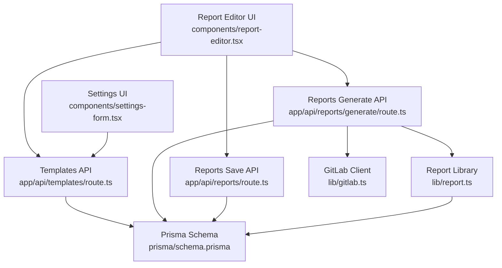
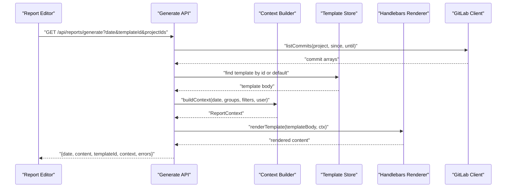
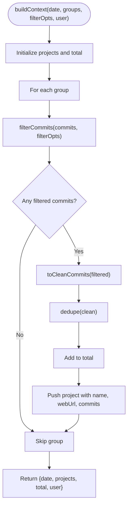
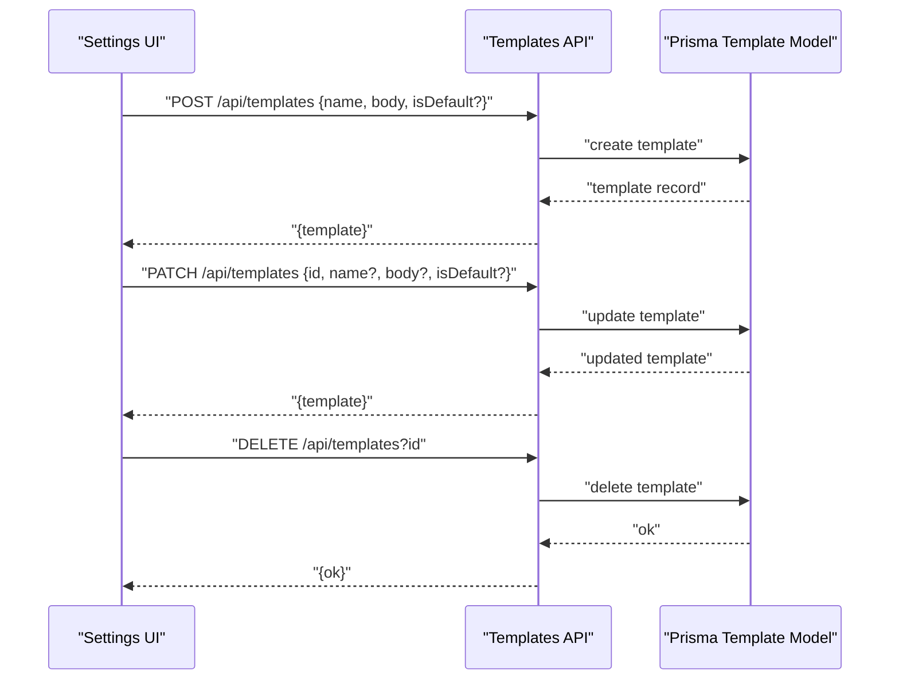
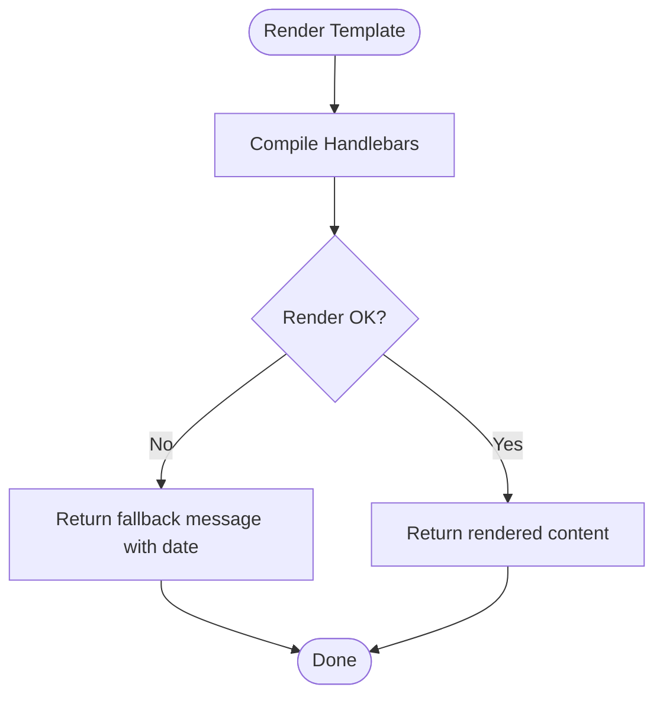
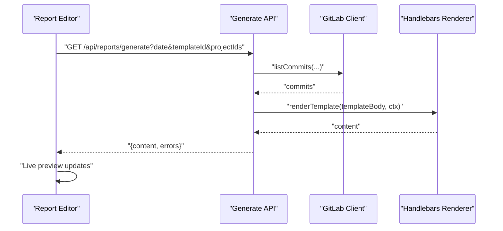
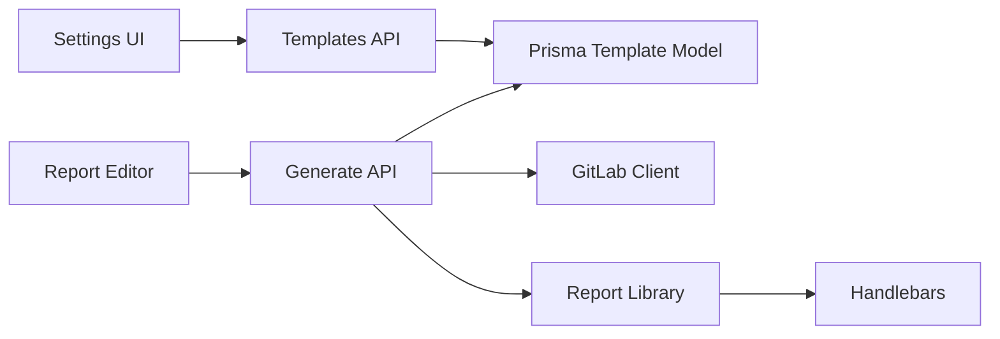
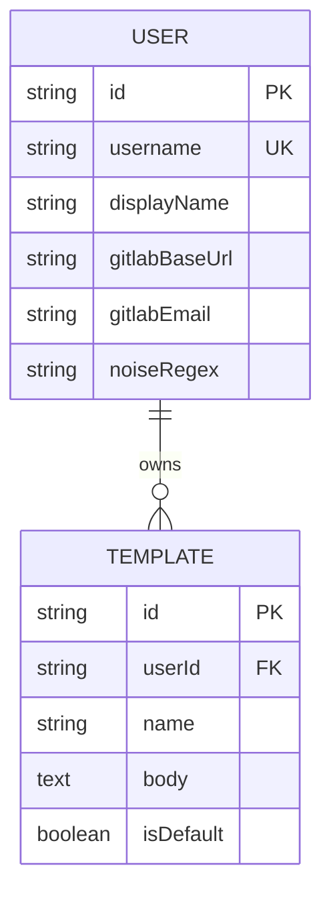

# Template Rendering System

<cite>
**Referenced Files in This Document**
- [app/api/templates/route.ts](file://app/api/templates/route.ts)
- [app/api/reports/generate/route.ts](file://app/api/reports/generate/route.ts)
- [app/api/reports/route.ts](file://app/api/reports/route.ts)
- [lib/report.ts](file://lib/report.ts)
- [lib/gitlab.ts](file://lib/gitlab.ts)
- [components/report-editor.tsx](file://components/report-editor.tsx)
- [components/settings-form.tsx](file://components/settings-form.tsx)
- [prisma/schema.prisma](file://prisma/schema.prisma)
</cite>

## Table of Contents
1. [Introduction](#introduction)
2. [Project Structure](#project-structure)
3. [Core Components](#core-components)
4. [Architecture Overview](#architecture-overview)
5. [Detailed Component Analysis](#detailed-component-analysis)
6. [Dependency Analysis](#dependency-analysis)
7. [Performance Considerations](#performance-considerations)
8. [Troubleshooting Guide](#troubleshooting-guide)
9. [Conclusion](#conclusion)
10. [Appendices](#appendices)

## Introduction
This document explains the template rendering system powered by Handlebars within the reporting application. It covers template syntax, available variables, context objects, default template structure, customization options, CRUD operations, validation and error handling, context building, data injection, variable substitution, conditional rendering, loops, template inheritance patterns, reusable components, best practices, and real-time preview capabilities.

## Project Structure
The template system spans frontend components, backend APIs, and shared libraries:
- Frontend: Editor and settings UI manage templates and real-time preview.
- Backend: REST endpoints handle template CRUD and report generation.
- Shared library: Handlebars rendering, context building, and default template definition.
- Data model: Templates stored per user with default selection.

**Diagram sources**
- [components/report-editor.tsx:19-284](file://components/report-editor.tsx#L19-L284)
- [components/settings-form.tsx:136-185](file://components/settings-form.tsx#L136-L185)
- [app/api/templates/route.ts:1-96](file://app/api/templates/route.ts#L1-L96)
- [app/api/reports/generate/route.ts:1-133](file://app/api/reports/generate/route.ts#L1-L133)
- [app/api/reports/route.ts:1-90](file://app/api/reports/route.ts#L1-L90)
- [lib/report.ts:137-159](file://lib/report.ts#L137-L159)
- [lib/gitlab.ts:1-149](file://lib/gitlab.ts#L1-L149)
- [prisma/schema.prisma:67-79](file://prisma/schema.prisma#L67-L79)

**Section sources**
- [components/report-editor.tsx:19-284](file://components/report-editor.tsx#L19-L284)
- [components/settings-form.tsx:136-185](file://components/settings-form.tsx#L136-L185)
- [app/api/templates/route.ts:1-96](file://app/api/templates/route.ts#L1-L96)
- [app/api/reports/generate/route.ts:1-133](file://app/api/reports/generate/route.ts#L1-L133)
- [app/api/reports/route.ts:1-90](file://app/api/reports/route.ts#L1-L90)
- [lib/report.ts:137-159](file://lib/report.ts#L137-L159)
- [lib/gitlab.ts:1-149](file://lib/gitlab.ts#L1-L149)
- [prisma/schema.prisma:67-79](file://prisma/schema.prisma#L67-L79)

## Core Components
- Handlebars rendering engine and default template definition.
- Context builder that transforms GitLab commit data into a structured ReportContext.
- Template CRUD endpoints with validation and default template management.
- Real-time editor with live preview and AI polishing integration.
- Report generation pipeline that selects templates, builds context, renders content, and aggregates errors.

Key responsibilities:
- Template storage and retrieval per user.
- Validation of template names and bodies.
- Selection of default or explicit template during report generation.
- Safe rendering with fallback error messages.
- Real-time preview and editing experience.

**Section sources**
- [lib/report.ts:137-159](file://lib/report.ts#L137-L159)
- [lib/report.ts:115-135](file://lib/report.ts#L115-L135)
- [app/api/templates/route.ts:7-25](file://app/api/templates/route.ts#L7-L25)
- [app/api/reports/generate/route.ts:87-106](file://app/api/reports/generate/route.ts#L87-L106)
- [components/report-editor.tsx:273-281](file://components/report-editor.tsx#L273-L281)

## Architecture Overview
The system follows a layered architecture:
- Presentation layer: React components for editing and settings.
- API layer: Next.js routes for templates and report generation/save.
- Domain layer: Handlebars rendering and context building.
- Data layer: Prisma models for users, templates, and reports.

**Diagram sources**
- [app/api/reports/generate/route.ts:23-132](file://app/api/reports/generate/route.ts#L23-L132)
- [lib/report.ts:115-144](file://lib/report.ts#L115-L144)
- [lib/gitlab.ts:120-148](file://lib/gitlab.ts#L120-L148)
- [app/api/templates/route.ts:87-106](file://app/api/templates/route.ts#L87-L106)

## Detailed Component Analysis

### Template Syntax and Variables
The system uses Handlebars templates with the following variables available in the ReportContext:
- date: formatted date string (YYYY-MM-DD).
- projects: array of project groups with:
  - name: project name with namespace.
  - webUrl: project web URL.
  - commits: array of cleaned commits with:
    - id, short_id, title, message, author_email, authored_date, web_url.
    - type, scope: derived from conventional commit parsing.
- total: total number of commits across projects.
- user: user profile with:
  - displayName: user’s display name.
  - email: user’s GitLab email if configured.

Default template demonstrates:
- Conditional rendering with if/else blocks.
- Iteration over projects and commits using each.
- Basic Markdown-style headings and lists.

Common patterns:
- Loops: {{#each projects}} ... {{/each}}, {{#each commits}} ... {{/each}}.
- Conditionals: {{#if projects.length}} ... {{else}} ... {{/if}}.
- Variable substitution: {{date}}, {{name}}, {{title}}.
- Nested access: {{user.displayName}}.

Advanced features:
- Conventional commit parsing for type and scope extraction.
- Deduplication of commits by normalized subject.
- Filtering by author email, noise regex, and merge commits.

**Section sources**
- [lib/report.ts:22-27](file://lib/report.ts#L22-L27)
- [lib/report.ts:146-159](file://lib/report.ts#L146-L159)
- [lib/report.ts:31-40](file://lib/report.ts#L31-L40)
- [lib/report.ts:77-88](file://lib/report.ts#L77-L88)
- [lib/report.ts:90-105](file://lib/report.ts#L90-L105)

### Context Building System
The buildContext function:
- Filters commits per project using provided options.
- Converts commits to a cleaner structure with conventional commit parsing.
- Deduplicates entries by normalized type/scope/title.
- Aggregates totals and constructs the final ReportContext.

Filtering options:
- authorEmail: restrict commits by author email.
- noiseRegex: ignore commits matching a case-insensitive pattern.
- dropMerges: exclude merge commits.

**Diagram sources**
- [lib/report.ts:115-135](file://lib/report.ts#L115-L135)
- [lib/report.ts:52-75](file://lib/report.ts#L52-L75)
- [lib/report.ts:90-105](file://lib/report.ts#L90-L105)
- [lib/report.ts:77-88](file://lib/report.ts#L77-L88)

**Section sources**
- [lib/report.ts:115-135](file://lib/report.ts#L115-L135)
- [lib/report.ts:52-75](file://lib/report.ts#L52-L75)
- [lib/report.ts:90-105](file://lib/report.ts#L90-L105)
- [lib/report.ts:77-88](file://lib/report.ts#L77-L88)

### Template CRUD Operations
Endpoints:
- GET /api/templates: Lists user templates, auto-creates default if none exist.
- POST /api/templates: Creates a new template; optionally sets it as default (auto-clears previous default).
- PATCH /api/templates: Updates template fields; supports setting as default.
- DELETE /api/templates?id: Deletes a template by ID.

Validation:
- Name length: 1–50 characters.
- Body: non-empty string.
- Default flag: boolean, optional.

Behavior:
- Default template selection logic ensures only one default per user.
- On missing templates, a default template body is provided.

**Diagram sources**
- [app/api/templates/route.ts:27-51](file://app/api/templates/route.ts#L27-L51)
- [app/api/templates/route.ts:53-82](file://app/api/templates/route.ts#L53-L82)
- [app/api/templates/route.ts:84-95](file://app/api/templates/route.ts#L84-L95)

**Section sources**
- [app/api/templates/route.ts:7-25](file://app/api/templates/route.ts#L7-L25)
- [app/api/templates/route.ts:27-51](file://app/api/templates/route.ts#L27-L51)
- [app/api/templates/route.ts:53-82](file://app/api/templates/route.ts#L53-L82)
- [app/api/templates/route.ts:84-95](file://app/api/templates/route.ts#L84-L95)

### Template Validation and Error Handling
Validation:
- Zod schemas enforce request payloads for template creation and updates.
- Date validation for report generation ensures YYYY-MM-DD format.
- Template existence checks prevent updates/deletes on non-existent templates.

Error handling:
- Render failures are caught and replaced with a user-friendly message including the date.
- GitLab API errors are captured and returned as part of the errors array for display.
- Frontend displays toast notifications for user feedback.

**Diagram sources**
- [lib/report.ts:137-144](file://lib/report.ts#L137-L144)

**Section sources**
- [lib/report.ts:137-144](file://lib/report.ts#L137-L144)
- [app/api/reports/generate/route.ts:74-83](file://app/api/reports/generate/route.ts#L74-L83)

### Template Preview and Real-time Rendering
The editor integrates a live preview:
- Uses a Markdown editor with live preview mode.
- Generates content on demand and displays errors per project.
- Supports AI polishing to refine content quality.

**Diagram sources**
- [components/report-editor.tsx:67-91](file://components/report-editor.tsx#L67-L91)
- [app/api/reports/generate/route.ts:23-132](file://app/api/reports/generate/route.ts#L23-L132)
- [lib/gitlab.ts:120-148](file://lib/gitlab.ts#L120-L148)
- [lib/report.ts:137-144](file://lib/report.ts#L137-L144)

**Section sources**
- [components/report-editor.tsx:273-281](file://components/report-editor.tsx#L273-L281)
- [components/report-editor.tsx:67-91](file://components/report-editor.tsx#L67-L91)
- [app/api/reports/generate/route.ts:108-123](file://app/api/reports/generate/route.ts#L108-L123)

### Template Inheritance and Reusable Components
- The system does not implement Handlebars partials or inheritance.
- Instead, templates are self-contained units stored per user.
- Best practice: keep templates modular and focused; reuse by sharing template IDs across users or duplicating templates.

Recommendations:
- Use consistent variable naming across templates.
- Encapsulate repeated patterns in comments or documentation within templates.
- Prefer default templates as starting points for customization.

[No sources needed since this section provides general guidance]

### Best Practices for Maintainable Templates
- Keep templates readable with clear headings and bullet lists.
- Use conditionals to handle empty states gracefully.
- Leverage conventional commit parsing for richer metadata.
- Avoid excessive nesting; prefer small, focused templates.
- Test templates with representative datasets.

[No sources needed since this section provides general guidance]

## Dependency Analysis
The template system depends on:
- Handlebars for rendering.
- Zod for request validation.
- Prisma for persistence.
- GitLab client for data fetching.

**Diagram sources**
- [app/api/templates/route.ts:1-96](file://app/api/templates/route.ts#L1-L96)
- [app/api/reports/generate/route.ts:1-133](file://app/api/reports/generate/route.ts#L1-L133)
- [lib/report.ts:137-159](file://lib/report.ts#L137-L159)
- [lib/gitlab.ts:1-149](file://lib/gitlab.ts#L1-L149)
- [prisma/schema.prisma:67-79](file://prisma/schema.prisma#L67-L79)

**Section sources**
- [app/api/templates/route.ts:1-96](file://app/api/templates/route.ts#L1-L96)
- [app/api/reports/generate/route.ts:1-133](file://app/api/reports/generate/route.ts#L1-L133)
- [lib/report.ts:137-159](file://lib/report.ts#L137-L159)
- [lib/gitlab.ts:1-149](file://lib/gitlab.ts#L1-L149)
- [prisma/schema.prisma:67-79](file://prisma/schema.prisma#L67-L79)

## Performance Considerations
- Template compilation occurs per request; caching compiled templates could reduce overhead.
- Limit concurrent GitLab requests and apply pagination safely.
- Avoid large default branches; filter by project IDs when generating reports.
- Debounce editor actions to minimize unnecessary re-renders.

[No sources needed since this section provides general guidance]

## Troubleshooting Guide
Common issues and resolutions:
- Template rendering fails: The renderer returns a fallback message including the date. Inspect the template body and context variables.
- Missing default template: On first access, the system creates a default template automatically.
- Invalid date format: Ensure YYYY-MM-DD format for report generation.
- GitLab token or base URL missing: Configure in settings and validate connectivity.
- Partial project failures: Errors are aggregated and displayed in the editor.

**Section sources**
- [lib/report.ts:137-144](file://lib/report.ts#L137-L144)
- [app/api/templates/route.ts:13-23](file://app/api/templates/route.ts#L13-L23)
- [app/api/reports/generate/route.ts:14-21](file://app/api/reports/generate/route.ts#L14-L21)
- [components/report-editor.tsx:260-271](file://components/report-editor.tsx#L260-L271)

## Conclusion
The template rendering system provides a robust, user-friendly way to generate daily reports using Handlebars. It offers flexible customization, safe rendering with error handling, real-time preview, and a clean CRUD interface for managing templates. By following the best practices outlined here, teams can maintain consistent, readable templates that adapt to evolving reporting needs.

## Appendices

### Data Model for Templates

**Diagram sources**
- [prisma/schema.prisma:16-33](file://prisma/schema.prisma#L16-L33)
- [prisma/schema.prisma:67-79](file://prisma/schema.prisma#L67-L79)