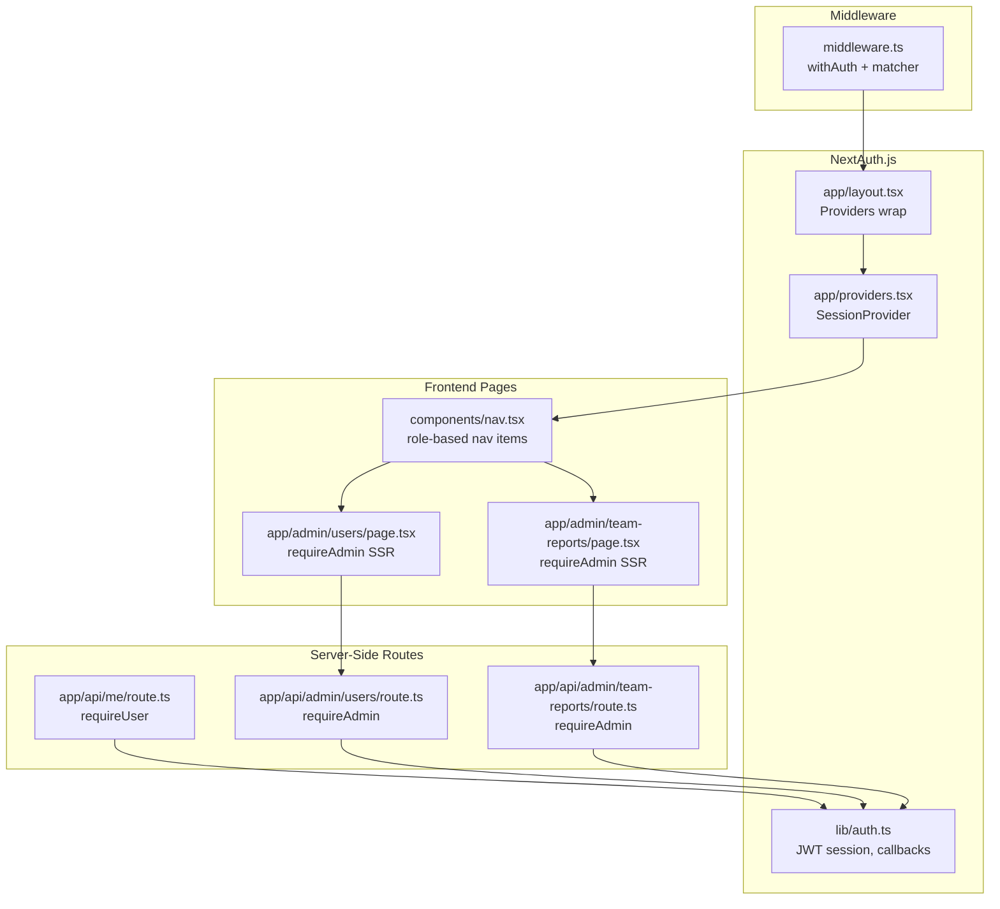
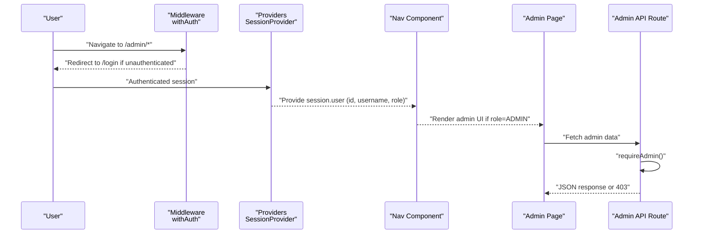
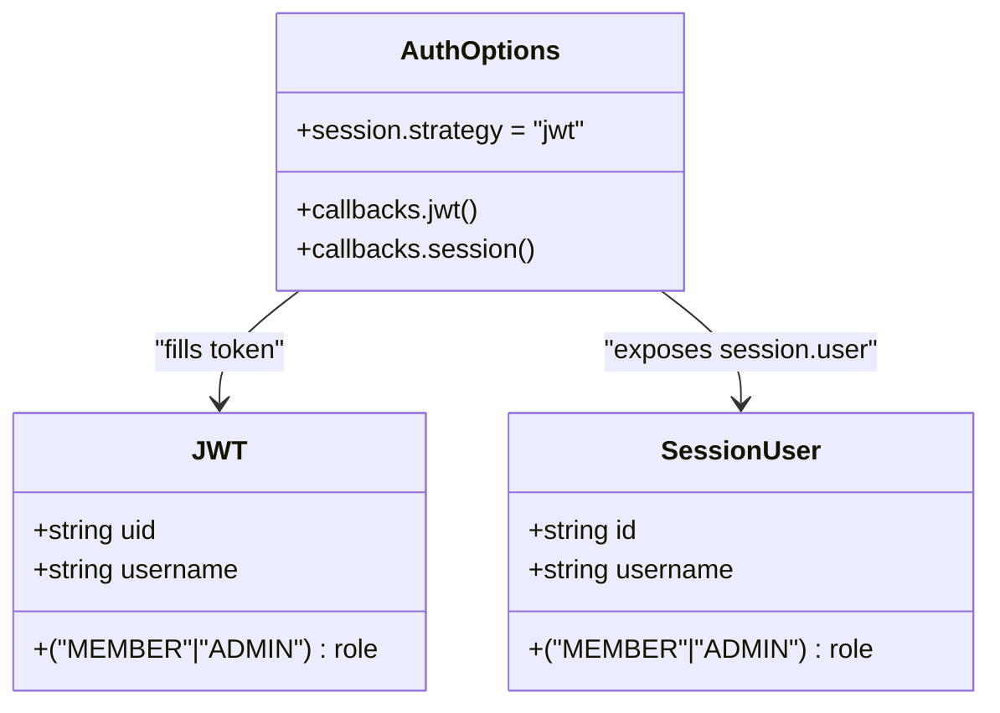
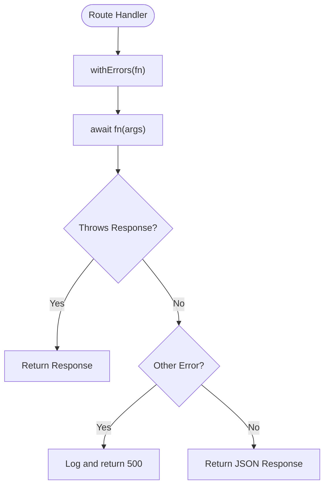
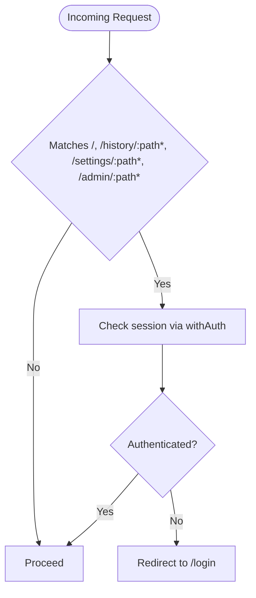
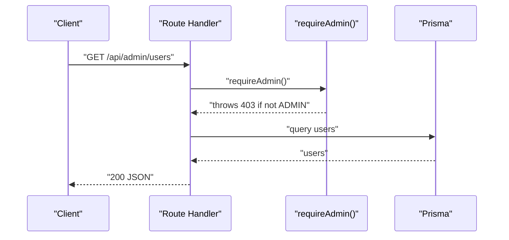
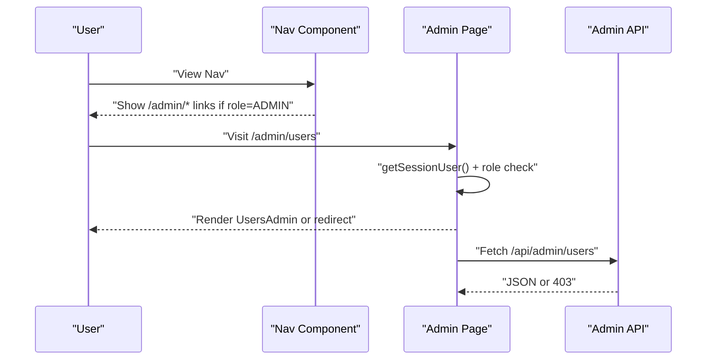
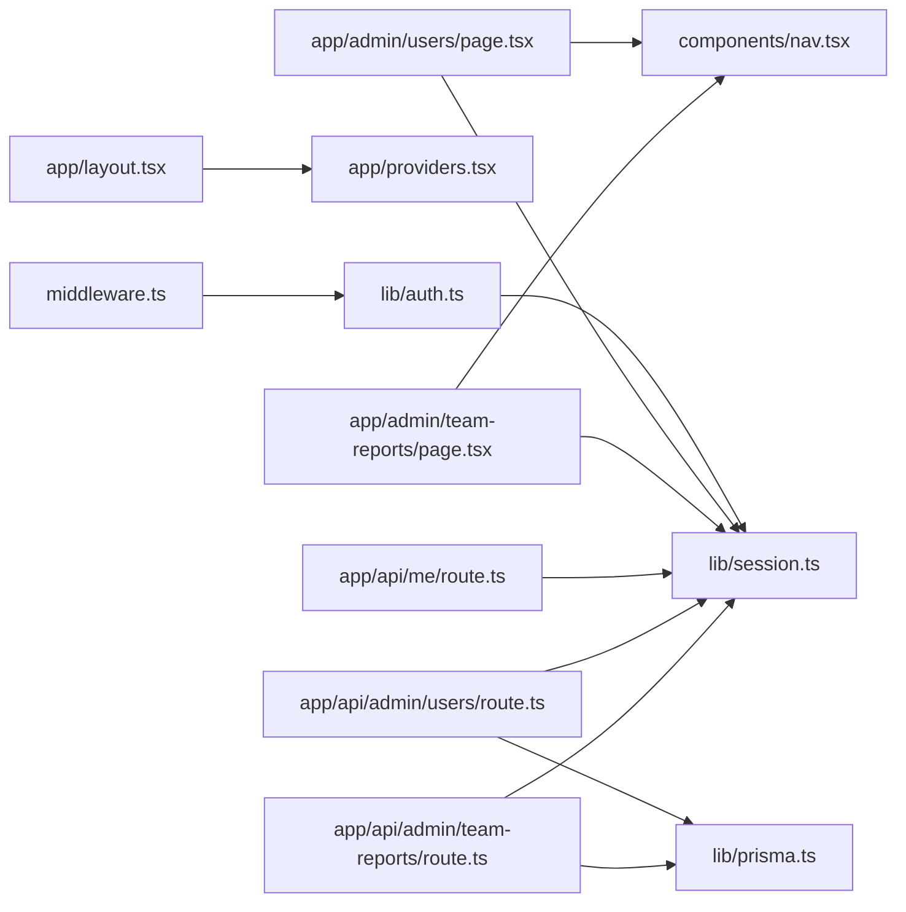

# Access Control and Permissions

<cite>
**Referenced Files in This Document**
- [middleware.ts](file://middleware.ts)
- [lib/auth.ts](file://lib/auth.ts)
- [lib/session.ts](file://lib/session.ts)
- [app/providers.tsx](file://app/providers.tsx)
- [app/layout.tsx](file://app/layout.tsx)
- [app/api/me/route.ts](file://app/api/me/route.ts)
- [app/api/admin/users/route.ts](file://app/api/admin/users/route.ts)
- [app/api/admin/team-reports/route.ts](file://app/api/admin/team-reports/route.ts)
- [app/admin/users/page.tsx](file://app/admin/users/page.tsx)
- [app/admin/team-reports/page.tsx](file://app/admin/team-reports/page.tsx)
- [components/nav.tsx](file://components/nav.tsx)
- [components/users-admin.tsx](file://components/users-admin.tsx)
- [components/team-reports.tsx](file://components/team-reports.tsx)
- [lib/prisma.ts](file://lib/prisma.ts)
</cite>

## Table of Contents
1. [Introduction](#introduction)
2. [Project Structure](#project-structure)
3. [Core Components](#core-components)
4. [Architecture Overview](#architecture-overview)
5. [Detailed Component Analysis](#detailed-component-analysis)
6. [Dependency Analysis](#dependency-analysis)
7. [Performance Considerations](#performance-considerations)
8. [Troubleshooting Guide](#troubleshooting-guide)
9. [Conclusion](#conclusion)

## Introduction
This document explains Pingyun Report’s access control and permissions system. It covers middleware-based authentication enforcement, route protection, role-based access control (MEMBER and ADMIN), session validation, user role checks, and permission verification. It also documents protected routes, API endpoint security, resource-level access controls, role hierarchy, and practical examples for API routes, frontend navigation guards, and component-level restrictions. Security considerations for role escalation, privilege management, and audit logging are included.

## Project Structure
The application uses Next.js App Router with NextAuth.js for authentication and a custom session wrapper for authorization. Middleware enforces authentication for protected routes. Server-side route handlers enforce roles via wrappers. Frontend pages and components conditionally render admin-only UI and call admin APIs.

**Diagram sources**
- [middleware.ts:1-10](file://middleware.ts#L1-L10)
- [lib/auth.ts:30-77](file://lib/auth.ts#L30-L77)
- [app/layout.tsx:11-24](file://app/layout.tsx#L11-L24)
- [app/providers.tsx:5-7](file://app/providers.tsx#L5-L7)
- [app/api/me/route.ts:7-23](file://app/api/me/route.ts#L7-L23)
- [app/api/admin/users/route.ts:7-21](file://app/api/admin/users/route.ts#L7-L21)
- [app/api/admin/team-reports/route.ts:6-32](file://app/api/admin/team-reports/route.ts#L6-L32)
- [app/admin/users/page.tsx:8-21](file://app/admin/users/page.tsx#L8-L21)
- [app/admin/team-reports/page.tsx:8-21](file://app/admin/team-reports/page.tsx#L8-L21)
- [components/nav.tsx:38-59](file://components/nav.tsx#L38-L59)

**Section sources**
- [middleware.ts:1-10](file://middleware.ts#L1-L10)
- [lib/auth.ts:30-77](file://lib/auth.ts#L30-L77)
- [app/layout.tsx:11-24](file://app/layout.tsx#L11-L24)
- [app/providers.tsx:5-7](file://app/providers.tsx#L5-L7)

## Core Components
- Authentication and session model
  - NextAuth.js with JWT strategy and custom callbacks to attach role to token and session.
  - Session types define user.id, username, and role.
- Authorization helpers
  - getSessionUser: server-side session extraction.
  - requireUser: throws 401 if no session.
  - requireAdmin: throws 403 if not ADMIN.
  - withErrors: wraps route handlers to convert thrown Responses into proper HTTP responses.
- Middleware
  - withAuth protects routes matched by the configured matcher array.
- Protected API routes
  - /api/me requires logged-in user.
  - /api/admin/* require ADMIN.
- Frontend guards
  - Admin pages enforce ADMIN at render time.
  - Navigation renders admin links conditionally on role.

**Section sources**
- [lib/auth.ts:6-28](file://lib/auth.ts#L6-L28)
- [lib/auth.ts:58-75](file://lib/auth.ts#L58-L75)
- [lib/session.ts:12-37](file://lib/session.ts#L12-L37)
- [lib/session.ts:39-55](file://lib/session.ts#L39-L55)
- [middleware.ts:3-9](file://middleware.ts#L3-L9)
- [app/api/me/route.ts:7-23](file://app/api/me/route.ts#L7-L23)
- [app/api/admin/users/route.ts:31-38](file://app/api/admin/users/route.ts#L31-L38)
- [app/api/admin/team-reports/route.ts:6-12](file://app/api/admin/team-reports/route.ts#L6-L12)
- [app/admin/users/page.tsx:9-11](file://app/admin/users/page.tsx#L9-L11)
- [app/admin/team-reports/page.tsx:9-11](file://app/admin/team-reports/page.tsx#L9-L11)
- [components/nav.tsx:38-59](file://components/nav.tsx#L38-L59)

## Architecture Overview
The system enforces authentication at the middleware level and authorization at the route and page levels. Roles are carried in the JWT and surfaced to both server and client. Admin-only resources are gated by both server-side checks and client-side visibility.

**Diagram sources**
- [middleware.ts:3-9](file://middleware.ts#L3-L9)
- [app/providers.tsx:5-7](file://app/providers.tsx#L5-L7)
- [components/nav.tsx:38-59](file://components/nav.tsx#L38-L59)
- [app/admin/users/page.tsx:9-11](file://app/admin/users/page.tsx#L9-L11)
- [app/api/admin/users/route.ts:31-38](file://app/api/admin/users/route.ts#L31-L38)

## Detailed Component Analysis

### Authentication and Session Model
- Role types are declared in module augmentation for both Session and JWT, ensuring strong typing across callbacks and session retrieval.
- JWT callbacks populate uid, username, and role into the token; session callback injects them into session.user.
- The session provider wraps the app to make session data available to client components.

**Diagram sources**
- [lib/auth.ts:30-77](file://lib/auth.ts#L30-L77)
- [lib/auth.ts:6-28](file://lib/auth.ts#L6-L28)

**Section sources**
- [lib/auth.ts:6-28](file://lib/auth.ts#L6-L28)
- [lib/auth.ts:58-75](file://lib/auth.ts#L58-L75)
- [app/providers.tsx:5-7](file://app/providers.tsx#L5-L7)
- [app/layout.tsx:11-24](file://app/layout.tsx#L11-L24)

### Authorization Helpers and Error Handling
- getSessionUser extracts typed user info from server session.
- requireUser throws 401 Unauthorized if missing.
- requireAdmin throws 403 Forbidden if role is not ADMIN.
- withErrors converts thrown NextResponse instances into HTTP responses and logs unexpected errors.

**Diagram sources**
- [lib/session.ts:39-55](file://lib/session.ts#L39-L55)

**Section sources**
- [lib/session.ts:12-37](file://lib/session.ts#L12-L37)
- [lib/session.ts:39-55](file://lib/session.ts#L39-L55)

### Middleware-Based Authentication Enforcement
- The middleware uses withAuth and redirects unauthenticated users to /login.
- The matcher array protects home, history, settings, and admin routes.

**Diagram sources**
- [middleware.ts:3-9](file://middleware.ts#L3-L9)

**Section sources**
- [middleware.ts:3-9](file://middleware.ts#L3-L9)

### Protected API Endpoints
- /api/me
  - requireUser ensures caller is authenticated.
  - Returns user profile with sensitive token masked.
- /api/admin/users
  - requireAdmin gates listing, creating, updating, and deleting users.
  - Validation via Zod before database writes.
- /api/admin/team-reports
  - requireAdmin gates fetching aggregated team reports by date.

**Diagram sources**
- [app/api/admin/users/route.ts:31-38](file://app/api/admin/users/route.ts#L31-L38)
- [lib/session.ts:31-37](file://lib/session.ts#L31-L37)
- [lib/prisma.ts:7-14](file://lib/prisma.ts#L7-L14)

**Section sources**
- [app/api/me/route.ts:7-23](file://app/api/me/route.ts#L7-L23)
- [app/api/admin/users/route.ts:7-21](file://app/api/admin/users/route.ts#L7-L21)
- [app/api/admin/users/route.ts:31-38](file://app/api/admin/users/route.ts#L31-L38)
- [app/api/admin/users/route.ts:65-77](file://app/api/admin/users/route.ts#L65-L77)
- [app/api/admin/users/route.ts:80-87](file://app/api/admin/users/route.ts#L80-L87)
- [app/api/admin/team-reports/route.ts:6-12](file://app/api/admin/team-reports/route.ts#L6-L12)
- [app/api/admin/team-reports/route.ts:14-32](file://app/api/admin/team-reports/route.ts#L14-L32)
- [lib/session.ts:31-37](file://lib/session.ts#L31-L37)
- [lib/prisma.ts:7-14](file://lib/prisma.ts#L7-L14)

### Frontend Navigation Guards and Role-Based UI
- Admin pages enforce ADMIN at render time using getSessionUser and redirect if unauthorized.
- Navigation displays admin links only when role is ADMIN.
- Client components call admin APIs directly after navigation; server-side checks remain the authoritative enforcement.

**Diagram sources**
- [components/nav.tsx:38-59](file://components/nav.tsx#L38-L59)
- [app/admin/users/page.tsx:9-11](file://app/admin/users/page.tsx#L9-L11)
- [app/admin/team-reports/page.tsx:9-11](file://app/admin/team-reports/page.tsx#L9-L11)
- [app/api/admin/users/route.ts:31-38](file://app/api/admin/users/route.ts#L31-L38)

**Section sources**
- [app/admin/users/page.tsx:9-11](file://app/admin/users/page.tsx#L9-L11)
- [app/admin/team-reports/page.tsx:9-11](file://app/admin/team-reports/page.tsx#L9-L11)
- [components/nav.tsx:38-59](file://components/nav.tsx#L38-L59)

### Component-Level Restrictions
- UsersAdmin and TeamReports components operate under the assumption that the backend enforces ADMIN. They render forms and actions only when the page is rendered with ADMIN privileges.
- These components do not re-check roles; they rely on server-side protections.

**Section sources**
- [components/users-admin.tsx:33-54](file://components/users-admin.tsx#L33-L54)
- [components/users-admin.tsx:68-78](file://components/users-admin.tsx#L68-L78)
- [components/team-reports.tsx:28-37](file://components/team-reports.tsx#L28-L37)

## Dependency Analysis
- Authentication depends on NextAuth.js configuration and JWT callbacks.
- Authorization helpers depend on NextResponse and server session retrieval.
- Middleware depends on NextAuth middleware adapter and matcher configuration.
- Protected routes depend on authorization helpers and Prisma for data access.
- Frontend guards depend on session provider and server-side page checks.

**Diagram sources**
- [lib/auth.ts:30-77](file://lib/auth.ts#L30-L77)
- [lib/session.ts:12-37](file://lib/session.ts#L12-L37)
- [middleware.ts:3-9](file://middleware.ts#L3-L9)
- [app/layout.tsx:11-24](file://app/layout.tsx#L11-L24)
- [app/providers.tsx:5-7](file://app/providers.tsx#L5-L7)
- [app/admin/users/page.tsx:9-11](file://app/admin/users/page.tsx#L9-L11)
- [app/admin/team-reports/page.tsx:9-11](file://app/admin/team-reports/page.tsx#L9-L11)
- [app/api/me/route.ts:7-23](file://app/api/me/route.ts#L7-L23)
- [app/api/admin/users/route.ts:31-38](file://app/api/admin/users/route.ts#L31-L38)
- [app/api/admin/team-reports/route.ts:6-12](file://app/api/admin/team-reports/route.ts#L6-L12)
- [lib/prisma.ts:7-14](file://lib/prisma.ts#L7-L14)
- [components/nav.tsx:38-59](file://components/nav.tsx#L38-L59)

**Section sources**
- [lib/auth.ts:30-77](file://lib/auth.ts#L30-L77)
- [lib/session.ts:12-37](file://lib/session.ts#L12-L37)
- [middleware.ts:3-9](file://middleware.ts#L3-L9)
- [app/layout.tsx:11-24](file://app/layout.tsx#L11-L24)
- [app/providers.tsx:5-7](file://app/providers.tsx#L5-L7)
- [app/admin/users/page.tsx:9-11](file://app/admin/users/page.tsx#L9-L11)
- [app/admin/team-reports/page.tsx:9-11](file://app/admin/team-reports/page.tsx#L9-L11)
- [app/api/me/route.ts:7-23](file://app/api/me/route.ts#L7-L23)
- [app/api/admin/users/route.ts:31-38](file://app/api/admin/users/route.ts#L31-L38)
- [app/api/admin/team-reports/route.ts:6-12](file://app/api/admin/team-reports/route.ts#L6-L12)
- [lib/prisma.ts:7-14](file://lib/prisma.ts#L7-L14)
- [components/nav.tsx:38-59](file://components/nav.tsx#L38-L59)

## Performance Considerations
- JWT strategy avoids frequent database lookups for session validation.
- withErrors centralizes error handling to reduce boilerplate and potential overhead.
- Admin pages and components fetch data via client-side fetch; consider caching or pagination for large datasets.
- Keep matcher minimal to avoid unnecessary middleware checks.

## Troubleshooting Guide
- 401 Unauthorized on protected routes
  - Occurs when getSessionUser returns null. Verify authentication flow and session persistence.
- 403 Forbidden on admin routes
  - Occurs when requireAdmin fails. Confirm user role stored in JWT and session.
- Unexpected 500 errors
  - withErrors logs internal errors. Check server logs for stack traces.
- Frontend shows admin links but API returns 403
  - Ensure server-side requireAdmin is invoked. Client-side visibility is cosmetic; server-side checks are authoritative.

**Section sources**
- [lib/session.ts:23-37](file://lib/session.ts#L23-L37)
- [lib/session.ts:39-55](file://lib/session.ts#L39-L55)
- [app/admin/users/page.tsx:9-11](file://app/admin/users/page.tsx#L9-L11)
- [app/admin/team-reports/page.tsx:9-11](file://app/admin/team-reports/page.tsx#L9-L11)

## Conclusion
Pingyun Report implements a layered access control system: middleware enforces authentication, authorization helpers enforce roles, and server-side route handlers protect resources. Roles are strongly typed and carried in JWTs, while frontend guards provide role-aware UI. Admin-only endpoints and pages ensure that administrative privileges are enforced consistently across the application. For robustness, add audit logging for sensitive operations and consider rate limiting and input sanitization for enhanced security.