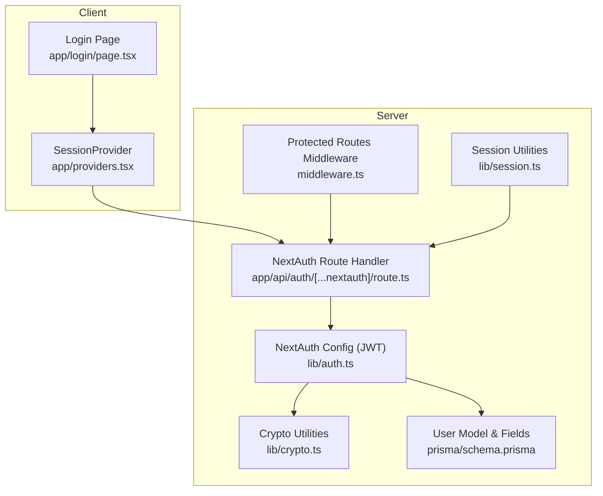
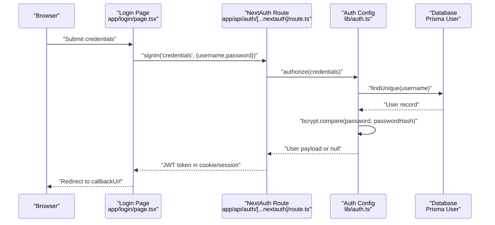
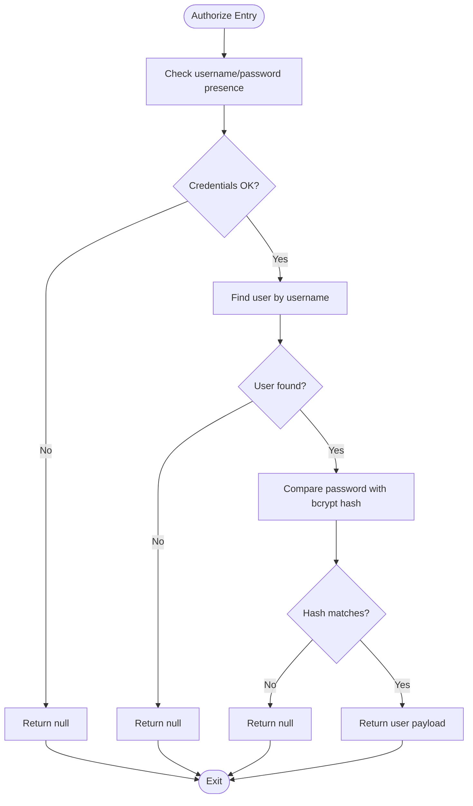
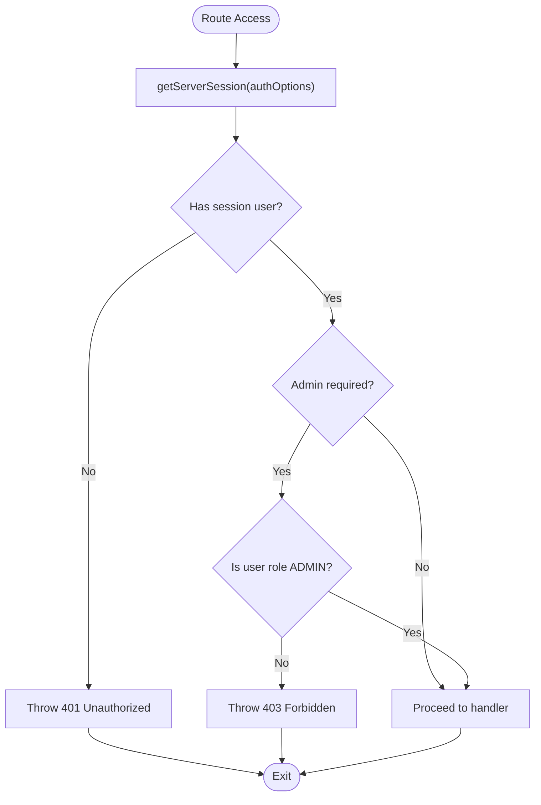
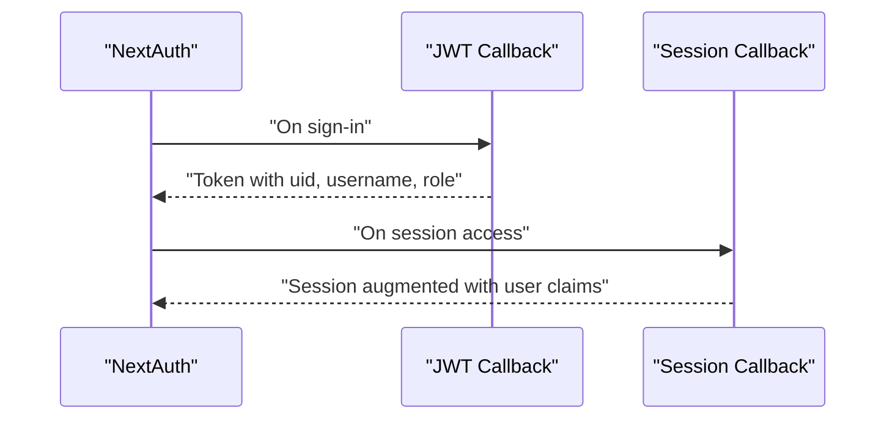
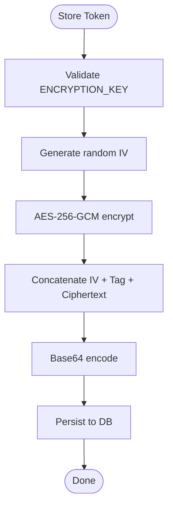
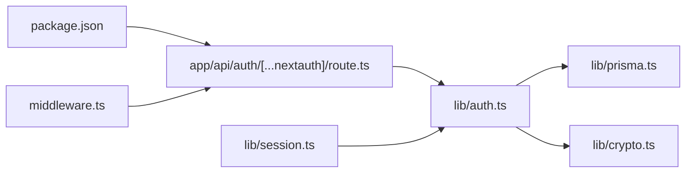

# Authentication Security

<cite>
**Referenced Files in This Document**
- [lib/auth.ts](file://lib/auth.ts)
- [app/api/auth/[...nextauth]/route.ts](file://app/api/auth/[...nextauth]/route.ts)
- [middleware.ts](file://middleware.ts)
- [app/login/page.tsx](file://app/login/page.tsx)
- [lib/session.ts](file://lib/session.ts)
- [lib/crypto.ts](file://lib/crypto.ts)
- [lib/prisma.ts](file://lib/prisma.ts)
- [prisma/schema.prisma](file://prisma/schema.prisma)
- [app/providers.tsx](file://app/providers.tsx)
- [package.json](file://package.json)
- [next.config.mjs](file://next.config.mjs)
</cite>

## Table of Contents
1. [Introduction](#introduction)
2. [Project Structure](#project-structure)
3. [Core Components](#core-components)
4. [Architecture Overview](#architecture-overview)
5. [Detailed Component Analysis](#detailed-component-analysis)
6. [Dependency Analysis](#dependency-analysis)
7. [Performance Considerations](#performance-considerations)
8. [Troubleshooting Guide](#troubleshooting-guide)
9. [Conclusion](#conclusion)
10. [Appendices](#appendices)

## Introduction
This document provides comprehensive documentation for Pingyun Report’s authentication security implementation. It focuses on the NextAuth.js configuration using a custom JWT strategy, including session token generation, validation, and renewal processes. It also documents bcrypt password hashing, salt generation, and secure password storage practices. Session management, including session duration, refresh mechanisms, and session invalidation, is explained alongside JWT token structure, signing algorithms, and security headers. Authentication flow diagrams, token lifecycle management, and production security considerations are included, along with mitigation strategies for common authentication vulnerabilities and best practices for secure session handling.

## Project Structure
Authentication in Pingyun Report is implemented via NextAuth.js with a credentials provider and JWT strategy. The key components are:
- NextAuth route handler that exposes the NextAuth API endpoints
- NextAuth configuration with custom JWT and session callbacks
- Middleware enforcing protected routes
- Client-side login page using the credentials provider
- Utilities for session retrieval and enforcement
- Cryptographic utilities for secure token storage
- Prisma schema defining user model and encrypted fields

**Diagram sources**
- [app/login/page.tsx:1-72](file://app/login/page.tsx#L1-L72)
- [app/providers.tsx:1-8](file://app/providers.tsx#L1-L8)
- [app/api/auth/[...nextauth]/route.ts:1-6](file://app/api/auth/[...nextauth]/route.ts#L1-L6)
- [lib/auth.ts:30-76](file://lib/auth.ts#L30-L76)
- [middleware.ts:1-10](file://middleware.ts#L1-L10)
- [lib/session.ts:1-56](file://lib/session.ts#L1-L56)
- [lib/crypto.ts:1-46](file://lib/crypto.ts#L1-L46)
- [prisma/schema.prisma:16-33](file://prisma/schema.prisma#L16-L33)

**Section sources**
- [app/api/auth/[...nextauth]/route.ts:1-6](file://app/api/auth/[...nextauth]/route.ts#L1-L6)
- [lib/auth.ts:30-76](file://lib/auth.ts#L30-L76)
- [middleware.ts:1-10](file://middleware.ts#L1-L10)
- [app/login/page.tsx:1-72](file://app/login/page.tsx#L1-L72)
- [lib/session.ts:1-56](file://lib/session.ts#L1-L56)
- [lib/crypto.ts:1-46](file://lib/crypto.ts#L1-L46)
- [prisma/schema.prisma:16-33](file://prisma/schema.prisma#L16-L33)
- [app/providers.tsx:1-8](file://app/providers.tsx#L1-L8)

## Core Components
- NextAuth configuration with JWT strategy and credentials provider
- Custom JWT and session callbacks for token population and session augmentation
- Middleware protecting routes and redirecting unauthenticated users
- Client-side login form using the credentials provider
- Session utilities for retrieving and enforcing user sessions
- Cryptographic utilities for secure token encryption and masking
- Prisma user model with password hash and encrypted GitLab token fields

Key implementation references:
- NextAuth options and callbacks: [lib/auth.ts:30-76](file://lib/auth.ts#L30-L76)
- NextAuth route handler: [app/api/auth/[...nextauth]/route.ts:1-6](file://app/api/auth/[...nextauth]/route.ts#L1-L6)
- Protected routes middleware: [middleware.ts:1-10](file://middleware.ts#L1-L10)
- Login page: [app/login/page.tsx:17-32](file://app/login/page.tsx#L17-L32)
- Session utilities: [lib/session.ts:11-29](file://lib/session.ts#L11-L29)
- Encryption utilities: [lib/crypto.ts:17-38](file://lib/crypto.ts#L17-L38)
- User model: [prisma/schema.prisma:16-33](file://prisma/schema.prisma#L16-L33)

**Section sources**
- [lib/auth.ts:30-76](file://lib/auth.ts#L30-L76)
- [app/api/auth/[...nextauth]/route.ts:1-6](file://app/api/auth/[...nextauth]/route.ts#L1-L6)
- [middleware.ts:1-10](file://middleware.ts#L1-L10)
- [app/login/page.tsx:17-32](file://app/login/page.tsx#L17-L32)
- [lib/session.ts:11-29](file://lib/session.ts#L11-L29)
- [lib/crypto.ts:17-38](file://lib/crypto.ts#L17-L38)
- [prisma/schema.prisma:16-33](file://prisma/schema.prisma#L16-L33)

## Architecture Overview
The authentication architecture centers on NextAuth.js with a JWT strategy. Users authenticate via the credentials provider, which validates credentials against the database using bcrypt. On successful authentication, NextAuth populates a JWT with user claims and returns it to the client. Subsequent requests rely on the JWT for session validation. Middleware enforces protection on selected routes, while utilities provide server-side session retrieval and enforcement.

**Diagram sources**
- [app/login/page.tsx:17-32](file://app/login/page.tsx#L17-L32)
- [app/api/auth/[...nextauth]/route.ts:1-6](file://app/api/auth/[...nextauth]/route.ts#L1-L6)
- [lib/auth.ts:40-56](file://lib/auth.ts#L40-L56)
- [lib/prisma.ts:1-14](file://lib/prisma.ts#L1-L14)
- [prisma/schema.prisma:16-33](file://prisma/schema.prisma#L16-L33)

## Detailed Component Analysis

### NextAuth.js Configuration with Custom JWT Strategy
- Strategy: JWT
- Provider: Credentials provider with username and password fields
- Authorization: Fetches user by username, compares bcrypt-hashed password, returns user payload on success
- JWT Callback: Populates token with uid, username, and role when a user is present
- Session Callback: Augments session.user with uid, username, and role derived from the token
- Pages: Redirects unauthenticated users to the login page

Implementation references:
- Session strategy and provider: [lib/auth.ts:30-57](file://lib/auth.ts#L30-L57)
- Authorization logic: [lib/auth.ts:40-56](file://lib/auth.ts#L40-L56)
- JWT callback: [lib/auth.ts:58-66](file://lib/auth.ts#L58-L66)
- Session callback: [lib/auth.ts:67-74](file://lib/auth.ts#L67-L74)
- NextAuth route handler: [app/api/auth/[...nextauth]/route.ts:1-6](file://app/api/auth/[...nextauth]/route.ts#L1-L6)

**Diagram sources**
- [lib/auth.ts:40-56](file://lib/auth.ts#L40-L56)

**Section sources**
- [lib/auth.ts:30-76](file://lib/auth.ts#L30-L76)
- [app/api/auth/[...nextauth]/route.ts:1-6](file://app/api/auth/[...nextauth]/route.ts#L1-L6)

### Password Hashing with bcrypt
- bcrypt is used for password verification against stored password hashes
- Salt generation is handled internally by bcrypt
- Secure password storage is achieved by storing only the hashed password

Implementation references:
- bcrypt compare in authorization: [lib/auth.ts:46](file://lib/auth.ts#L46)
- bcrypt dependency: [package.json:19](file://package.json#L19)

Security considerations:
- Use a secure secret for NextAuth (NEXTAUTH_SECRET) as documented in the project’s guidance
- Ensure bcrypt cost factors are appropriate for your environment

**Section sources**
- [lib/auth.ts:46](file://lib/auth.ts#L46)
- [package.json:19](file://package.json#L19)

### Session Management and Middleware Protection
- Server-side session retrieval via getServerSession with authOptions
- Enforcement utilities for requiring users and admins
- Middleware protects routes and redirects to login when unauthenticated
- Route handler wrapper converts thrown responses into HTTP responses

Implementation references:
- Session retrieval: [lib/session.ts:12-20](file://lib/session.ts#L12-L20)
- Require user/admin: [lib/session.ts:22-37](file://lib/session.ts#L22-L37)
- Middleware configuration: [middleware.ts:3-9](file://middleware.ts#L3-L9)
- Error wrapper: [lib/session.ts:39-55](file://lib/session.ts#L39-L55)

**Diagram sources**
- [lib/session.ts:12-37](file://lib/session.ts#L12-L37)
- [middleware.ts:3-9](file://middleware.ts#L3-L9)

**Section sources**
- [lib/session.ts:12-37](file://lib/session.ts#L12-L37)
- [middleware.ts:3-9](file://middleware.ts#L3-L9)

### JWT Token Structure and Lifecycle
- Token fields: uid, username, role
- Token population occurs during the jwt callback when a user is present
- Session augmentation occurs in the session callback, exposing user claims to the session
- Token lifecycle is managed server-side; clients receive a signed JWT from NextAuth

Implementation references:
- JWT type augmentation: [lib/auth.ts:22-28](file://lib/auth.ts#L22-L28)
- JWT callback: [lib/auth.ts:58-66](file://lib/auth.ts#L58-L66)
- Session callback: [lib/auth.ts:67-74](file://lib/auth.ts#L67-L74)

**Diagram sources**
- [lib/auth.ts:58-74](file://lib/auth.ts#L58-L74)

**Section sources**
- [lib/auth.ts:22-28](file://lib/auth.ts#L22-L28)
- [lib/auth.ts:58-74](file://lib/auth.ts#L58-L74)

### Secure Token Storage and Encryption Utilities
- GitLab token is stored encrypted using AES-256-GCM with a random IV and authentication tag
- Encryption key is provided via ENCRYPTION_KEY environment variable (64-character hex string)
- Token masking utility for safe display

Implementation references:
- Encryption/decryption functions: [lib/crypto.ts:17-38](file://lib/crypto.ts#L17-L38)
- Key validation and error messaging: [lib/crypto.ts:7-15](file://lib/crypto.ts#L7-L15)
- Masking utility: [lib/crypto.ts:40-45](file://lib/crypto.ts#L40-L45)
- Encrypted field in schema: [prisma/schema.prisma:23](file://prisma/schema.prisma#L23)

**Diagram sources**
- [lib/crypto.ts:17-25](file://lib/crypto.ts#L17-L25)
- [prisma/schema.prisma:23](file://prisma/schema.prisma#L23)

**Section sources**
- [lib/crypto.ts:7-38](file://lib/crypto.ts#L7-L38)
- [prisma/schema.prisma:23](file://prisma/schema.prisma#L23)

### Client-Side Authentication Flow
- Login page captures username and password
- signIn with credentials provider is invoked with redirect disabled
- Successful authentication redirects to callbackUrl

Implementation references:
- Client-side submission: [app/login/page.tsx:17-32](file://app/login/page.tsx#L17-L32)
- Session provider: [app/providers.tsx:3-7](file://app/providers.tsx#L3-L7)

**Section sources**
- [app/login/page.tsx:17-32](file://app/login/page.tsx#L17-L32)
- [app/providers.tsx:3-7](file://app/providers.tsx#L3-L7)

## Dependency Analysis
- NextAuth.js version and dependencies are declared in package.json
- NextAuth route handler depends on the auth options exported by lib/auth.ts
- Middleware depends on next-auth/middleware
- Session utilities depend on getServerSession and authOptions
- Encryption utilities depend on Node crypto and environment variables
- Prisma client is used for user lookup and updates

**Diagram sources**
- [package.json:16-31](file://package.json#L16-L31)
- [app/api/auth/[...nextauth]/route.ts:1-6](file://app/api/auth/[...nextauth]/route.ts#L1-L6)
- [lib/auth.ts:1-4](file://lib/auth.ts#L1-L4)
- [middleware.ts:1](file://middleware.ts#L1)
- [lib/session.ts:1-3](file://lib/session.ts#L1-L3)
- [lib/crypto.ts:1](file://lib/crypto.ts#L1)
- [lib/prisma.ts:1-2](file://lib/prisma.ts#L1-L2)

**Section sources**
- [package.json:16-31](file://package.json#L16-L31)
- [app/api/auth/[...nextauth]/route.ts:1-6](file://app/api/auth/[...nextauth]/route.ts#L1-L6)
- [lib/auth.ts:1-4](file://lib/auth.ts#L1-L4)
- [middleware.ts:1](file://middleware.ts#L1)
- [lib/session.ts:1-3](file://lib/session.ts#L1-L3)
- [lib/crypto.ts:1](file://lib/crypto.ts#L1)
- [lib/prisma.ts:1-2](file://lib/prisma.ts#L1-L2)

## Performance Considerations
- Use bcrypt cost factors appropriate for your hardware to balance security and latency
- Minimize database queries in callbacks; the current implementation performs a single lookup per login
- Consider caching frequently accessed user roles or permissions at the edge if scaling horizontally
- Keep NextAuth secret and encryption key securely managed to avoid repeated re-hashing or decryption overhead

## Troubleshooting Guide
Common issues and mitigations:
- Unauthorized errors: Ensure the user is authenticated and role checks are performed using requireUser and requireAdmin utilities
- Missing NEXTAUTH_SECRET or ENCRYPTION_KEY: Both are required; incorrect or missing values will cause runtime errors
- Middleware redirection loops: Verify matcher patterns and callbackUrl handling in the login page
- Session retrieval failures: Confirm SessionProvider wraps the application and that getServerSession is called after authentication

References:
- Unauthorized/Forbidden utilities: [lib/session.ts:22-37](file://lib/session.ts#L22-L37)
- Middleware configuration: [middleware.ts:3-9](file://middleware.ts#L3-L9)
- Login callbackUrl handling: [app/login/page.tsx:10-11](file://app/login/page.tsx#L10-L11)
- Environment guidance: [package.json:18](file://package.json#L18)

**Section sources**
- [lib/session.ts:22-37](file://lib/session.ts#L22-L37)
- [middleware.ts:3-9](file://middleware.ts#L3-L9)
- [app/login/page.tsx:10-11](file://app/login/page.tsx#L10-L11)
- [package.json:18](file://package.json#L18)

## Conclusion
Pingyun Report’s authentication system leverages NextAuth.js with a JWT strategy and credentials provider. It ensures secure password handling via bcrypt, manages sessions server-side, and protects routes using middleware. Token lifecycle is controlled by NextAuth callbacks, while sensitive tokens are encrypted at rest. Production deployments should enforce strict environment variable management, monitor session behavior, and apply best practices for JWT and cryptographic operations.

## Appendices

### Security Headers and Best Practices
- Enforce HTTPS and secure cookies in production
- Rotate NEXTAUTH_SECRET and ENCRYPTION_KEY regularly
- Limit credential retry attempts and implement rate limiting
- Sanitize and validate all inputs, especially in the credentials provider
- Audit logs for failed authentication attempts and suspicious activity

### JWT Signing and Algorithms
- NextAuth uses jose under the hood for JWT operations; ensure proper secret management and algorithm selection aligns with your security posture

**Section sources**
- [package.json:24](file://package.json#L24)
- [lib/auth.ts:30-31](file://lib/auth.ts#L30-L31)