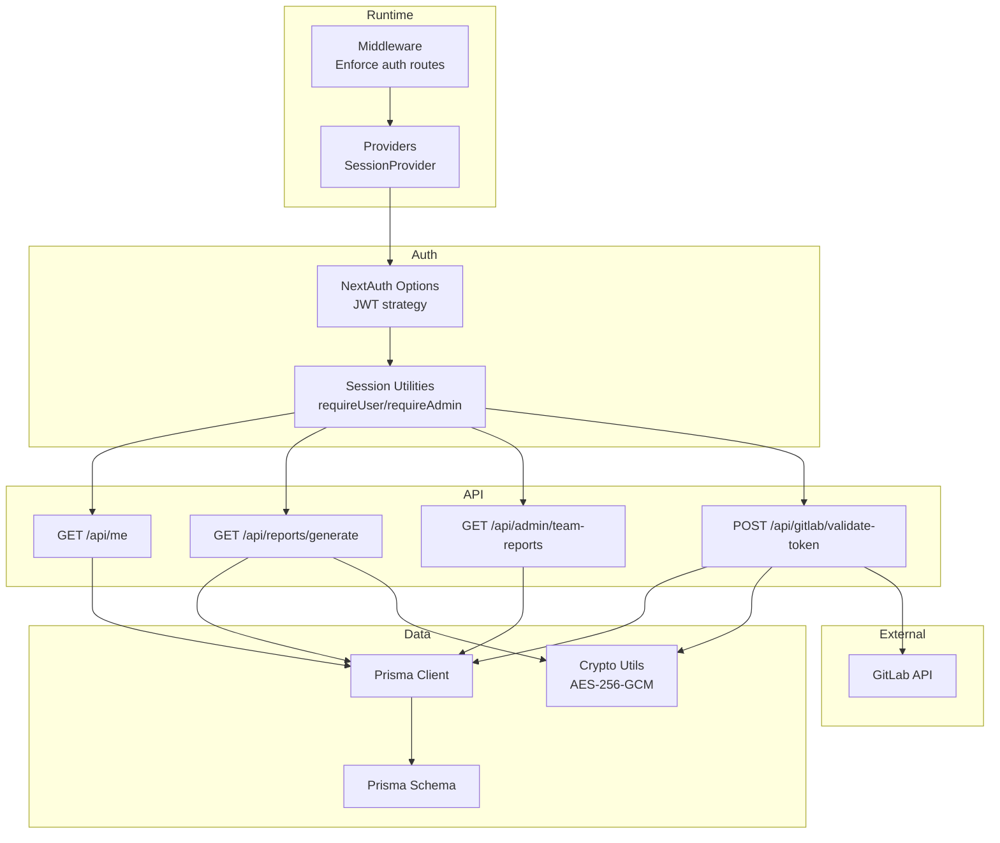
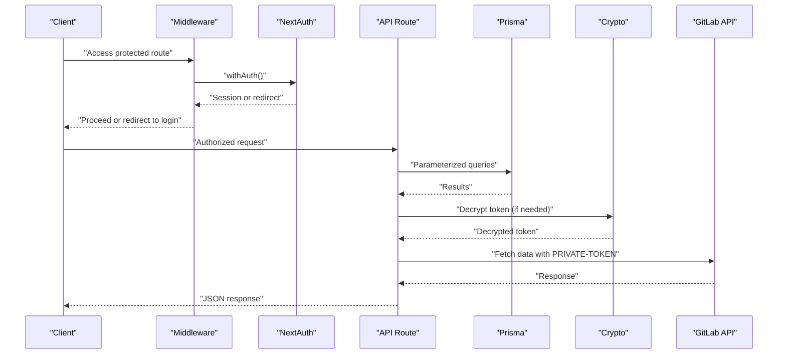
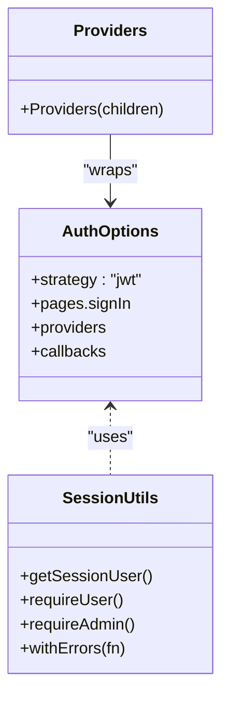
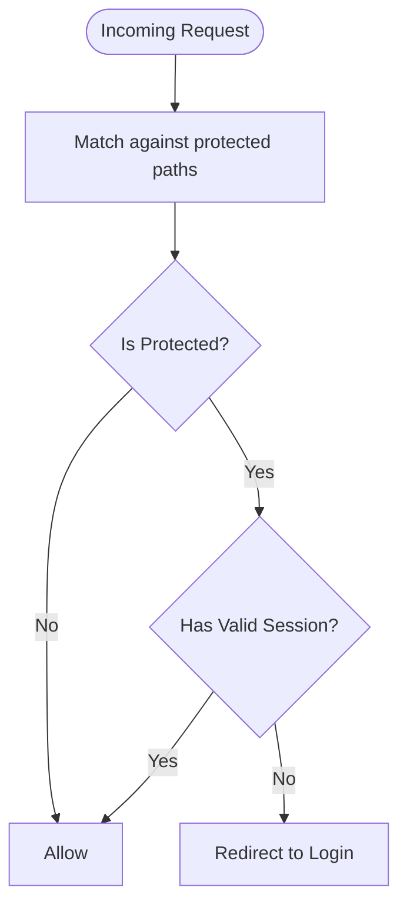
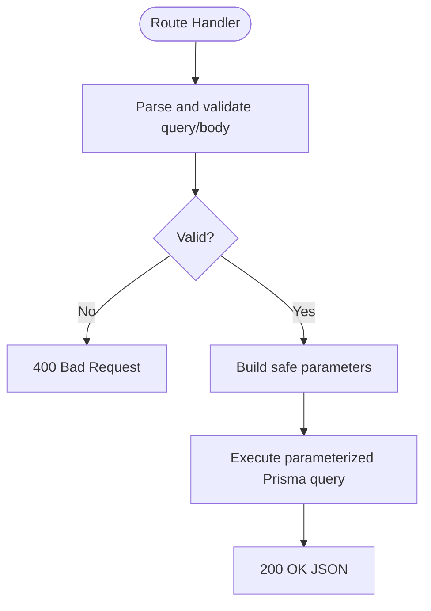
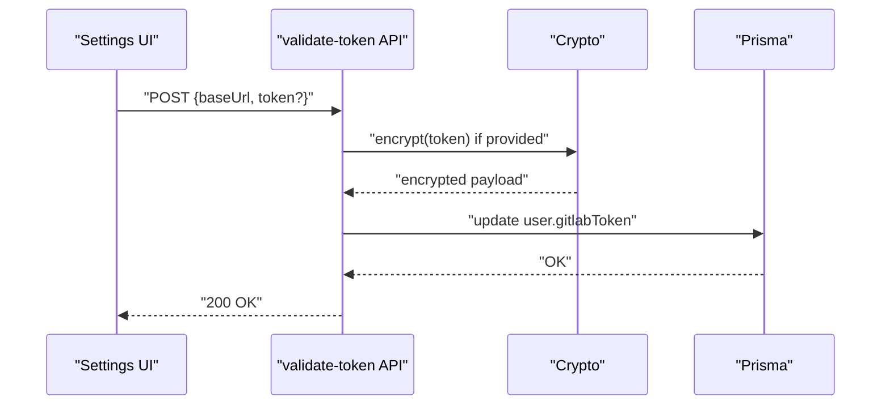
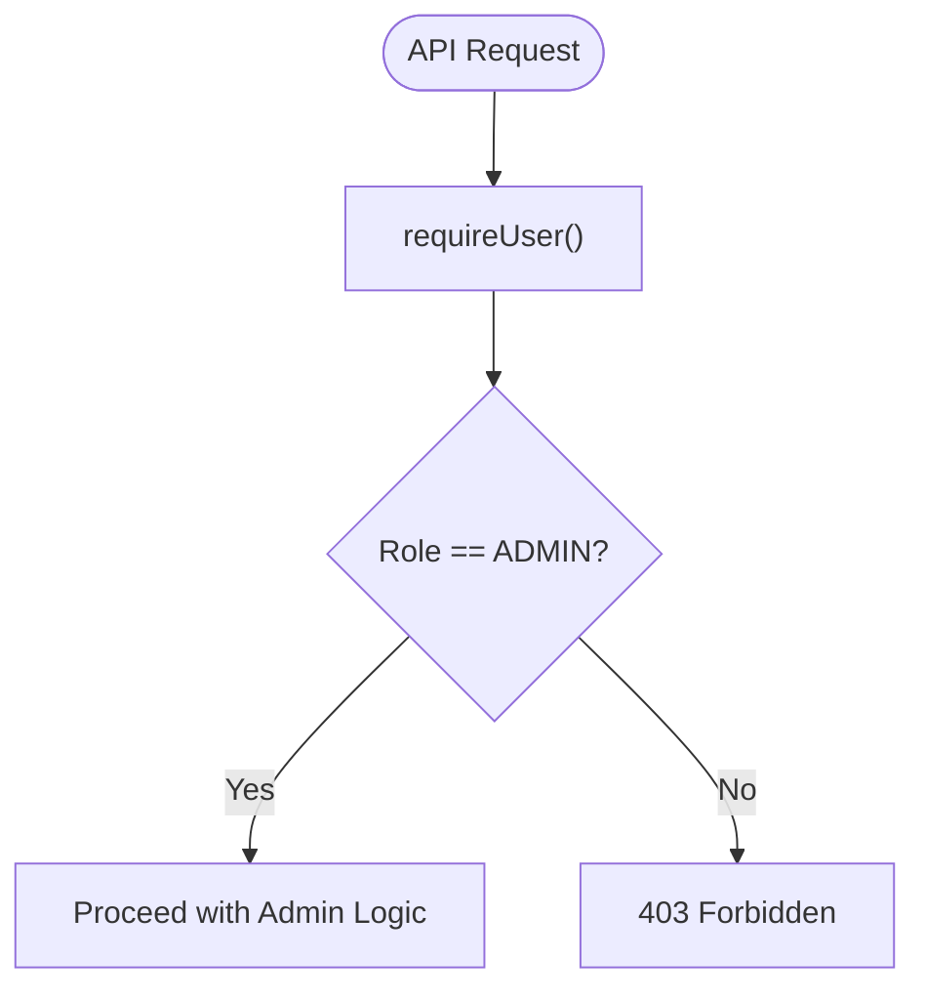
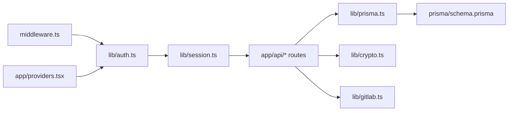

# Data Protection Measures

<cite>
**Referenced Files in This Document**
- [middleware.ts](file://middleware.ts)
- [providers.tsx](file://app/providers.tsx)
- [auth.ts](file://lib/auth.ts)
- [session.ts](file://lib/session.ts)
- [crypto.ts](file://lib/crypto.ts)
- [prisma.ts](file://lib/prisma.ts)
- [schema.prisma](file://prisma/schema.prisma)
- [gitlab.ts](file://lib/gitlab.ts)
- [report.ts](file://lib/report.ts)
- [next.config.mjs](file://next.config.mjs)
- [app/api/me/route.ts](file://app/api/me/route.ts)
- [app/api/reports/generate/route.ts](file://app/api/reports/generate/route.ts)
- [app/api/admin/team-reports/route.ts](file://app/api/admin/team-reports/route.ts)
- [app/api/gitlab/validate-token/route.ts](file://app/api/gitlab/validate-token/route.ts)
</cite>

## Table of Contents
1. [Introduction](#introduction)
2. [Project Structure](#project-structure)
3. [Core Components](#core-components)
4. [Architecture Overview](#architecture-overview)
5. [Detailed Component Analysis](#detailed-component-analysis)
6. [Dependency Analysis](#dependency-analysis)
7. [Performance Considerations](#performance-considerations)
8. [Troubleshooting Guide](#troubleshooting-guide)
9. [Conclusion](#conclusion)
10. [Appendices](#appendices)

## Introduction
This document details Pingyun Report’s data protection measures and security practices. It focuses on input validation and sanitization, parameterized database access, prevention of injection attacks, secure data transmission, authentication and session management, sensitive data handling, CORS and CSRF considerations, XSS prevention, security headers, and compliance-related data retention and deletion practices. The goal is to provide a comprehensive yet accessible guide for developers and operators to understand and maintain the platform’s security posture.

## Project Structure
Security-critical areas of the codebase include:
- Authentication and session management via NextAuth.js
- Middleware enforcing protected routes
- API routes validating inputs and returning masked tokens
- Cryptographic utilities for encryption and token masking
- Database access through Prisma with strict logging and environment-driven configuration
- GitLab integration performed server-side with token encryption and safe caching

**Diagram sources**
- [middleware.ts:1-10](file://middleware.ts#L1-L10)
- [providers.tsx:1-8](file://app/providers.tsx#L1-L8)
- [auth.ts:30-77](file://lib/auth.ts#L30-L77)
- [session.ts:11-56](file://lib/session.ts#L11-L56)
- [app/api/me/route.ts:1-67](file://app/api/me/route.ts#L1-L67)
- [app/api/reports/generate/route.ts:1-133](file://app/api/reports/generate/route.ts#L1-L133)
- [app/api/admin/team-reports/route.ts:1-34](file://app/api/admin/team-reports/route.ts#L1-L34)
- [app/api/gitlab/validate-token/route.ts:1-81](file://app/api/gitlab/validate-token/route.ts#L1-L81)
- [crypto.ts:1-46](file://lib/crypto.ts#L1-L46)
- [prisma.ts:1-14](file://lib/prisma.ts#L1-L14)
- [schema.prisma:16-79](file://prisma/schema.prisma#L16-L79)
- [gitlab.ts:45-80](file://lib/gitlab.ts#L45-L80)

**Section sources**
- [middleware.ts:1-10](file://middleware.ts#L1-L10)
- [providers.tsx:1-8](file://app/providers.tsx#L1-L8)
- [auth.ts:30-77](file://lib/auth.ts#L30-L77)
- [session.ts:11-56](file://lib/session.ts#L11-L56)
- [prisma.ts:1-14](file://lib/prisma.ts#L1-L14)
- [schema.prisma:16-79](file://prisma/schema.prisma#L16-L79)
- [crypto.ts:1-46](file://lib/crypto.ts#L1-L46)
- [gitlab.ts:45-80](file://lib/gitlab.ts#L45-L80)

## Core Components
- Authentication and session management:
  - NextAuth.js configured with JWT strategy and credential provider
  - Password verification using bcrypt
  - Session retrieval and enforcement helpers
- Middleware:
  - Route protection for authenticated paths
- Cryptography:
  - AES-256-GCM encryption/decryption for tokens
  - Token masking for safe display
- Database:
  - Prisma client with environment-driven logging and MySQL datasource
  - Strict schema modeling for sensitive fields
- GitLab integration:
  - Server-side API calls with PRIVATE-TOKEN header
  - Encrypted token storage and optional token persistence

**Section sources**
- [auth.ts:30-77](file://lib/auth.ts#L30-L77)
- [session.ts:11-56](file://lib/session.ts#L11-L56)
- [middleware.ts:1-10](file://middleware.ts#L1-L10)
- [crypto.ts:1-46](file://lib/crypto.ts#L1-L46)
- [prisma.ts:1-14](file://lib/prisma.ts#L1-L14)
- [schema.prisma:16-79](file://prisma/schema.prisma#L16-L79)
- [gitlab.ts:45-80](file://lib/gitlab.ts#L45-L80)

## Architecture Overview
The system enforces authentication at the middleware level and uses NextAuth.js for session management. API routes validate inputs, enforce authorization, and handle sensitive data securely. Cryptographic primitives protect tokens at rest, and database access is performed through Prisma with strict logging. GitLab integration occurs server-side to avoid exposing tokens to clients.

**Diagram sources**
- [middleware.ts:1-10](file://middleware.ts#L1-L10)
- [auth.ts:30-77](file://lib/auth.ts#L30-L77)
- [session.ts:11-56](file://lib/session.ts#L11-L56)
- [app/api/reports/generate/route.ts:1-133](file://app/api/reports/generate/route.ts#L1-L133)
- [app/api/me/route.ts:1-67](file://app/api/me/route.ts#L1-L67)
- [app/api/gitlab/validate-token/route.ts:1-81](file://app/api/gitlab/validate-token/route.ts#L1-L81)
- [crypto.ts:1-46](file://lib/crypto.ts#L1-L46)
- [prisma.ts:1-14](file://lib/prisma.ts#L1-L14)
- [gitlab.ts:45-80](file://lib/gitlab.ts#L45-L80)

## Detailed Component Analysis

### Authentication and Session Management
- JWT-based session strategy with credential provider
- Password comparison using bcrypt
- Session retrieval and enforcement helpers
- Provider wrapper for client-side session consumption

**Diagram sources**
- [auth.ts:30-77](file://lib/auth.ts#L30-L77)
- [session.ts:11-56](file://lib/session.ts#L11-L56)
- [providers.tsx:1-8](file://app/providers.tsx#L1-L8)

**Section sources**
- [auth.ts:30-77](file://lib/auth.ts#L30-L77)
- [session.ts:11-56](file://lib/session.ts#L11-L56)
- [providers.tsx:1-8](file://app/providers.tsx#L1-L8)

### Middleware and Route Protection
- Protects home and nested routes under /history, /settings, /admin
- Redirects unauthenticated users to login

**Diagram sources**
- [middleware.ts:3-9](file://middleware.ts#L3-L9)

**Section sources**
- [middleware.ts:1-10](file://middleware.ts#L1-L10)

### Input Validation and Parameter Binding
- Zod-based validation for API query parameters and request bodies
- Regex validation for date formats
- Safe parameter extraction from URL search params
- Parameterized Prisma queries prevent SQL injection

**Diagram sources**
- [app/api/reports/generate/route.ts:14-30](file://app/api/reports/generate/route.ts#L14-L30)
- [app/api/admin/team-reports/route.ts:8-12](file://app/api/admin/team-reports/route.ts#L8-L12)
- [app/api/me/route.ts:49-52](file://app/api/me/route.ts#L49-L52)
- [prisma.ts:1-14](file://lib/prisma.ts#L1-L14)

**Section sources**
- [app/api/reports/generate/route.ts:14-30](file://app/api/reports/generate/route.ts#L14-L30)
- [app/api/admin/team-reports/route.ts:8-12](file://app/api/admin/team-reports/route.ts#L8-L12)
- [app/api/me/route.ts:49-52](file://app/api/me/route.ts#L49-L52)
- [prisma.ts:1-14](file://lib/prisma.ts#L1-L14)

### Secure Data Transmission and Transport Security
- HTTPS enforcement is handled by deployment infrastructure (not implemented in application code)
- Private tokens are transmitted via PRIVATE-TOKEN header to GitLab
- No client-side token exposure; masked previews are returned to the UI

**Section sources**
- [gitlab.ts:61-69](file://lib/gitlab.ts#L61-L69)
- [app/api/me/route.ts:24-32](file://app/api/me/route.ts#L24-L32)

### Sensitive Data Handling
- Encryption at rest:
  - AES-256-GCM with random IV and auth tag
  - Environment variable key validation
- Decryption only on demand for server-side operations
- Token masking for safe UI display
- Password hashing with bcrypt during authentication

**Diagram sources**
- [app/api/gitlab/validate-token/route.ts:37-38](file://app/api/gitlab/validate-token/route.ts#L37-L38)
- [crypto.ts:18-25](file://lib/crypto.ts#L18-L25)

**Section sources**
- [crypto.ts:1-46](file://lib/crypto.ts#L1-L46)
- [app/api/gitlab/validate-token/route.ts:13-38](file://app/api/gitlab/validate-token/route.ts#L13-L38)
- [app/api/me/route.ts:24-32](file://app/api/me/route.ts#L24-L32)
- [auth.ts:46](file://lib/auth.ts#L46)

### Authorization and Access Control
- Role-based access control enforced in API routes
- Admin-only endpoint for team reports
- Standard user checks for personal data and generation endpoints

**Diagram sources**
- [session.ts:31-37](file://lib/session.ts#L31-L37)
- [app/api/admin/team-reports/route.ts:6-7](file://app/api/admin/team-reports/route.ts#L6-L7)

**Section sources**
- [session.ts:31-37](file://lib/session.ts#L31-L37)
- [app/api/admin/team-reports/route.ts:6-7](file://app/api/admin/team-reports/route.ts#L6-L7)

### Injection Prevention
- Zod parsing ensures typed, validated inputs
- Regex validation for date formats prevents malformed inputs
- Prisma queries are parameterized; no string concatenation for dynamic conditions
- Template rendering uses server-side compilation with escaping disabled only where intended

**Section sources**
- [app/api/reports/generate/route.ts:14-30](file://app/api/reports/generate/route.ts#L14-L30)
- [app/api/admin/team-reports/route.ts:10-12](file://app/api/admin/team-reports/route.ts#L10-L12)
- [prisma.ts:1-14](file://lib/prisma.ts#L1-L14)
- [report.ts:137-144](file://lib/report.ts#L137-L144)

### CORS Policy Configuration
- Not configured in application code; defaults apply
- Recommendation: Explicitly set CORS origins and credentials policy at the proxy/load balancer level

**Section sources**
- [next.config.mjs:1-11](file://next.config.mjs#L1-L11)

### CSRF Protection
- Not explicitly implemented in application code
- Recommendation: Enable CSRF protection at the framework/proxy level or implement token-based CSRF protection

**Section sources**
- [auth.ts:30-77](file://lib/auth.ts#L30-L77)

### XSS Prevention
- Template rendering uses server-side compilation; no client-side template injection surface in the analyzed routes
- Token masking avoids accidental exposure of secrets in UI
- No unsafe HTML injection observed in the analyzed API responses

**Section sources**
- [report.ts:137-144](file://lib/report.ts#L137-L144)
- [app/api/me/route.ts:24-32](file://app/api/me/route.ts#L24-L32)

### Security Headers Implementation
- Not implemented in application code
- Recommendation: Configure security headers (Content-Security-Policy, X-Frame-Options, etc.) at the reverse proxy or CDN level

**Section sources**
- [next.config.mjs:1-11](file://next.config.mjs#L1-L11)

### Secure Cookie Settings
- NextAuth.js manages cookies; ensure deployment enforces secure flags at the proxy/load balancer level
- Application code does not manually manipulate cookie attributes

**Section sources**
- [auth.ts:30-77](file://lib/auth.ts#L30-L77)

### Data Retention and Deletion
- Data retention and deletion policies are not explicitly implemented in application code
- Recommendation: Define and implement retention schedules and secure deletion procedures aligned with applicable regulations

**Section sources**
- [schema.prisma:16-79](file://prisma/schema.prisma#L16-L79)

## Dependency Analysis

**Diagram sources**
- [middleware.ts:1-10](file://middleware.ts#L1-L10)
- [auth.ts:30-77](file://lib/auth.ts#L30-L77)
- [session.ts:11-56](file://lib/session.ts#L11-L56)
- [prisma.ts:1-14](file://lib/prisma.ts#L1-L14)
- [schema.prisma:16-79](file://prisma/schema.prisma#L16-L79)
- [crypto.ts:1-46](file://lib/crypto.ts#L1-L46)
- [gitlab.ts:45-80](file://lib/gitlab.ts#L45-L80)
- [providers.tsx:1-8](file://app/providers.tsx#L1-L8)

**Section sources**
- [middleware.ts:1-10](file://middleware.ts#L1-L10)
- [auth.ts:30-77](file://lib/auth.ts#L30-L77)
- [session.ts:11-56](file://lib/session.ts#L11-L56)
- [prisma.ts:1-14](file://lib/prisma.ts#L1-L14)
- [schema.prisma:16-79](file://prisma/schema.prisma#L16-L79)
- [crypto.ts:1-46](file://lib/crypto.ts#L1-L46)
- [gitlab.ts:45-80](file://lib/gitlab.ts#L45-L80)
- [providers.tsx:1-8](file://app/providers.tsx#L1-L8)

## Performance Considerations
- Zod parsing adds minimal overhead; keep validation close to route entry
- Prisma client reuse reduces connection overhead
- Encryption/decryption is CPU-bound; cache decrypted tokens only in memory for the duration of a single request
- GitLab API calls are rate-limited by upstream; consider adding retry/backoff and circuit breaker logic at the proxy level

## Troubleshooting Guide
- Authentication failures:
  - Verify NextAuth configuration and environment variables
  - Check session retrieval and role assertions
- Authorization errors:
  - Confirm admin role checks and user sessions
- Input validation errors:
  - Review Zod schemas and regex patterns
- Database connectivity:
  - Check Prisma client initialization and environment variables
- Encryption errors:
  - Ensure ENCRYPTION_KEY is set and 64-character hex string
- GitLab integration:
  - Validate PRIVATE-TOKEN header and base URL normalization

**Section sources**
- [auth.ts:30-77](file://lib/auth.ts#L30-L77)
- [session.ts:23-37](file://lib/session.ts#L23-L37)
- [app/api/reports/generate/route.ts:14-30](file://app/api/reports/generate/route.ts#L14-L30)
- [prisma.ts:1-14](file://lib/prisma.ts#L1-L14)
- [crypto.ts:7-15](file://lib/crypto.ts#L7-L15)
- [gitlab.ts:41-43](file://lib/gitlab.ts#L41-L43)

## Conclusion
Pingyun Report implements robust authentication and session management, secure cryptographic handling of sensitive data, and parameterized database access. Input validation and authorization checks are enforced at the route level, and GitLab integration is performed server-side to minimize exposure. Areas for improvement include explicit CORS/CSRF/security headers configuration and documented data retention/deletion policies aligned with regulatory requirements.

## Appendices
- Compliance considerations:
  - Define data retention periods and secure deletion procedures
  - Implement audit logging for sensitive operations
  - Enforce transport security and secure cookie settings at the deployment boundary
  - Regularly rotate ENCRYPTION_KEY and review access controls