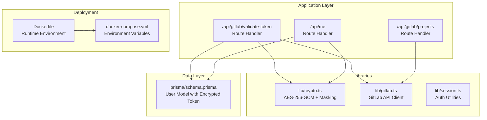
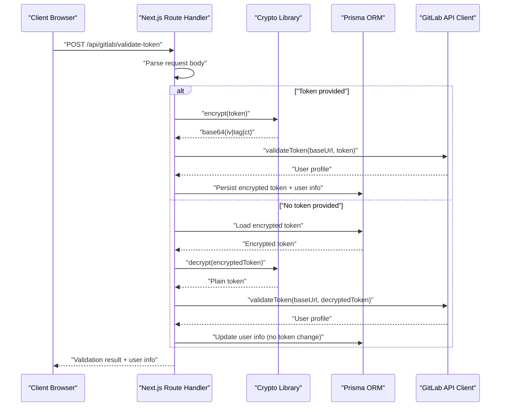
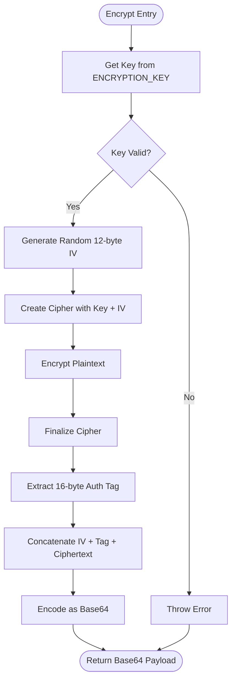
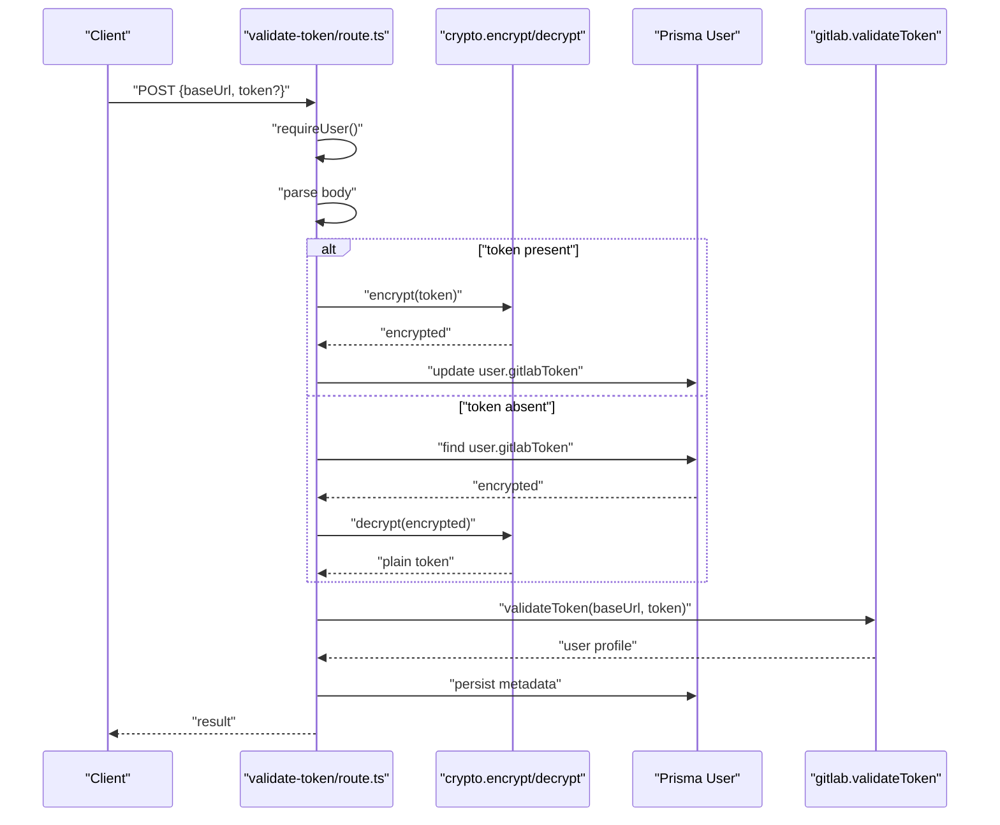
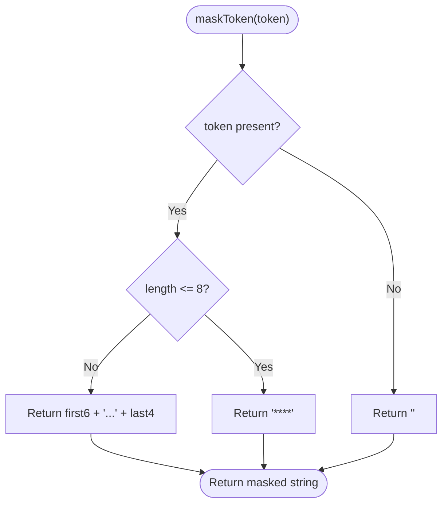
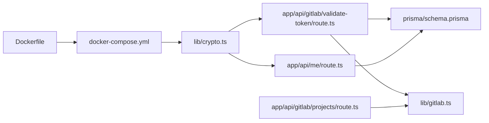

# Encryption System

<cite>
**Referenced Files in This Document**
- [crypto.ts](file://lib/crypto.ts)
- [validate-token/route.ts](file://app/api/gitlab/validate-token/route.ts)
- [me/route.ts](file://app/api/me/route.ts)
- [projects/route.ts](file://app/api/gitlab/projects/route.ts)
- [gitlab.ts](file://lib/gitlab.ts)
- [schema.prisma](file://prisma/schema.prisma)
- [docker-compose.yml](file://docker-compose.yml)
- [Dockerfile](file://Dockerfile)
- [README.md](file://README.md)
</cite>

## Table of Contents
1. [Introduction](#introduction)
2. [Project Structure](#project-structure)
3. [Core Components](#core-components)
4. [Architecture Overview](#architecture-overview)
5. [Detailed Component Analysis](#detailed-component-analysis)
6. [Dependency Analysis](#dependency-analysis)
7. [Performance Considerations](#performance-considerations)
8. [Troubleshooting Guide](#troubleshooting-guide)
9. [Conclusion](#conclusion)

## Introduction
This document provides comprehensive documentation for Pingyun Report's encryption system. The system uses AES-256-GCM to securely store GitLab Personal Access Tokens (PATs) in the database. It covers key generation requirements, initialization vector handling, authentication tag verification, payload format, base64 encoding/decoding, environment variable configuration, security best practices, token masking for safe display, practical workflows, error handling, and production deployment considerations.

## Project Structure
The encryption system spans several modules:
- Cryptographic primitives and utilities in the crypto library
- API routes that handle GitLab token validation and storage
- Database schema that stores encrypted tokens
- Deployment configuration that injects the encryption key



**Diagram sources**
- [validate-token/route.ts:1-81](file://app/api/gitlab/validate-token/route.ts#L1-L81)
- [me/route.ts:1-67](file://app/api/me/route.ts#L1-L67)
- [projects/route.ts:1-42](file://app/api/gitlab/projects/route.ts#L1-L42)
- [crypto.ts:1-46](file://lib/crypto.ts#L1-L46)
- [gitlab.ts:1-149](file://lib/gitlab.ts#L1-L149)
- [schema.prisma:16-33](file://prisma/schema.prisma#L16-L33)
- [Dockerfile:1-44](file://Dockerfile#L1-L44)
- [docker-compose.yml:1-21](file://docker-compose.yml#L1-L21)

**Section sources**
- [validate-token/route.ts:1-81](file://app/api/gitlab/validate-token/route.ts#L1-L81)
- [me/route.ts:1-67](file://app/api/me/route.ts#L1-L67)
- [projects/route.ts:1-42](file://app/api/gitlab/projects/route.ts#L1-L42)
- [crypto.ts:1-46](file://lib/crypto.ts#L1-L46)
- [gitlab.ts:1-149](file://lib/gitlab.ts#L1-L149)
- [schema.prisma:16-33](file://prisma/schema.prisma#L16-L33)
- [Dockerfile:1-44](file://Dockerfile#L1-L44)
- [docker-compose.yml:1-21](file://docker-compose.yml#L1-L21)

## Core Components
- AES-256-GCM cryptographic engine with 12-byte random IV and 16-byte authentication tag
- Base64-encoded payload format: iv | tag | ciphertext
- Environment-driven key management via ENCRYPTION_KEY
- Token masking utility for safe UI display
- GitLab API client that operates server-side only

Key characteristics:
- Algorithm: AES-256-GCM
- IV length: 12 bytes
- Authentication tag length: 16 bytes
- Key requirement: 64-character hex string (32 bytes)
- Payload encoding: Base64

**Section sources**
- [crypto.ts:3-5](file://lib/crypto.ts#L3-L5)
- [crypto.ts:7-15](file://lib/crypto.ts#L7-L15)
- [crypto.ts:17-38](file://lib/crypto.ts#L17-L38)
- [crypto.ts:40-45](file://lib/crypto.ts#L40-L45)
- [README.md:61-70](file://README.md#L61-L70)

## Architecture Overview
The encryption system integrates with the GitLab token lifecycle:



**Diagram sources**
- [validate-token/route.ts:13-79](file://app/api/gitlab/validate-token/route.ts#L13-L79)
- [crypto.ts:17-38](file://lib/crypto.ts#L17-L38)
- [gitlab.ts:87-89](file://lib/gitlab.ts#L87-L89)
- [schema.prisma:22-25](file://prisma/schema.prisma#L22-L25)

## Detailed Component Analysis

### Cryptographic Engine (AES-256-GCM)
The crypto module implements secure encryption and decryption using Node.js built-in crypto APIs.

Implementation highlights:
- Algorithm constant: AES-256-GCM
- IV length: 12 bytes (standard for GCM)
- Tag length: 16 bytes (authentication tag)
- Key validation: 64-character hex string (32 bytes)
- Encryption process: random IV + authenticated encryption + tag extraction
- Decryption process: split base64 payload, set auth tag, decrypt with IV



**Diagram sources**
- [crypto.ts:7-15](file://lib/crypto.ts#L7-L15)
- [crypto.ts:17-25](file://lib/crypto.ts#L17-L25)

**Section sources**
- [crypto.ts:3-5](file://lib/crypto.ts#L3-L5)
- [crypto.ts:7-15](file://lib/crypto.ts#L7-L15)
- [crypto.ts:17-25](file://lib/crypto.ts#L17-L25)

### Token Validation Workflow
The validation endpoint coordinates token handling, encryption, and GitLab API verification.

Processing logic:
- Parse and validate request body (URL + optional token)
- If token provided: encrypt and persist; validate against GitLab
- If no token: load encrypted token from DB, decrypt, validate against GitLab
- Persist user metadata (base URL, user ID, email)
- Attempt to refresh project cache
- Return success with user info or warning if project fetch fails



**Diagram sources**
- [validate-token/route.ts:13-79](file://app/api/gitlab/validate-token/route.ts#L13-L79)
- [crypto.ts:17-38](file://lib/crypto.ts#L17-L38)
- [gitlab.ts:87-89](file://lib/gitlab.ts#L87-L89)

**Section sources**
- [validate-token/route.ts:8-39](file://app/api/gitlab/validate-token/route.ts#L8-L39)
- [validate-token/route.ts:41-74](file://app/api/gitlab/validate-token/route.ts#L41-L74)

### Token Masking for Safe Display
The masking utility ensures tokens are never shown in full in the UI.

Behavior:
- Returns empty string for null/undefined
- Returns "****" for tokens with length ≤ 8
- Returns "XXXX...YYYY" for longer tokens (first 6 + "..." + last 4)



**Diagram sources**
- [crypto.ts:40-45](file://lib/crypto.ts#L40-L45)

**Section sources**
- [crypto.ts:40-45](file://lib/crypto.ts#L40-L45)
- [me/route.ts:24-32](file://app/api/me/route.ts#L24-L32)

### Database Schema and Storage
The User model includes an encrypted token field with explicit documentation.

Schema characteristics:
- Field: gitlabToken (String?)
- Type: Text (MySQL)
- Constraint: AES-256-GCM encrypted, base64
- Purpose: Store GitLab PAT securely

```mermaid
erDiagram
USER {
string id PK
string username UK
string passwordHash
string displayName
enum role
string gitlabBaseUrl
string gitlabToken @db.Text
int gitlabUserId
string gitlabEmail
string noiseRegex @db.Text
datetime createdAt
datetime updatedAt
}
```

**Diagram sources**
- [schema.prisma:16-33](file://prisma/schema.prisma#L16-L33)

**Section sources**
- [schema.prisma:22-25](file://prisma/schema.prisma#L22-L25)

### Environment Configuration and Deployment
The system relies on environment variables for secure operation.

Required variables:
- ENCRYPTION_KEY: 64-character hex string (32 bytes)
- DATABASE_URL: MySQL connection string
- NEXTAUTH_URL: Application URL
- NEXTAUTH_SECRET: Secret for NextAuth

Deployment considerations:
- Dockerfile sets production environment and runs Prisma migrations on startup
- docker-compose.yml injects ENCRYPTION_KEY and other secrets
- README documents generation command for key creation

**Section sources**
- [README.md:54-70](file://README.md#L54-L70)
- [Dockerfile:22-44](file://Dockerfile#L22-L44)
- [docker-compose.yml:10-20](file://docker-compose.yml#L10-L20)

## Dependency Analysis
The encryption system has minimal but critical dependencies across modules.



**Diagram sources**
- [crypto.ts:1-46](file://lib/crypto.ts#L1-L46)
- [validate-token/route.ts:1-81](file://app/api/gitlab/validate-token/route.ts#L1-L81)
- [me/route.ts:1-67](file://app/api/me/route.ts#L1-L67)
- [projects/route.ts:1-42](file://app/api/gitlab/projects/route.ts#L1-L42)
- [gitlab.ts:1-149](file://lib/gitlab.ts#L1-L149)
- [schema.prisma:16-33](file://prisma/schema.prisma#L16-L33)
- [Dockerfile:1-44](file://Dockerfile#L1-L44)
- [docker-compose.yml:1-21](file://docker-compose.yml#L1-L21)

**Section sources**
- [crypto.ts:1-46](file://lib/crypto.ts#L1-L46)
- [validate-token/route.ts:1-81](file://app/api/gitlab/validate-token/route.ts#L1-L81)
- [me/route.ts:1-67](file://app/api/me/route.ts#L1-L67)
- [projects/route.ts:1-42](file://app/api/gitlab/projects/route.ts#L1-L42)
- [gitlab.ts:1-149](file://lib/gitlab.ts#L1-L149)
- [schema.prisma:16-33](file://prisma/schema.prisma#L16-L33)
- [Dockerfile:1-44](file://Dockerfile#L1-L44)
- [docker-compose.yml:1-21](file://docker-compose.yml#L1-L21)

## Performance Considerations
- Encryption overhead: AES-256-GCM is fast; negligible compared to network latency to GitLab
- Base64 encoding adds ~33% size increase; acceptable for small token payloads
- IV reuse: Random IV per encryption prevents nonce misuse
- Tag verification: Automatic integrity check during decryption
- Database I/O: Single write on token update; decryption only when needed

## Troubleshooting Guide

Common issues and resolutions:

### Invalid ENCRYPTION_KEY
Symptoms:
- Error during encryption/decryption
- Application fails to start or throws during token operations

Resolution:
- Verify ENCRYPTION_KEY is exactly 64 hex characters
- Regenerate key using the documented OpenSSL command
- Ensure key is injected via environment (compose file or runtime)

**Section sources**
- [crypto.ts:7-15](file://lib/crypto.ts#L7-L15)
- [README.md:61-70](file://README.md#L61-L70)
- [docker-compose.yml](file://docker-compose.yml#L14)

### Corrupted or Tampered Data
Symptoms:
- Decryption errors or authentication failures
- Database contains malformed base64

Resolution:
- Re-enter GitLab token to re-encrypt
- Check database encoding and base64 validity
- Ensure consistent key across deployments

**Section sources**
- [crypto.ts:28-38](file://lib/crypto.ts#L28-L38)

### Token Not Returned to Client
Behavior:
- Frontend sees masked token preview instead of full token

Explanation:
- By design, raw tokens are never returned to the browser
- Only a masked preview is computed server-side for display

**Section sources**
- [me/route.ts:24-32](file://app/api/me/route.ts#L24-L32)
- [crypto.ts:40-45](file://lib/crypto.ts#L40-L45)

### GitLab API Validation Failures
Symptoms:
- Token appears valid but GitLab rejects it
- Network timeouts or rate limiting

Resolution:
- Verify token scope (read_api + read_repository)
- Check GitLab base URL correctness
- Retry after network stabilization

**Section sources**
- [validate-token/route.ts](file://app/api/gitlab/validate-token/route.ts#L29)
- [gitlab.ts:87-89](file://lib/gitlab.ts#L87-L89)

## Conclusion
Pingyun Report's encryption system provides robust protection for GitLab tokens using industry-standard AES-256-GCM with proper IV handling and authentication tags. The implementation emphasizes security through environment-driven key management, server-side-only GitLab API access, and safe UI display via token masking. For production deployments, ensure proper key rotation procedures, secure environment variable management, and consistent deployment configurations to maintain confidentiality and integrity of stored tokens.