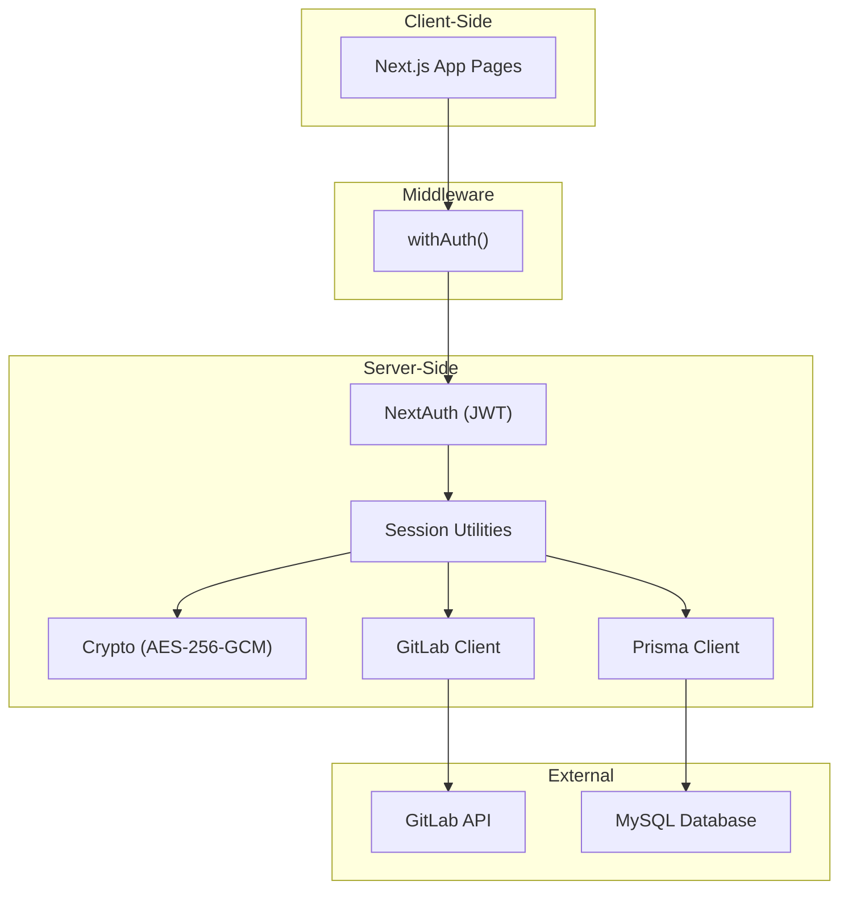
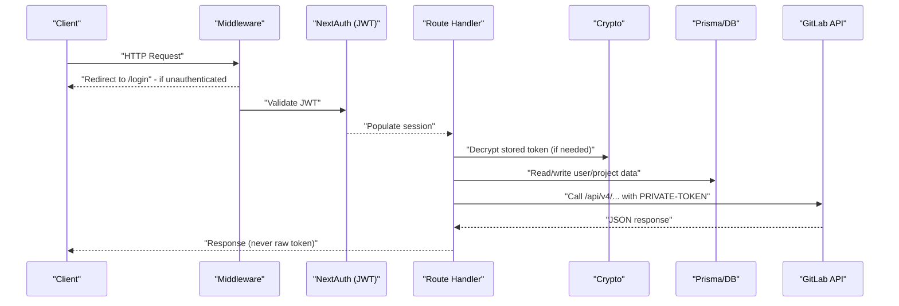
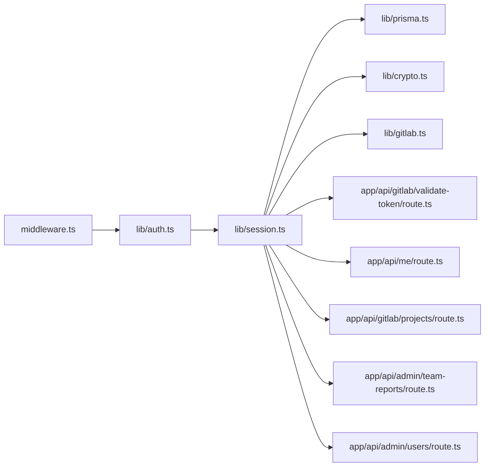

# Security Implementation

<cite>
**Referenced Files in This Document**
- [crypto.ts](file://lib/crypto.ts)
- [auth.ts](file://lib/auth.ts)
- [gitlab.ts](file://lib/gitlab.ts)
- [session.ts](file://lib/session.ts)
- [middleware.ts](file://middleware.ts)
- [validate-token/route.ts](file://app/api/gitlab/validate-token/route.ts)
- [me/route.ts](file://app/api/me/route.ts)
- [projects/route.ts](file://app/api/gitlab/projects/route.ts)
- [admin/team-reports/route.ts](file://app/api/admin/team-reports/route.ts)
- [admin/users/route.ts](file://app/api/admin/users/route.ts)
- [prisma.ts](file://lib/prisma.ts)
- [schema.prisma](file://prisma/schema.prisma)
- [package.json](file://package.json)
</cite>

## Table of Contents
1. [Introduction](#introduction)
2. [Project Structure](#project-structure)
3. [Core Components](#core-components)
4. [Architecture Overview](#architecture-overview)
5. [Detailed Component Analysis](#detailed-component-analysis)
6. [Dependency Analysis](#dependency-analysis)
7. [Performance Considerations](#performance-considerations)
8. [Troubleshooting Guide](#troubleshooting-guide)
9. [Conclusion](#conclusion)
10. [Appendices](#appendices)

## Introduction
This document explains Pingyun Report’s security implementation across encryption, authentication, authorization, data protection, and operational controls. It focuses on:
- AES-256-GCM encryption for GitLab tokens with secure key management and token masking
- Server-side-only GitLab API client design to prevent token leakage
- Authentication via bcrypt and JWT-based sessions
- Middleware-based access control, role-based permissions, and route protection
- Input validation and sanitization
- Environment variable and database security practices
- Audit, vulnerability assessment, incident response, and patch management guidelines

## Project Structure
Security-critical modules are organized by responsibility:
- Encryption and token masking: lib/crypto.ts
- Authentication and session: lib/auth.ts, lib/session.ts, middleware.ts
- GitLab integration: lib/gitlab.ts plus server-side API routes
- Data persistence: lib/prisma.ts and prisma/schema.prisma
- API routes enforcing access control: app/api/* routes

**Diagram sources**
- [middleware.ts:1-10](file://middleware.ts#L1-L10)
- [auth.ts:30-77](file://lib/auth.ts#L30-L77)
- [session.ts:11-37](file://lib/session.ts#L11-L37)
- [crypto.ts:17-45](file://lib/crypto.ts#L17-L45)
- [gitlab.ts:45-80](file://lib/gitlab.ts#L45-L80)
- [prisma.ts:7-14](file://lib/prisma.ts#L7-L14)

**Section sources**
- [middleware.ts:1-10](file://middleware.ts#L1-L10)
- [auth.ts:30-77](file://lib/auth.ts#L30-L77)
- [session.ts:11-37](file://lib/session.ts#L11-L37)
- [crypto.ts:17-45](file://lib/crypto.ts#L17-L45)
- [gitlab.ts:45-80](file://lib/gitlab.ts#L45-L80)
- [prisma.ts:7-14](file://lib/prisma.ts#L7-L14)

## Core Components
- Encryption and token masking: AES-256-GCM with validated 32-byte key, random IV, and authentication tag; token masking for safe display.
- Authentication and session: NextAuth with JWT strategy, bcrypt password hashing, and typed session/user interfaces.
- Access control: Middleware protecting routes and route handlers requiring user/admin roles.
- GitLab integration: Server-only client that never exposes tokens to clients; validates tokens and caches minimal user/project metadata.
- Data protection: Zod-based input validation, Prisma ORM with environment-driven datasource, and encrypted token storage.

**Section sources**
- [crypto.ts:17-45](file://lib/crypto.ts#L17-L45)
- [auth.ts:30-77](file://lib/auth.ts#L30-L77)
- [session.ts:11-37](file://lib/session.ts#L11-L37)
- [gitlab.ts:45-80](file://lib/gitlab.ts#L45-L80)
- [prisma.ts:7-14](file://lib/prisma.ts#L7-L14)

## Architecture Overview
The system enforces strict server-side processing for sensitive operations:
- Middleware ensures unauthenticated users cannot access protected routes.
- NextAuth manages JWT-based sessions with bcrypt-secured credentials.
- Route handlers validate inputs, enforce roles, and call the GitLab client internally.
- Tokens are stored encrypted and never returned in plaintext to clients; masked previews are shown instead.

**Diagram sources**
- [middleware.ts:1-10](file://middleware.ts#L1-L10)
- [auth.ts:30-77](file://lib/auth.ts#L30-L77)
- [session.ts:11-37](file://lib/session.ts#L11-L37)
- [validate-token/route.ts:13-80](file://app/api/gitlab/validate-token/route.ts#L13-L80)
- [me/route.ts:7-47](file://app/api/me/route.ts#L7-L47)
- [gitlab.ts:45-80](file://lib/gitlab.ts#L45-L80)
- [prisma.ts:7-14](file://lib/prisma.ts#L7-L14)

## Detailed Component Analysis

### Encryption and Token Masking (AES-256-GCM)
- Key management: Requires a 64-character hex string (32 bytes) via ENCRYPTION_KEY. Validation prevents weak keys.
- Encryption: Random 12-byte IV, GCM mode, 16-byte auth tag, output as base64(iv | tag | ciphertext).
- Decryption: Validates auth tag and reconstructs plaintext.
- Token masking: Safe display format “glpat-abcd...wxyz” for UI previews.

Security considerations:
- Store ENCRYPTION_KEY securely and rotate periodically.
- Treat encrypted tokens as secrets; avoid logging decrypted values.
- Validate inputs and handle decryption errors gracefully.

**Section sources**
- [crypto.ts:7-15](file://lib/crypto.ts#L7-L15)
- [crypto.ts:17-38](file://lib/crypto.ts#L17-L38)
- [crypto.ts:40-45](file://lib/crypto.ts#L40-L45)

### GitLab Client and Token Handling
- Server-only client: All GitLab calls originate from the backend; tokens are never exposed to the client.
- Token validation: Calls /api/v4/user with PRIVATE-TOKEN header; non-OK responses raise errors.
- Pagination safety: Limits pages to avoid excessive load.
- Token caching: On successful validation, stores encrypted token and user metadata; optional project cache refresh.

Operational safeguards:
- Enforce timeouts and abort signals to prevent hanging requests.
- Avoid printing raw responses; sanitize logs.

**Section sources**
- [gitlab.ts:45-80](file://lib/gitlab.ts#L45-L80)
- [gitlab.ts:87-89](file://lib/gitlab.ts#L87-L89)
- [gitlab.ts:91-111](file://lib/gitlab.ts#L91-L111)
- [gitlab.ts:120-148](file://lib/gitlab.ts#L120-L148)

### Authentication and Session Management
- Strategy: JWT-based sessions via NextAuth.
- Password hashing: bcrypt compares during login; bcrypt hashes used for account creation and updates.
- Typed session/user: Strongly-typed JWT and session payloads to reduce runtime errors.
- Unauthorized/forbidden handling: Dedicated helpers throw structured 401/403 responses.

Best practices:
- Use HTTPS in production; set secure cookies and appropriate SameSite attributes.
- Rotate JWT secrets regularly; monitor failed auth attempts.

**Section sources**
- [auth.ts:30-77](file://lib/auth.ts#L30-L77)
- [session.ts:11-37](file://lib/session.ts#L11-L37)

### Middleware-Based Access Control and Route Protection
- Middleware: Protects root and admin routes; redirects unauthenticated users to /login.
- Route-level guards: requireUser and requireAdmin wrappers enforce role checks and return structured errors.
- Error normalization: withErrors converts thrown Responses into JSON responses and logs unexpected errors.

Implementation highlights:
- Matched routes include "/", "/history/*", "/settings/*", "/admin/*".
- Admin-only endpoints restrict access to ADMIN role.

**Section sources**
- [middleware.ts:1-10](file://middleware.ts#L1-L10)
- [session.ts:11-37](file://lib/session.ts#L11-L37)
- [session.ts:39-55](file://lib/session.ts#L39-L55)

### Role-Based Permissions and Admin Operations
- Roles: MEMBER and ADMIN persisted in the User model.
- Admin endpoints:
  - Team reports: Aggregate reports by date for admins.
  - Users: CRUD operations guarded by requireAdmin with Zod validation.

Validation and sanitization:
- Zod schemas validate request bodies and query parameters.
- Regex updates sanitized via optional/nullable handling.

**Section sources**
- [schema.prisma:11-33](file://prisma/schema.prisma#L11-L33)
- [admin/team-reports/route.ts:6-33](file://app/api/admin/team-reports/route.ts#L6-L33)
- [admin/users/route.ts:24-56](file://app/api/admin/users/route.ts#L24-L56)
- [admin/users/route.ts:58-87](file://app/api/admin/users/route.ts#L58-L87)

### Data Protection and Input Validation
- Input validation: Zod schemas define allowed shapes and constraints for all mutation endpoints.
- Sanitization: Optional fields support nullification; regex updates handled carefully.
- Database access: Prisma client configured with environment-driven DATABASE_URL; logs restricted in production.

Recommendations:
- Escape or sanitize any user-generated content before rendering.
- Apply rate limiting to prevent abuse of authentication and token validation endpoints.

**Section sources**
- [validate-token/route.ts:8-11](file://app/api/gitlab/validate-token/route.ts#L8-L11)
- [validate-token/route.ts:13-80](file://app/api/gitlab/validate-token/route.ts#L13-L80)
- [me/route.ts:49-66](file://app/api/me/route.ts#L49-L66)
- [prisma.ts:7-14](file://lib/prisma.ts#L7-L14)
- [schema.prisma:6-9](file://prisma/schema.prisma#L6-L9)

### Secure Token Exposure Prevention
- Never return raw tokens to clients; masked previews only.
- Decrypt tokens server-side only when needed for validation or GitLab calls.
- Masking logic ensures partial visibility without exposing full tokens.

UI-safe display:
- Masked previews shown in user profile endpoint.

**Section sources**
- [me/route.ts:24-46](file://app/api/me/route.ts#L24-L46)
- [crypto.ts:40-45](file://lib/crypto.ts#L40-L45)
- [validate-token/route.ts:26-38](file://app/api/gitlab/validate-token/route.ts#L26-L38)

### API Design Principles to Prevent Token Leakage
- Private headers: PRIVATE-TOKEN is used exclusively server-side.
- No client-side token handling: All GitLab operations are executed on the server.
- Minimal data exposure: Only necessary fields are returned; token fields excluded from responses.

**Section sources**
- [gitlab.ts:61-76](file://lib/gitlab.ts#L61-L76)
- [validate-token/route.ts:29-38](file://app/api/gitlab/validate-token/route.ts#L29-L38)

### Database Security and Environment Variables
- Datasource: MySQL via Prisma; DATABASE_URL loaded from environment.
- Logging: Reduced logs in production to minimize risk of sensitive data exposure.
- Secrets: ENCRYPTION_KEY must be set and validated.

Recommendations:
- Restrict database network access; use TLS.
- Store secrets in a secure secret manager; rotate frequently.
- Limit database user privileges to least-privilege.

**Section sources**
- [schema.prisma:6-9](file://prisma/schema.prisma#L6-L9)
- [prisma.ts:7-14](file://lib/prisma.ts#L7-L14)
- [crypto.ts:7-15](file://lib/crypto.ts#L7-L15)

## Dependency Analysis

**Diagram sources**
- [middleware.ts:1-10](file://middleware.ts#L1-L10)
- [auth.ts:30-77](file://lib/auth.ts#L30-L77)
- [session.ts:11-37](file://lib/session.ts#L11-L37)
- [prisma.ts:7-14](file://lib/prisma.ts#L7-L14)
- [crypto.ts:17-45](file://lib/crypto.ts#L17-L45)
- [gitlab.ts:45-80](file://lib/gitlab.ts#L45-L80)
- [validate-token/route.ts:13-80](file://app/api/gitlab/validate-token/route.ts#L13-L80)
- [me/route.ts:7-47](file://app/api/me/route.ts#L7-L47)
- [projects/route.ts:6-42](file://app/api/gitlab/projects/route.ts#L6-L42)
- [admin/team-reports/route.ts:6-33](file://app/api/admin/team-reports/route.ts#L6-L33)
- [admin/users/route.ts:31-56](file://app/api/admin/users/route.ts#L31-L56)

**Section sources**
- [middleware.ts:1-10](file://middleware.ts#L1-L10)
- [auth.ts:30-77](file://lib/auth.ts#L30-L77)
- [session.ts:11-37](file://lib/session.ts#L11-L37)
- [prisma.ts:7-14](file://lib/prisma.ts#L7-L14)
- [crypto.ts:17-45](file://lib/crypto.ts#L17-L45)
- [gitlab.ts:45-80](file://lib/gitlab.ts#L45-L80)
- [validate-token/route.ts:13-80](file://app/api/gitlab/validate-token/route.ts#L13-L80)
- [me/route.ts:7-47](file://app/api/me/route.ts#L7-L47)
- [projects/route.ts:6-42](file://app/api/gitlab/projects/route.ts#L6-L42)
- [admin/team-reports/route.ts:6-33](file://app/api/admin/team-reports/route.ts#L6-L33)
- [admin/users/route.ts:31-56](file://app/api/admin/users/route.ts#L31-L56)

## Performance Considerations
- Encryption overhead: AES-256-GCM adds CPU cost; batch operations and caching can mitigate repeated encryption/decryption.
- GitLab pagination: Safety caps on pages reduce load; consider caching project lists and invalidating on demand.
- Database queries: Use selective field retrieval and indexes; avoid N+1 queries.
- Rate limiting: Apply to authentication and token validation endpoints to prevent brute-force and abuse.

## Troubleshooting Guide
Common issues and mitigations:
- Unauthorized/Forbidden responses: Verify user session and role; check middleware matchers and route guards.
- Token validation failures: Confirm ENCRYPTION_KEY correctness, token format, and GitLab base URL; inspect error messages from GitLab API.
- Database connectivity: Validate DATABASE_URL and network access; review Prisma logs in development.
- Masked token discrepancies: Ensure decrypted token length and masking logic; handle decryption exceptions gracefully.

**Section sources**
- [session.ts:22-37](file://lib/session.ts#L22-L37)
- [session.ts:39-55](file://lib/session.ts#L39-L55)
- [validate-token/route.ts:13-80](file://app/api/gitlab/validate-token/route.ts#L13-L80)
- [prisma.ts:7-14](file://lib/prisma.ts#L7-L14)
- [crypto.ts:7-15](file://lib/crypto.ts#L7-L15)

## Conclusion
Pingyun Report implements a layered security model:
- Strong encryption for tokens with strict key management and masking for UI display
- JWT-based authentication with bcrypt and robust session handling
- Middleware and route-level guards enforcing access control and role-based permissions
- Server-only GitLab integration preventing token leakage
- Input validation, sanitization, and secure database configuration

Adhering to the recommended practices and operational procedures will further strengthen the system against evolving threats.

## Appendices

### Security Best Practices Checklist
- Environment variables
  - Store ENCRYPTION_KEY and DATABASE_URL in a secret manager; restrict access.
  - Validate presence and format of secrets at startup.
- Database connections
  - Use TLS; limit network exposure; apply least privilege.
- External API communications
  - Set timeouts and abort signals; avoid logging sensitive headers.
- Authentication
  - Enforce HTTPS; configure secure cookie policies; rotate secrets.
- Input validation and sanitization
  - Use Zod schemas; escape or sanitize rendered user content.
- Audit and incident response
  - Log security-relevant events; establish escalation and remediation procedures.
- Updates and patch management
  - Automate dependency updates; test patches in staging; roll out with monitoring.

### API Security Controls Summary
- Authentication: NextAuth with JWT; bcrypt password hashing.
- Authorization: requireUser/requireAdmin wrappers; role enforcement.
- Data protection: Zod validation; masked token display; encrypted storage.
- Token handling: Server-only; PRIVATE-TOKEN header; no client exposure.
- Error handling: Normalized responses; controlled error logging.

**Section sources**
- [auth.ts:30-77](file://lib/auth.ts#L30-L77)
- [session.ts:11-37](file://lib/session.ts#L11-L37)
- [validate-token/route.ts:13-80](file://app/api/gitlab/validate-token/route.ts#L13-L80)
- [me/route.ts:24-46](file://app/api/me/route.ts#L24-L46)
- [crypto.ts:17-45](file://lib/crypto.ts#L17-L45)
- [gitlab.ts:45-80](file://lib/gitlab.ts#L45-L80)