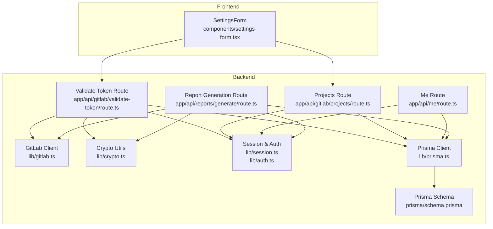
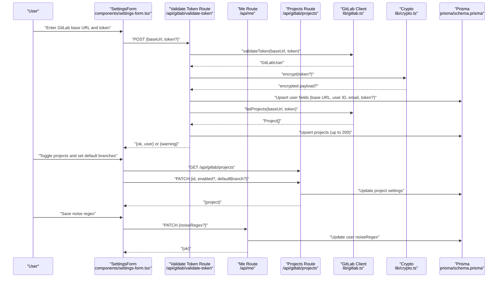
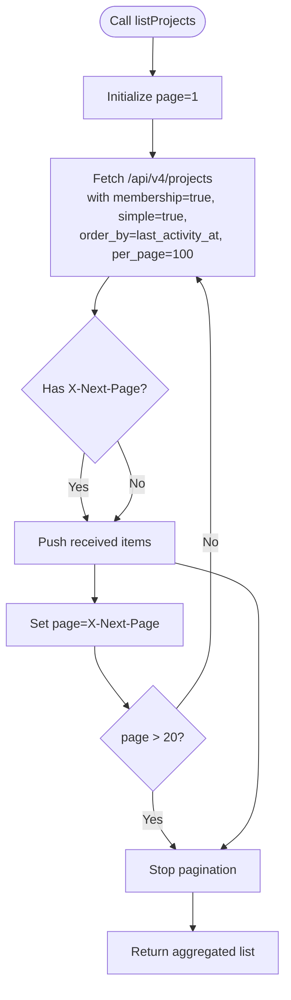
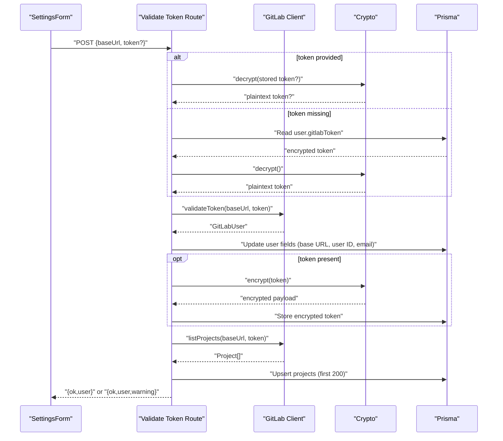
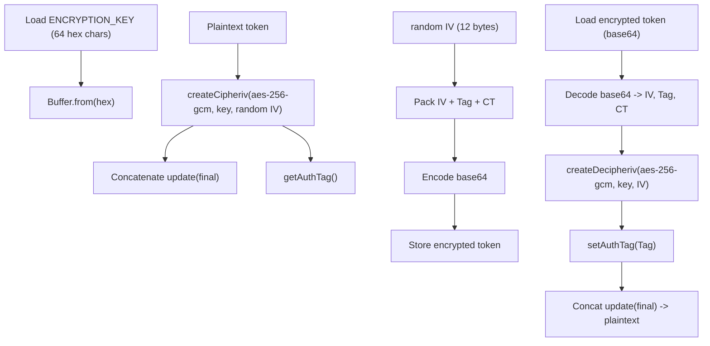
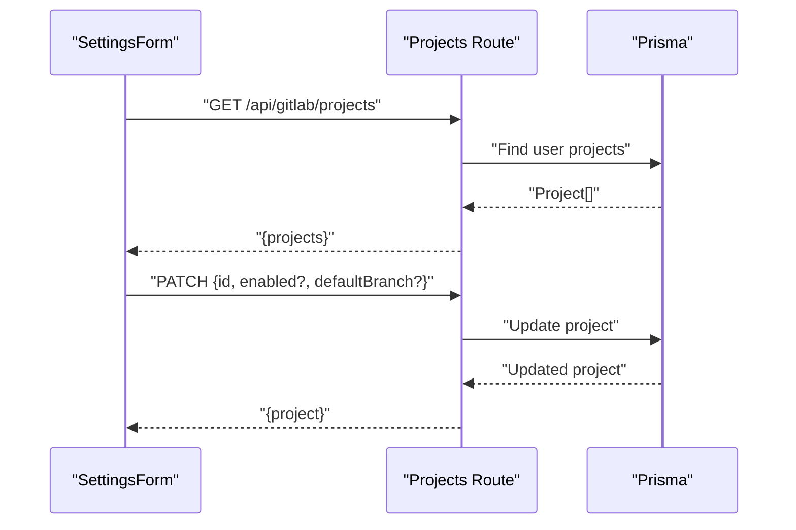
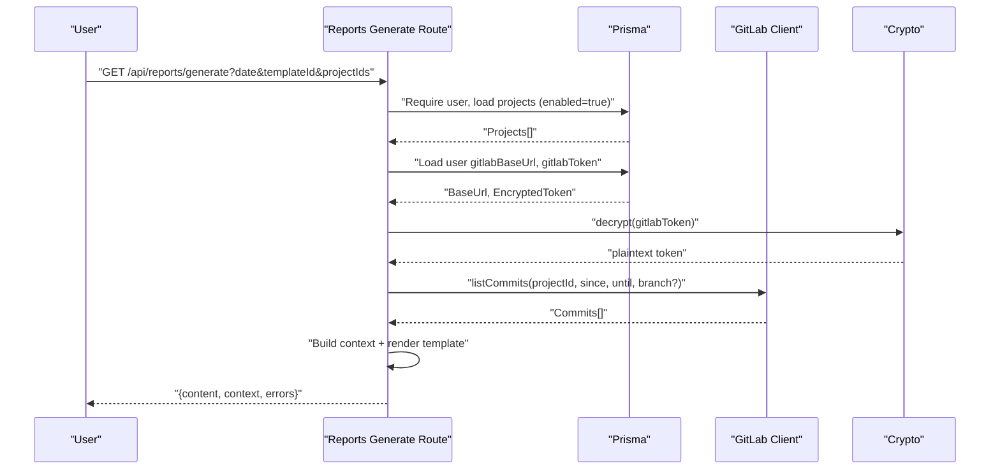
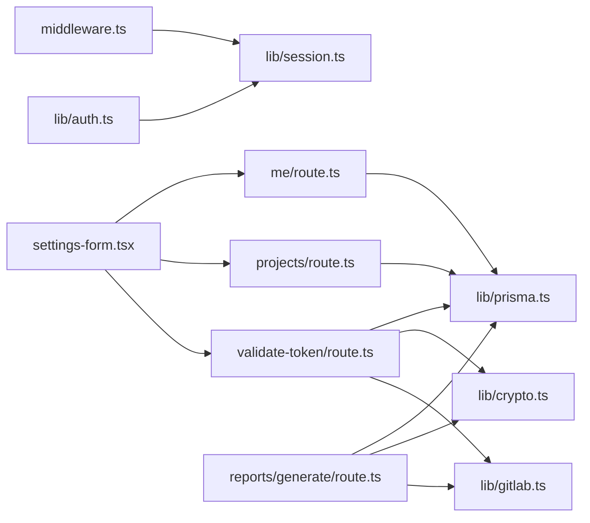
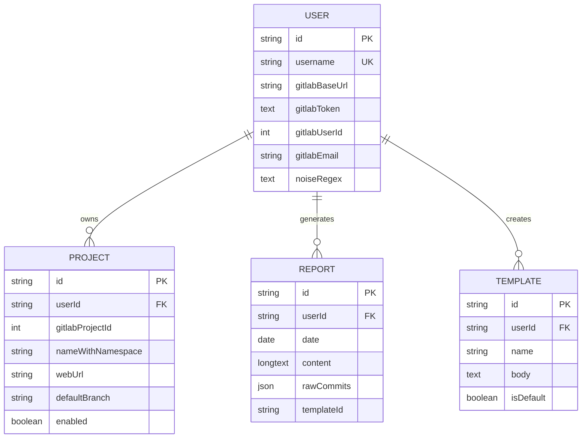

# GitLab Integration Configuration

<cite>
**Referenced Files in This Document**
- [lib/gitlab.ts](file://lib/gitlab.ts)
- [app/api/gitlab/validate-token/route.ts](file://app/api/gitlab/validate-token/route.ts)
- [app/api/gitlab/projects/route.ts](file://app/api/gitlab/projects/route.ts)
- [lib/crypto.ts](file://lib/crypto.ts)
- [components/settings-form.tsx](file://components/settings-form.tsx)
- [prisma/schema.prisma](file://prisma/schema.prisma)
- [lib/session.ts](file://lib/session.ts)
- [lib/prisma.ts](file://lib/prisma.ts)
- [lib/auth.ts](file://lib/auth.ts)
- [app/api/me/route.ts](file://app/api/me/route.ts)
- [app/api/reports/generate/route.ts](file://app/api/reports/generate/route.ts)
- [middleware.ts](file://middleware.ts)
- [package.json](file://package.json)
</cite>

## Table of Contents
1. [Introduction](#introduction)
2. [Project Structure](#project-structure)
3. [Core Components](#core-components)
4. [Architecture Overview](#architecture-overview)
5. [Detailed Component Analysis](#detailed-component-analysis)
6. [Dependency Analysis](#dependency-analysis)
7. [Performance Considerations](#performance-considerations)
8. [Troubleshooting Guide](#troubleshooting-guide)
9. [Conclusion](#conclusion)
10. [Appendices](#appendices)

## Introduction
This document explains how to configure Pingyun Report to integrate with GitLab. It covers:
- Connecting to GitLab via base URL and personal access token
- Token validation and secure storage using AES-256-GCM encryption
- Project configuration, branch specification, and noise regex filtering
- The GitLab API client implementation, error handling, and retry strategies
- Step-by-step setup, common issues, and troubleshooting procedures

## Project Structure
The GitLab integration spans frontend and backend modules:
- Frontend form for configuration and project toggling
- Backend routes for validating tokens, persisting settings, and fetching projects
- Secure crypto utilities for encryption/decryption
- Prisma schema modeling user and project settings
- Authentication and session middleware ensuring protected access

**Diagram sources**
- [components/settings-form.tsx:1-368](file://components/settings-form.tsx#L1-L368)
- [app/api/gitlab/validate-token/route.ts:1-81](file://app/api/gitlab/validate-token/route.ts#L1-L81)
- [app/api/gitlab/projects/route.ts:1-42](file://app/api/gitlab/projects/route.ts#L1-L42)
- [app/api/me/route.ts:1-67](file://app/api/me/route.ts#L1-L67)
- [app/api/reports/generate/route.ts:1-133](file://app/api/reports/generate/route.ts#L1-L133)
- [lib/gitlab.ts:1-149](file://lib/gitlab.ts#L1-L149)
- [lib/crypto.ts:1-46](file://lib/crypto.ts#L1-L46)
- [lib/session.ts:1-56](file://lib/session.ts#L1-L56)
- [lib/auth.ts:1-77](file://lib/auth.ts#L1-L77)
- [lib/prisma.ts:1-14](file://lib/prisma.ts#L1-L14)
- [prisma/schema.prisma:1-80](file://prisma/schema.prisma#L1-L80)

**Section sources**
- [components/settings-form.tsx:1-368](file://components/settings-form.tsx#L1-L368)
- [app/api/gitlab/validate-token/route.ts:1-81](file://app/api/gitlab/validate-token/route.ts#L1-L81)
- [app/api/gitlab/projects/route.ts:1-42](file://app/api/gitlab/projects/route.ts#L1-L42)
- [app/api/me/route.ts:1-67](file://app/api/me/route.ts#L1-L67)
- [app/api/reports/generate/route.ts:1-133](file://app/api/reports/generate/route.ts#L1-L133)
- [lib/gitlab.ts:1-149](file://lib/gitlab.ts#L1-L149)
- [lib/crypto.ts:1-46](file://lib/crypto.ts#L1-L46)
- [lib/session.ts:1-56](file://lib/session.ts#L1-L56)
- [lib/auth.ts:1-77](file://lib/auth.ts#L1-L77)
- [lib/prisma.ts:1-14](file://lib/prisma.ts#L1-L14)
- [prisma/schema.prisma:1-80](file://prisma/schema.prisma#L1-L80)

## Core Components
- GitLab API client: Provides typed wrappers for user, projects, and commits endpoints with pagination and timeouts.
- Token validation and persistence: Validates tokens against GitLab, persists base URL and user info, optionally stores encrypted token.
- Encryption utilities: AES-256-GCM encryption/decryption for secure token storage.
- Project configuration: Enables/disables projects and sets default branches per user.
- Noise regex filtering: Allows filtering commit messages via regex.
- Session and auth: Protects routes and ensures authorized access.

**Section sources**
- [lib/gitlab.ts:1-149](file://lib/gitlab.ts#L1-L149)
- [app/api/gitlab/validate-token/route.ts:1-81](file://app/api/gitlab/validate-token/route.ts#L1-L81)
- [lib/crypto.ts:1-46](file://lib/crypto.ts#L1-L46)
- [app/api/gitlab/projects/route.ts:1-42](file://app/api/gitlab/projects/route.ts#L1-L42)
- [app/api/me/route.ts:1-67](file://app/api/me/route.ts#L1-L67)
- [lib/session.ts:1-56](file://lib/session.ts#L1-L56)
- [lib/auth.ts:1-77](file://lib/auth.ts#L1-L77)

## Architecture Overview
The integration follows a client-server pattern:
- Frontend collects base URL and optional token, submits to backend.
- Backend validates token against GitLab, persists user preferences and optional encrypted token.
- Reports generation decrypts stored token and queries GitLab commits for configured projects.

**Diagram sources**
- [components/settings-form.tsx:61-88](file://components/settings-form.tsx#L61-L88)
- [app/api/gitlab/validate-token/route.ts:13-80](file://app/api/gitlab/validate-token/route.ts#L13-L80)
- [app/api/gitlab/projects/route.ts:6-41](file://app/api/gitlab/projects/route.ts#L6-L41)
- [app/api/me/route.ts:7-47](file://app/api/me/route.ts#L7-L47)
- [lib/gitlab.ts:82-111](file://lib/gitlab.ts#L82-L111)
- [lib/crypto.ts:18-38](file://lib/crypto.ts#L18-L38)
- [prisma/schema.prisma:16-49](file://prisma/schema.prisma#L16-L49)

## Detailed Component Analysis

### GitLab API Client
Implements:
- Base URL normalization and query parameter handling
- Timeout via AbortController
- Pagination via X-Next-Page header with a safety cap
- Typed models for user, project, and commit resources
- Token injection via PRIVATE-TOKEN header

Key behaviors:
- getCurrentUser and validateToken reuse the same endpoint
- listProjects paginates up to 20 pages (2000 items max)
- listCommits paginates with optional branch and time window

**Diagram sources**
- [lib/gitlab.ts:91-111](file://lib/gitlab.ts#L91-L111)

**Section sources**
- [lib/gitlab.ts:1-149](file://lib/gitlab.ts#L1-L149)

### Token Validation and Persistence
- Accepts base URL and optional token; if absent, decrypts stored token for validation
- Persists base URL, GitLab user ID, and email
- Optionally encrypts and stores the token
- Attempts to refresh project cache up to 200 projects in a transaction
- Returns warnings if project cache fails but token is valid

**Diagram sources**
- [app/api/gitlab/validate-token/route.ts:13-80](file://app/api/gitlab/validate-token/route.ts#L13-L80)
- [lib/gitlab.ts:82-111](file://lib/gitlab.ts#L82-L111)
- [lib/crypto.ts:18-38](file://lib/crypto.ts#L18-L38)
- [prisma/schema.prisma:16-49](file://prisma/schema.prisma#L16-L49)

**Section sources**
- [app/api/gitlab/validate-token/route.ts:1-81](file://app/api/gitlab/validate-token/route.ts#L1-L81)

### AES-256-GCM Encryption Implementation
- Algorithm: aes-256-gcm
- Key derivation: 32-byte hex key from ENCRYPTION_KEY environment variable
- Format: base64(iv | tag | ciphertext)
- Masking: Safe display of partial token for UI

Security notes:
- IV length 12 bytes; authentication tag length 16 bytes
- Decryption requires the exact IV and tag; tampering detected via GCM tag verification

**Diagram sources**
- [lib/crypto.ts:3-38](file://lib/crypto.ts#L3-L38)

**Section sources**
- [lib/crypto.ts:1-46](file://lib/crypto.ts#L1-L46)

### Project Configuration and Branch Specification
- Users can enable/disable projects and set default branches
- Projects are cached per user and upserted from GitLab during token validation
- Branch defaults are applied when generating reports

**Diagram sources**
- [app/api/gitlab/projects/route.ts:6-41](file://app/api/gitlab/projects/route.ts#L6-L41)
- [prisma/schema.prisma:35-49](file://prisma/schema.prisma#L35-L49)

**Section sources**
- [app/api/gitlab/projects/route.ts:1-42](file://app/api/gitlab/projects/route.ts#L1-L42)
- [prisma/schema.prisma:35-49](file://prisma/schema.prisma#L35-L49)

### Noise Regex Filtering
- Users can specify a regex to filter commit titles/messages
- Applied during report generation context building

**Section sources**
- [app/api/me/route.ts:49-66](file://app/api/me/route.ts#L49-L66)
- [app/api/reports/generate/route.ts:108-117](file://app/api/reports/generate/route.ts#L108-L117)

### Report Generation and API Requests
- Validates presence of base URL and encrypted token
- Decrypts token and queries commits for enabled projects
- Builds report context and renders template
- Surfaces per-project errors without failing the whole request

**Diagram sources**
- [app/api/reports/generate/route.ts:23-132](file://app/api/reports/generate/route.ts#L23-L132)
- [lib/gitlab.ts:120-148](file://lib/gitlab.ts#L120-L148)
- [lib/crypto.ts:28-38](file://lib/crypto.ts#L28-L38)
- [prisma/schema.prisma:16-49](file://prisma/schema.prisma#L16-L49)

**Section sources**
- [app/api/reports/generate/route.ts:1-133](file://app/api/reports/generate/route.ts#L1-L133)
- [lib/gitlab.ts:120-148](file://lib/gitlab.ts#L120-L148)
- [lib/crypto.ts:28-38](file://lib/crypto.ts#L28-L38)

## Dependency Analysis
- Routes depend on session guards and Prisma for persistence
- Crypto utilities are used in validation and report generation
- GitLab client encapsulates HTTP calls and pagination
- Middleware enforces authentication for protected pages

**Diagram sources**
- [lib/auth.ts:30-77](file://lib/auth.ts#L30-L77)
- [lib/session.ts:40-55](file://lib/session.ts#L40-L55)
- [middleware.ts:1-10](file://middleware.ts#L1-L10)
- [app/api/gitlab/validate-token/route.ts:1-81](file://app/api/gitlab/validate-token/route.ts#L1-L81)
- [app/api/gitlab/projects/route.ts:1-42](file://app/api/gitlab/projects/route.ts#L1-L42)
- [app/api/me/route.ts:1-67](file://app/api/me/route.ts#L1-L67)
- [app/api/reports/generate/route.ts:1-133](file://app/api/reports/generate/route.ts#L1-L133)
- [lib/gitlab.ts:1-149](file://lib/gitlab.ts#L1-L149)
- [lib/crypto.ts:1-46](file://lib/crypto.ts#L1-L46)
- [lib/prisma.ts:1-14](file://lib/prisma.ts#L1-L14)
- [components/settings-form.tsx:1-368](file://components/settings-form.tsx#L1-L368)

**Section sources**
- [lib/auth.ts:1-77](file://lib/auth.ts#L1-L77)
- [lib/session.ts:1-56](file://lib/session.ts#L1-L56)
- [middleware.ts:1-10](file://middleware.ts#L1-L10)
- [app/api/gitlab/validate-token/route.ts:1-81](file://app/api/gitlab/validate-token/route.ts#L1-L81)
- [app/api/gitlab/projects/route.ts:1-42](file://app/api/gitlab/projects/route.ts#L1-L42)
- [app/api/me/route.ts:1-67](file://app/api/me/route.ts#L1-L67)
- [app/api/reports/generate/route.ts:1-133](file://app/api/reports/generate/route.ts#L1-L133)
- [lib/gitlab.ts:1-149](file://lib/gitlab.ts#L1-L149)
- [lib/crypto.ts:1-46](file://lib/crypto.ts#L1-L46)
- [lib/prisma.ts:1-14](file://lib/prisma.ts#L1-L14)
- [components/settings-form.tsx:1-368](file://components/settings-form.tsx#L1-L368)

## Performance Considerations
- Pagination caps: The client limits pagination to 20 pages to prevent excessive API calls.
- Transactional project upsert: Bulk upserts are performed in a single transaction to reduce overhead.
- No-cache policy: API requests bypass browser caches to ensure fresh data.
- Timeout: Requests are aborted after a fixed timeout to avoid hanging calls.

[No sources needed since this section provides general guidance]

## Troubleshooting Guide
Common issues and resolutions:
- Missing ENCRYPTION_KEY
  - Symptom: Encryption/decryption errors during token validation or report generation.
  - Resolution: Set ENCRYPTION_KEY to a 64-character hex string.
  - Reference: [lib/crypto.ts:7-15](file://lib/crypto.ts#L7-L15)

- Unauthorized or forbidden access
  - Symptom: 401/403 responses on protected routes.
  - Resolution: Ensure user is logged in and session is active; verify middleware configuration.
  - References: [lib/session.ts:23-29](file://lib/session.ts#L23-L29), [middleware.ts:1-10](file://middleware.ts#L1-L10)

- Token validation failures
  - Symptom: Validation returns an error or warning about project list failure.
  - Resolution: Confirm base URL correctness, token permissions (read_api/read_repository), and network reachability.
  - References: [app/api/gitlab/validate-token/route.ts:29](file://app/api/gitlab/validate-token/route.ts#L29), [app/api/gitlab/validate-token/route.ts:68-74](file://app/api/gitlab/validate-token/route.ts#L68-L74)

- Project list not loading
  - Symptom: Projects appear empty after validation.
  - Resolution: Retry validation; note that only the first 200 projects are upserted.
  - Reference: [app/api/gitlab/validate-token/route.ts:42-67](file://app/api/gitlab/validate-token/route.ts#L42-L67)

- Report generation errors
  - Symptom: Some projects fail to fetch commits; report still generated with errors.
  - Resolution: Check project visibility, branch names, and GitLab rate limits.
  - Reference: [app/api/reports/generate/route.ts:74-84](file://app/api/reports/generate/route.ts#L74-L84)

- Network timeouts
  - Symptom: Requests abort after 20 seconds.
  - Resolution: Improve network stability or reduce query scope (fewer projects/shorter time windows).
  - Reference: [lib/gitlab.ts:58-79](file://lib/gitlab.ts#L58-L79)

**Section sources**
- [lib/crypto.ts:7-15](file://lib/crypto.ts#L7-L15)
- [lib/session.ts:23-29](file://lib/session.ts#L23-L29)
- [middleware.ts:1-10](file://middleware.ts#L1-L10)
- [app/api/gitlab/validate-token/route.ts:29](file://app/api/gitlab/validate-token/route.ts#L29)
- [app/api/gitlab/validate-token/route.ts:68-74](file://app/api/gitlab/validate-token/route.ts#L68-L74)
- [app/api/gitlab/validate-token/route.ts:42-67](file://app/api/gitlab/validate-token/route.ts#L42-L67)
- [app/api/reports/generate/route.ts:74-84](file://app/api/reports/generate/route.ts#L74-L84)
- [lib/gitlab.ts:58-79](file://lib/gitlab.ts#L58-L79)

## Conclusion
Pingyun Report integrates with GitLab by securely storing tokens, validating them against the GitLab API, caching project metadata, and generating reports from commit data. The system emphasizes security through encryption, robust error handling, and controlled pagination to maintain performance and reliability.

[No sources needed since this section summarizes without analyzing specific files]

## Appendices

### Step-by-Step Setup Guide
1. Prepare environment
   - Generate ENCRYPTION_KEY (64-character hex) and set it in the environment.
   - Reference: [lib/crypto.ts:7-15](file://lib/crypto.ts#L7-L15)

2. Configure GitLab
   - Create a personal access token with read_api and read_repository scopes.
   - Determine your GitLab base URL (e.g., https://gitlab.example.com).

3. Connect in the UI
   - Navigate to Settings and enter the GitLab base URL.
   - Optionally paste the token; leave blank to reuse existing encrypted token.
   - Click "Save and validate".
   - Reference: [components/settings-form.tsx:61-88](file://components/settings-form.tsx#L61-L88), [app/api/gitlab/validate-token/route.ts:13-80](file://app/api/gitlab/validate-token/route.ts#L13-L80)

4. Configure projects and branches
   - Enable projects and set default branches.
   - Reference: [app/api/gitlab/projects/route.ts:6-41](file://app/api/gitlab/projects/route.ts#L6-L41)

5. Filter commits (optional)
   - Enter a noise regex to exclude matching commit titles/messages.
   - Reference: [app/api/me/route.ts:49-66](file://app/api/me/route.ts#L49-L66)

6. Generate reports
   - Trigger report generation; the system will decrypt the token and query commits.
   - Reference: [app/api/reports/generate/route.ts:23-132](file://app/api/reports/generate/route.ts#L23-L132)

**Section sources**
- [lib/crypto.ts:7-15](file://lib/crypto.ts#L7-L15)
- [components/settings-form.tsx:61-88](file://components/settings-form.tsx#L61-L88)
- [app/api/gitlab/validate-token/route.ts:13-80](file://app/api/gitlab/validate-token/route.ts#L13-L80)
- [app/api/gitlab/projects/route.ts:6-41](file://app/api/gitlab/projects/route.ts#L6-L41)
- [app/api/me/route.ts:49-66](file://app/api/me/route.ts#L49-L66)
- [app/api/reports/generate/route.ts:23-132](file://app/api/reports/generate/route.ts#L23-L132)

### Data Model Overview

**Diagram sources**
- [prisma/schema.prisma:16-79](file://prisma/schema.prisma#L16-L79)

**Section sources**
- [prisma/schema.prisma:1-80](file://prisma/schema.prisma#L1-L80)