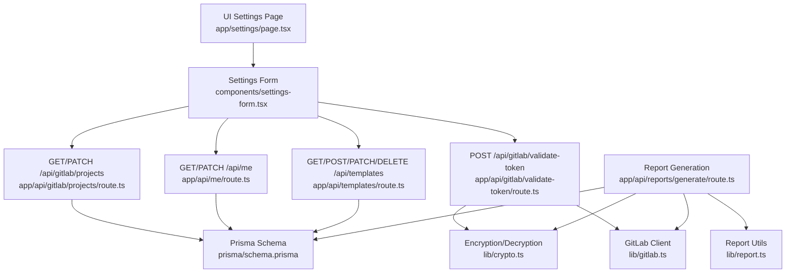
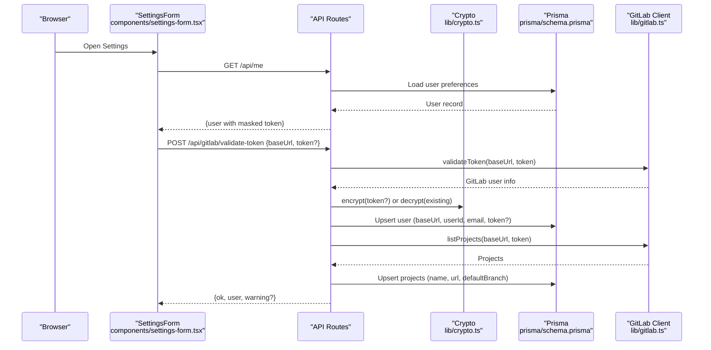
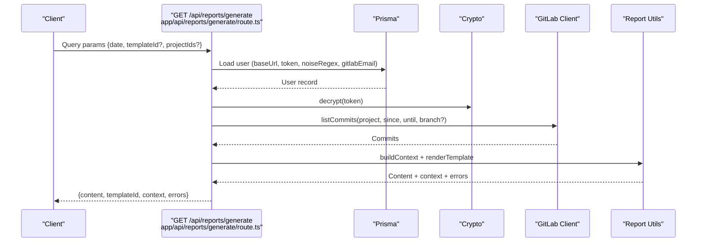
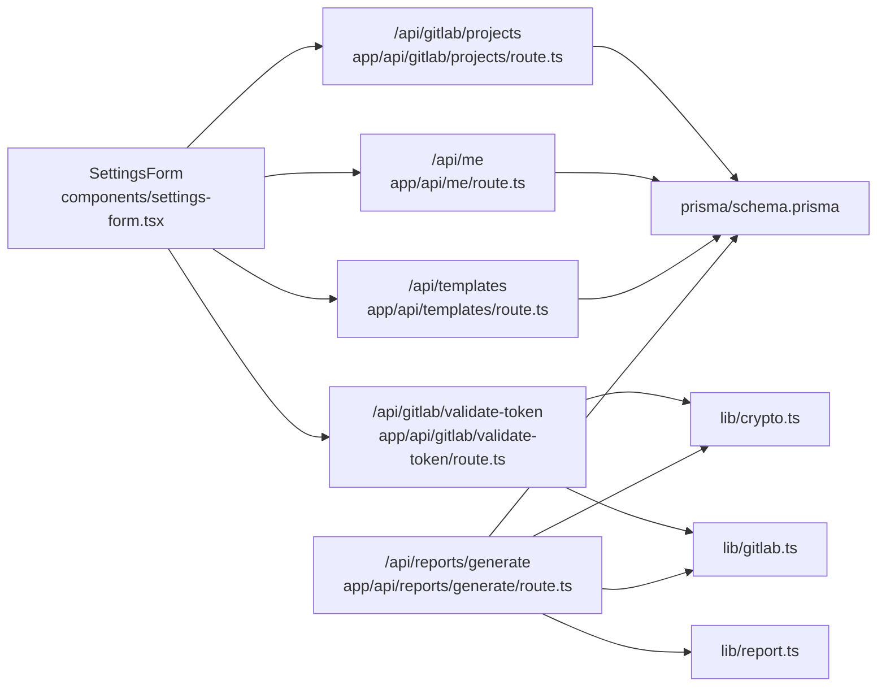

# Settings and Configuration

<cite>
**Referenced Files in This Document**
- [README.md](file://README.md)
- [package.json](file://package.json)
- [app/settings/page.tsx](file://app/settings/page.tsx)
- [components/settings-form.tsx](file://components/settings-form.tsx)
- [lib/crypto.ts](file://lib/crypto.ts)
- [lib/gitlab.ts](file://lib/gitlab.ts)
- [lib/report.ts](file://lib/report.ts)
- [lib/session.ts](file://lib/session.ts)
- [lib/prisma.ts](file://lib/prisma.ts)
- [prisma/schema.prisma](file://prisma/schema.prisma)
- [app/api/me/route.ts](file://app/api/me/route.ts)
- [app/api/gitlab/validate-token/route.ts](file://app/api/gitlab/validate-token/route.ts)
- [app/api/gitlab/projects/route.ts](file://app/api/gitlab/projects/route.ts)
- [app/api/templates/route.ts](file://app/api/templates/route.ts)
- [app/api/reports/generate/route.ts](file://app/api/reports/generate/route.ts)
</cite>

## Table of Contents
1. [Introduction](#introduction)
2. [Project Structure](#project-structure)
3. [Core Components](#core-components)
4. [Architecture Overview](#architecture-overview)
5. [Detailed Component Analysis](#detailed-component-analysis)
6. [Dependency Analysis](#dependency-analysis)
7. [Performance Considerations](#performance-considerations)
8. [Troubleshooting Guide](#troubleshooting-guide)
9. [Conclusion](#conclusion)
10. [Appendices](#appendices)

## Introduction
This document explains Pingyun Report’s settings and configuration system. It covers user preferences, GitLab configuration (base URL and personal access token), project-specific settings, encryption of sensitive tokens, template management, system-wide configuration and environment variables, noise regex for commit filtering, branch-specific project settings, configuration validation, backup and migration strategies, and common configuration scenarios with troubleshooting guidance.

## Project Structure
The settings and configuration system spans the UI, API routes, encryption utilities, GitLab client, report builder, and database schema. The UI exposes a settings page and form for managing preferences and GitLab connectivity. Server-side API routes validate and persist settings, while the encryption utility protects sensitive tokens. The report generator consumes user preferences and project settings to produce daily reports.

**Diagram sources**
- [app/settings/page.tsx:1-21](file://app/settings/page.tsx#L1-L21)
- [components/settings-form.tsx:1-368](file://components/settings-form.tsx#L1-L368)
- [app/api/me/route.ts:1-67](file://app/api/me/route.ts#L1-L67)
- [app/api/gitlab/validate-token/route.ts:1-81](file://app/api/gitlab/validate-token/route.ts#L1-L81)
- [app/api/gitlab/projects/route.ts:1-42](file://app/api/gitlab/projects/route.ts#L1-L42)
- [app/api/templates/route.ts:1-96](file://app/api/templates/route.ts#L1-L96)
- [lib/crypto.ts:1-46](file://lib/crypto.ts#L1-L46)
- [lib/gitlab.ts:1-149](file://lib/gitlab.ts#L1-L149)
- [lib/report.ts:1-159](file://lib/report.ts#L1-L159)
- [prisma/schema.prisma:1-80](file://prisma/schema.prisma#L1-L80)

**Section sources**
- [README.md:1-86](file://README.md#L1-L86)
- [package.json:1-47](file://package.json#L1-L47)

## Core Components
- Settings UI: Presents GitLab connection, noise regex, project toggles and branches, and template management.
- API routes: Persist and retrieve user preferences, validate GitLab tokens, manage projects, and manage templates.
- Encryption: AES-256-GCM encryption/decryption for GitLab tokens at rest.
- GitLab client: Server-side REST client to validate tokens and list projects/commits.
- Report utilities: Commit filtering, deduplication, conventional commit parsing, and template rendering.
- Database schema: Stores user preferences, project settings, and templates.

**Section sources**
- [components/settings-form.tsx:1-368](file://components/settings-form.tsx#L1-L368)
- [app/api/me/route.ts:1-67](file://app/api/me/route.ts#L1-L67)
- [app/api/gitlab/validate-token/route.ts:1-81](file://app/api/gitlab/validate-token/route.ts#L1-L81)
- [app/api/gitlab/projects/route.ts:1-42](file://app/api/gitlab/projects/route.ts#L1-L42)
- [app/api/templates/route.ts:1-96](file://app/api/templates/route.ts#L1-L96)
- [lib/crypto.ts:1-46](file://lib/crypto.ts#L1-L46)
- [lib/gitlab.ts:1-149](file://lib/gitlab.ts#L1-L149)
- [lib/report.ts:1-159](file://lib/report.ts#L1-L159)
- [prisma/schema.prisma:1-80](file://prisma/schema.prisma#L1-L80)

## Architecture Overview
The settings system is a client-server architecture:
- Client: React UI fetches and updates settings via API endpoints.
- Server: Route handlers enforce authentication, validate inputs, call encryption utilities, and interact with the database and GitLab API.
- Data protection: Tokens are encrypted before storage and never returned to the client; only a masked preview is shown.

**Diagram sources**
- [components/settings-form.tsx:44-88](file://components/settings-form.tsx#L44-L88)
- [app/api/me/route.ts:7-47](file://app/api/me/route.ts#L7-L47)
- [app/api/gitlab/validate-token/route.ts:13-80](file://app/api/gitlab/validate-token/route.ts#L13-L80)
- [lib/crypto.ts:18-38](file://lib/crypto.ts#L18-L38)
- [lib/gitlab.ts:87-111](file://lib/gitlab.ts#L87-L111)
- [prisma/schema.prisma:16-33](file://prisma/schema.prisma#L16-L33)

## Detailed Component Analysis

### User Preferences Management
- Retrieves current user preferences and masked token preview.
- Allows updating noise regex and display name.
- The masked token preview is computed by decrypting the stored token and applying a masking function.

Key behaviors:
- GET /api/me returns user fields including gitlabBaseUrl, gitlabEmail, noiseRegex, and a tokenMask derived from the decrypted token.
- PATCH /api/me accepts noiseRegex and/or displayName updates.

Security:
- Raw tokens are never returned to the client; only a masked preview is shown.

**Section sources**
- [app/api/me/route.ts:7-47](file://app/api/me/route.ts#L7-L47)
- [lib/crypto.ts:40-46](file://lib/crypto.ts#L40-L46)
- [components/settings-form.tsx:44-107](file://components/settings-form.tsx#L44-L107)

### GitLab Configuration: Base URL and Token
- Base URL: Required for all GitLab API calls.
- Personal Access Token (PAT): Optional for saving but validated if present; if absent, the existing encrypted token is reused for validation.
- Validation flow:
  - Validates token against GitLab user endpoint.
  - Persists gitlabBaseUrl, gitlabUserId, gitlabEmail, and optionally encrypts/updates the token.
  - Attempts to refresh project list cache by upserting projects.

Branch-specific project settings:
- After successful validation, the system upserts projects with defaultBranch and enabled flags, enabling per-project branch selection.

**Section sources**
- [app/api/gitlab/validate-token/route.ts:13-80](file://app/api/gitlab/validate-token/route.ts#L13-L80)
- [lib/gitlab.ts:82-111](file://lib/gitlab.ts#L82-L111)
- [lib/crypto.ts:18-38](file://lib/crypto.ts#L18-L38)
- [prisma/schema.prisma:16-49](file://prisma/schema.prisma#L16-L49)

### Project-Specific Settings
- Listing projects: GET /api/gitlab/projects returns user’s projects ordered by enabled status and namespace.
- Updating project settings:
  - Toggle enabled flag.
  - Set default branch per project (null resets to default branch).
- Branch selection is respected during report generation.

**Section sources**
- [app/api/gitlab/projects/route.ts:6-42](file://app/api/gitlab/projects/route.ts#L6-L42)
- [app/api/reports/generate/route.ts:57-85](file://app/api/reports/generate/route.ts#L57-L85)
- [prisma/schema.prisma:35-49](file://prisma/schema.prisma#L35-L49)

### Noise Regex Configuration for Commit Filtering
- Stored in user preferences (noiseRegex).
- Applied during report generation to filter commits by title using a case-insensitive regular expression.
- Merge commits are dropped by default unless overridden.

**Section sources**
- [lib/report.ts:52-75](file://lib/report.ts#L52-L75)
- [app/api/reports/generate/route.ts:108-117](file://app/api/reports/generate/route.ts#L108-L117)

### Template Management
- Default template: Created automatically if none exists; renders a basic daily report.
- Operations:
  - GET: Lists templates, ensuring at least one default exists.
  - POST: Creates a new template; setting isDefault clears existing defaults.
  - PATCH: Updates name/body/isDefault; setting isDefault clears existing defaults.
  - DELETE: Removes a template by id.
- Report generation selects either a provided templateId or the user’s default template.

**Section sources**
- [app/api/templates/route.ts:7-96](file://app/api/templates/route.ts#L7-L96)
- [lib/report.ts:146-159](file://lib/report.ts#L146-L159)
- [app/api/reports/generate/route.ts:87-106](file://app/api/reports/generate/route.ts#L87-L106)

### Encryption System for Sensitive Tokens (AES-256-GCM)
- Encryption key is required as a 64-character hex string (32 bytes) via ENCRYPTION_KEY environment variable.
- encrypt(): Generates a random 12-byte IV, encrypts with GCM, appends tag, and returns base64-encoded payload.
- decrypt(): Parses base64 payload, splits into IV, tag, and ciphertext, then decrypts and verifies authenticity.
- maskToken(): Produces a safe display preview like “glpat-xxxx...yzzw”.

Security implications:
- Tokens are stored encrypted at rest.
- Rotation requires re-encrypting existing tokens; otherwise users must re-enter PATs.

**Section sources**
- [lib/crypto.ts:1-46](file://lib/crypto.ts#L1-L46)
- [README.md:65-71](file://README.md#L65-L71)
- [prisma/schema.prisma:22-23](file://prisma/schema.prisma#L22-L23)

### Report Generation Pipeline Using Settings

**Diagram sources**
- [app/api/reports/generate/route.ts:23-132](file://app/api/reports/generate/route.ts#L23-L132)
- [lib/crypto.ts:28-38](file://lib/crypto.ts#L28-L38)
- [lib/gitlab.ts:120-148](file://lib/gitlab.ts#L120-L148)
- [lib/report.ts:115-144](file://lib/report.ts#L115-L144)

## Dependency Analysis
- UI depends on API routes for fetching and persisting settings.
- API routes depend on:
  - Authentication utilities for session checks.
  - Encryption utilities for secure token handling.
  - GitLab client for server-side API calls.
  - Prisma client for database operations.
- Report generation composes settings, GitLab data, and template rendering.

**Diagram sources**
- [components/settings-form.tsx:1-368](file://components/settings-form.tsx#L1-L368)
- [app/api/me/route.ts:1-67](file://app/api/me/route.ts#L1-L67)
- [app/api/gitlab/validate-token/route.ts:1-81](file://app/api/gitlab/validate-token/route.ts#L1-L81)
- [app/api/gitlab/projects/route.ts:1-42](file://app/api/gitlab/projects/route.ts#L1-L42)
- [app/api/templates/route.ts:1-96](file://app/api/templates/route.ts#L1-L96)
- [app/api/reports/generate/route.ts:1-133](file://app/api/reports/generate/route.ts#L1-L133)
- [lib/crypto.ts:1-46](file://lib/crypto.ts#L1-L46)
- [lib/gitlab.ts:1-149](file://lib/gitlab.ts#L1-L149)
- [lib/report.ts:1-159](file://lib/report.ts#L1-L159)
- [prisma/schema.prisma:1-80](file://prisma/schema.prisma#L1-L80)

**Section sources**
- [lib/session.ts:1-56](file://lib/session.ts#L1-L56)
- [lib/prisma.ts:1-14](file://lib/prisma.ts#L1-L14)

## Performance Considerations
- Pagination and limits: GitLab client paginates with per_page caps and safety caps to avoid excessive requests.
- Caching: Project lists are upserted after token validation to reduce repeated GitLab calls.
- Filtering: Commit filtering and deduplication occur server-side before rendering to minimize client workload.

**Section sources**
- [lib/gitlab.ts:91-111](file://lib/gitlab.ts#L91-L111)
- [app/api/gitlab/validate-token/route.ts:40-67](file://app/api/gitlab/validate-token/route.ts#L40-L67)
- [lib/report.ts:52-88](file://lib/report.ts#L52-L88)

## Troubleshooting Guide
Common issues and resolutions:
- Unauthorized or forbidden: Ensure a valid session; server-side wrappers convert errors to JSON responses.
  - See [lib/session.ts:22-55](file://lib/session.ts#L22-L55)
- Missing GitLab base URL or token: Report generation requires both; configure via Settings.
  - See [app/api/reports/generate/route.ts:36-43](file://app/api/reports/generate/route.ts#L36-L43)
- Invalid or expired PAT: Re-enter token in Settings; validation will fail if invalid.
  - See [app/api/gitlab/validate-token/route.ts:13-39](file://app/api/gitlab/validate-token/route.ts#L13-L39)
- Token rotation: Rotating ENCRYPTION_KEY requires re-encrypting existing tokens; users must re-enter PATs.
  - See [README.md:65-71](file://README.md#L65-L71)
- Project list not loading: Validation may succeed but project list load fails; check GitLab connectivity and permissions.
  - See [app/api/gitlab/validate-token/route.ts:68-74](file://app/api/gitlab/validate-token/route.ts#L68-L74)
- Template rendering errors: Fallback content is returned; inspect template syntax.
  - See [lib/report.ts:137-144](file://lib/report.ts#L137-L144)

**Section sources**
- [lib/session.ts:22-55](file://lib/session.ts#L22-L55)
- [app/api/reports/generate/route.ts:36-43](file://app/api/reports/generate/route.ts#L36-L43)
- [app/api/gitlab/validate-token/route.ts:13-39](file://app/api/gitlab/validate-token/route.ts#L13-L39)
- [README.md:65-71](file://README.md#L65-L71)
- [lib/report.ts:137-144](file://lib/report.ts#L137-L144)

## Conclusion
Pingyun Report’s settings and configuration system provides a secure, user-friendly way to manage GitLab connectivity, project selection, commit filtering, and templates. Sensitive tokens are protected with AES-256-GCM encryption, and all GitLab API calls are performed server-side. The system supports branch-specific project settings and flexible template customization, with robust validation and error handling.

## Appendices

### System-wide Configuration Options and Environment Variables
- DATABASE_URL: MySQL connection string for Prisma.
- NEXTAUTH_URL: External URL of the application for NextAuth.
- NEXTAUTH_SECRET: Secret for NextAuth sessions.
- ENCRYPTION_KEY: 64-character hex string for AES-256-GCM encryption of tokens.
- LLM_API_BASE / LLM_API_KEY / LLM_MODEL: Optional for AI polish.
- ADMIN_USERNAME / ADMIN_PASSWORD / ADMIN_DISPLAY_NAME: Seed-only initial admin credentials.

Security notes:
- Tokens are encrypted at rest; rotate ENCRYPTION_KEY carefully and re-encrypt tokens.
- GitLab API calls are server-side; tokens never leave the server.

**Section sources**
- [README.md:54-71](file://README.md#L54-L71)
- [lib/crypto.ts:7-15](file://lib/crypto.ts#L7-L15)

### Configuration Validation and Backup Procedures
- Validation:
  - Base URL must be a valid URL.
  - Token length minimum is enforced when provided.
  - Token is validated via GitLab user endpoint.
- Backup:
  - Back up the MySQL database regularly.
  - Preserve ENCRYPTION_KEY; losing it prevents decryption of stored tokens.
- Migration strategies:
  - Apply Prisma migrations to update schema.
  - For encryption key rotation, re-encrypt stored tokens and update all users’ PATs.

**Section sources**
- [app/api/gitlab/validate-token/route.ts:8-11](file://app/api/gitlab/validate-token/route.ts#L8-L11)
- [app/api/me/route.ts:49-52](file://app/api/me/route.ts#L49-L52)
- [README.md:65-71](file://README.md#L65-L71)
- [lib/crypto.ts:7-15](file://lib/crypto.ts#L7-L15)

### Common Configuration Scenarios
- First-time setup:
  - Navigate to Settings, enter GitLab base URL and PAT, click Save and Validate.
  - Enable desired projects and set default branches.
  - Adjust noise regex to filter unwanted commits.
  - Create or customize templates.
  - Reference: [README.md:27-33](file://README.md#L27-L33)
- Daily usage:
  - Open the home page to auto-generate a report for the current day.
  - Edit markdown and save to persist.
  - Reference: [README.md:34-39](file://README.md#L34-L39)

**Section sources**
- [README.md:27-39](file://README.md#L27-L39)