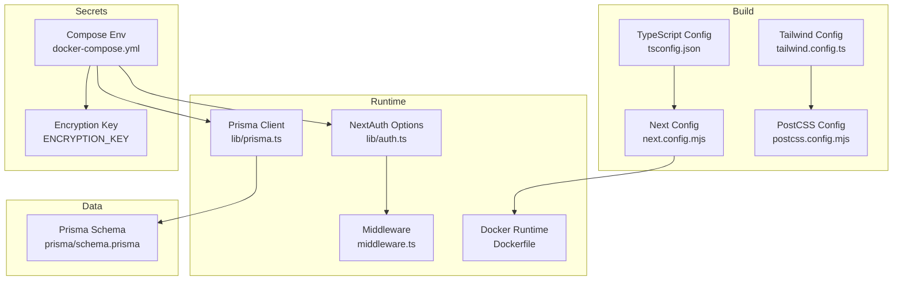
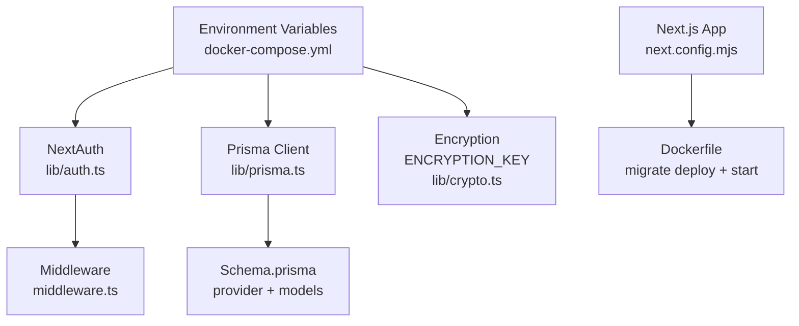
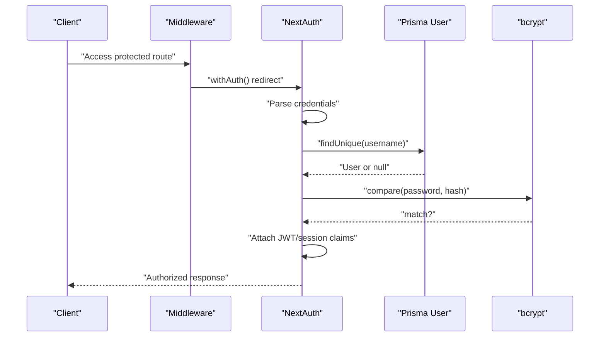
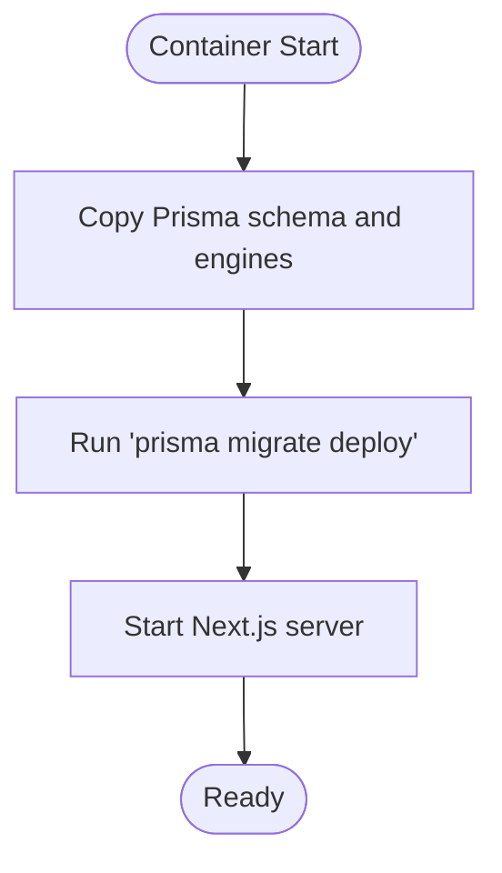
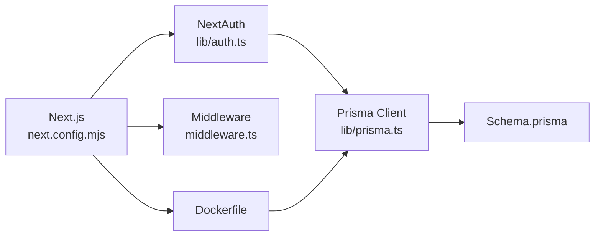

# System Configuration

<cite>
**Referenced Files in This Document**
- [package.json](file://package.json)
- [next.config.mjs](file://next.config.mjs)
- [Dockerfile](file://Dockerfile)
- [docker-compose.yml](file://docker-compose.yml)
- [middleware.ts](file://middleware.ts)
- [lib/prisma.ts](file://lib/prisma.ts)
- [prisma/schema.prisma](file://prisma/schema.prisma)
- [lib/auth.ts](file://lib/auth.ts)
- [app/providers.tsx](file://app/providers.tsx)
- [lib/crypto.ts](file://lib/crypto.ts)
- [lib/gitlab.ts](file://lib/gitlab.ts)
- [tailwind.config.ts](file://tailwind.config.ts)
- [postcss.config.mjs](file://postcss.config.mjs)
- [tsconfig.json](file://tsconfig.json)
</cite>

## Table of Contents
1. [Introduction](#introduction)
2. [Project Structure](#project-structure)
3. [Core Components](#core-components)
4. [Architecture Overview](#architecture-overview)
5. [Detailed Component Analysis](#detailed-component-analysis)
6. [Dependency Analysis](#dependency-analysis)
7. [Performance Considerations](#performance-considerations)
8. [Troubleshooting Guide](#troubleshooting-guide)
9. [Conclusion](#conclusion)
10. [Appendices](#appendices)

## Introduction
This document describes the system-wide configuration for Pingyun Report. It covers environment variables, database connectivity, authentication provider setup, middleware and routing protection, encryption configuration, Prisma schema and migrations, Next.js build and runtime configuration, production deployment via Docker, and operational best practices for validation and environment-specific overrides.

## Project Structure
Key configuration areas and their locations:
- Environment variables and secrets are supplied via Docker Compose and consumed by the app and Prisma.
- Next.js runtime and build-time configuration is centralized in next.config.mjs.
- Authentication is configured with NextAuth and JWT sessions.
- Database client initialization and Prisma schema define data model and datasource.
- Middleware enforces protected routes.
- Encryption relies on a dedicated environment variable for AES-256-GCM.
- Tailwind and PostCSS are configured for styling.
- TypeScript compiler options are defined in tsconfig.json.

**Diagram sources**
- [middleware.ts:1-10](file://middleware.ts#L1-L10)
- [lib/auth.ts:30-77](file://lib/auth.ts#L30-L77)
- [lib/prisma.ts:1-14](file://lib/prisma.ts#L1-L14)
- [Dockerfile:1-44](file://Dockerfile#L1-L44)
- [next.config.mjs:1-11](file://next.config.mjs#L1-L11)
- [tsconfig.json:1-25](file://tsconfig.json#L1-L25)
- [tailwind.config.ts:1-24](file://tailwind.config.ts#L1-L24)
- [postcss.config.mjs:1-7](file://postcss.config.mjs#L1-L7)
- [prisma/schema.prisma:1-80](file://prisma/schema.prisma#L1-L80)
- [docker-compose.yml:1-21](file://docker-compose.yml#L1-L21)

**Section sources**
- [package.json:1-47](file://package.json#L1-L47)
- [next.config.mjs:1-11](file://next.config.mjs#L1-L11)
- [Dockerfile:1-44](file://Dockerfile#L1-L44)
- [docker-compose.yml:1-21](file://docker-compose.yml#L1-L21)
- [middleware.ts:1-10](file://middleware.ts#L1-L10)
- [lib/prisma.ts:1-14](file://lib/prisma.ts#L1-L14)
- [prisma/schema.prisma:1-80](file://prisma/schema.prisma#L1-L80)
- [lib/auth.ts:30-77](file://lib/auth.ts#L30-L77)
- [app/providers.tsx:1-8](file://app/providers.tsx#L1-L8)
- [lib/crypto.ts:1-46](file://lib/crypto.ts#L1-L46)
- [tailwind.config.ts:1-24](file://tailwind.config.ts#L1-L24)
- [postcss.config.mjs:1-7](file://postcss.config.mjs#L1-L7)
- [tsconfig.json:1-25](file://tsconfig.json#L1-L25)

## Core Components
- Environment variables and secrets
  - Required: DATABASE_URL, NEXTAUTH_URL, NEXTAUTH_SECRET, ENCRYPTION_KEY
  - Optional defaults: LLM_API_BASE, LLM_API_KEY, LLM_MODEL, ADMIN_USERNAME, ADMIN_PASSWORD, ADMIN_DISPLAY_NAME
  - These are passed from docker-compose.yml to the container and consumed by the app and Prisma.
- Database connection
  - Datasource provider is MySQL; URL is sourced from DATABASE_URL.
  - Prisma client logs are adjusted based on NODE_ENV.
- Authentication provider
  - NextAuth with JWT strategy and credentials provider.
  - Password verification uses bcrypt against stored hashes.
- Middleware and routing protection
  - Protected routes enforced via next-auth/middleware with redirect to login.
- Encryption
  - AES-256-GCM encryption/decryption using ENCRYPTION_KEY.
- Prisma schema and migrations
  - Models: User, Project, Report, Template with relations and indexes.
  - Migrations executed at container startup via Prisma CLI in Dockerfile.
- Next.js configuration
  - Standalone output, strict mode, and selective external packages for server components.
- Build pipeline
  - Scripts orchestrate Prisma client generation and Next build.
- Styling and tooling
  - Tailwind and PostCSS configured; TypeScript strictness and module resolution set.

**Section sources**
- [docker-compose.yml:10-21](file://docker-compose.yml#L10-L21)
- [prisma/schema.prisma:6-9](file://prisma/schema.prisma#L6-L9)
- [lib/prisma.ts:10-11](file://lib/prisma.ts#L10-L11)
- [lib/auth.ts:30-77](file://lib/auth.ts#L30-L77)
- [middleware.ts:3-9](file://middleware.ts#L3-L9)
- [lib/crypto.ts:7-15](file://lib/crypto.ts#L7-L15)
- [prisma/schema.prisma:16-79](file://prisma/schema.prisma#L16-L79)
- [Dockerfile:43-44](file://Dockerfile#L43-L44)
- [next.config.mjs:3-7](file://next.config.mjs#L3-L7)
- [package.json:5-14](file://package.json#L5-L14)
- [tailwind.config.ts:1-24](file://tailwind.config.ts#L1-L24)
- [postcss.config.mjs:1-7](file://postcss.config.mjs#L1-L7)
- [tsconfig.json:2-24](file://tsconfig.json#L2-L24)

## Architecture Overview
The configuration architecture ties together environment-driven settings, Next.js runtime, authentication, database access, and secure encryption.

**Diagram sources**
- [docker-compose.yml:10-21](file://docker-compose.yml#L10-L21)
- [next.config.mjs:1-11](file://next.config.mjs#L1-L11)
- [lib/auth.ts:30-77](file://lib/auth.ts#L30-L77)
- [middleware.ts:1-10](file://middleware.ts#L1-L10)
- [lib/prisma.ts:1-14](file://lib/prisma.ts#L1-L14)
- [prisma/schema.prisma:1-80](file://prisma/schema.prisma#L1-L80)
- [lib/crypto.ts:1-46](file://lib/crypto.ts#L1-L46)
- [Dockerfile:43-44](file://Dockerfile#L43-L44)

## Detailed Component Analysis

### Environment Variable Configuration
- Required
  - DATABASE_URL: Prisma datasource URL for MySQL.
  - NEXTAUTH_URL: Base URL for NextAuth (including scheme and host).
  - NEXTAUTH_SECRET: Secret for signing NextAuth JWTs.
  - ENCRYPTION_KEY: 64-character hex string for AES-256-GCM.
- Optional with defaults
  - LLM_API_BASE, LLM_API_KEY, LLM_MODEL: AI service configuration.
  - ADMIN_USERNAME, ADMIN_PASSWORD, ADMIN_DISPLAY_NAME: Seed defaults.
- Consumption
  - Prisma reads DATABASE_URL from the environment.
  - NextAuth reads NEXTAUTH_URL and NEXTAUTH_SECRET.
  - Encryption module reads ENCRYPTION_KEY.

Validation and overrides
- ENCRYPTION_KEY length and format are validated at runtime.
- Defaults are provided in docker-compose.yml for optional variables.

**Section sources**
- [docker-compose.yml:10-21](file://docker-compose.yml#L10-L21)
- [prisma/schema.prisma:8](file://prisma/schema.prisma#L8)
- [lib/crypto.ts:7-15](file://lib/crypto.ts#L7-L15)

### Database Connection Settings
- Provider: MySQL.
- URL sourcing: env("DATABASE_URL").
- Client logging: reduced in production, increased in development.

Operational notes
- Ensure DATABASE_URL points to a reachable MySQL instance.
- In production, migrations are applied at container startup via Prisma CLI.

**Section sources**
- [prisma/schema.prisma:6-9](file://prisma/schema.prisma#L6-L9)
- [lib/prisma.ts:10-11](file://lib/prisma.ts#L10-L11)
- [Dockerfile:43](file://Dockerfile#L43)

### Authentication Provider Setup
- Strategy: JWT.
- Provider: Credentials with username/password.
- Authorization flow:
  - Lookup user by username.
  - Compare bcrypt-hashed password.
  - Attach id, username, role to JWT and session.
- Session wrapper: app/providers.tsx wraps the app tree with SessionProvider.

**Diagram sources**
- [middleware.ts:3-9](file://middleware.ts#L3-L9)
- [lib/auth.ts:30-77](file://lib/auth.ts#L30-L77)
- [lib/prisma.ts:1-14](file://lib/prisma.ts#L1-L14)
- [app/providers.tsx:5-7](file://app/providers.tsx#L5-L7)

**Section sources**
- [lib/auth.ts:30-77](file://lib/auth.ts#L30-L77)
- [app/providers.tsx:1-8](file://app/providers.tsx#L1-L8)
- [middleware.ts:1-10](file://middleware.ts#L1-L10)

### Middleware Configuration and Route Protection
- Protects home and admin/history/settings routes.
- Redirects unauthenticated users to /login.

Best practices
- Keep matchers minimal and explicit.
- Centralize redirect target in one place.

**Section sources**
- [middleware.ts:7-9](file://middleware.ts#L7-L9)

### Security Headers and CORS
- No explicit custom security headers or CORS configuration is present in the analyzed files.
- Consider adding security headers and CORS policies at the reverse proxy or Next.js middleware level if needed.

[No sources needed since this section does not analyze specific files]

### Prisma Configuration, Schema, and Migration Strategies
- Client generator and MySQL datasource.
- Models: User, Project, Report, Template with relations and indexes.
- Migrations:
  - Generated during build.
  - Applied at container startup via Prisma CLI command in Dockerfile.

**Diagram sources**
- [Dockerfile:32-44](file://Dockerfile#L32-L44)
- [prisma/schema.prisma:1-80](file://prisma/schema.prisma#L1-L80)

**Section sources**
- [prisma/schema.prisma:1-80](file://prisma/schema.prisma#L1-L80)
- [Dockerfile:18-19](file://Dockerfile#L18-L19)
- [Dockerfile:43](file://Dockerfile#L43)

### Next.js Configuration: Build and Runtime
- Standalone output for containerized deployments.
- Strict mode enabled.
- Experimental externalization for selected packages.
- Telemetry disabled in Docker build and runtime.

Build scripts
- Prisma client generation precedes Next build.
- Additional commands for migration and studio.

**Section sources**
- [next.config.mjs:3-7](file://next.config.mjs#L3-L7)
- [package.json:5-14](file://package.json#L5-L14)
- [Dockerfile:17-24](file://Dockerfile#L17-L24)

### Production Deployment Configuration
- Multi-stage Docker build with Prisma client and engines copied for runtime.
- Non-root user and fixed port.
- Environment variables injected via docker-compose.yml.

**Section sources**
- [Dockerfile:1-44](file://Dockerfile#L1-L44)
- [docker-compose.yml:1-21](file://docker-compose.yml#L1-L21)

### Monitoring and Logging
- No explicit monitoring or logging configuration is present in the analyzed files.
- Consider integrating structured logging and health checks at the reverse proxy or platform level.

[No sources needed since this section does not analyze specific files]

### Configuration Validation and Overrides
- ENCRYPTION_KEY validation ensures a 64-character hex string.
- docker-compose.yml provides defaults for optional variables.
- Prisma logs adjust by NODE_ENV.

**Section sources**
- [lib/crypto.ts:7-15](file://lib/crypto.ts#L7-L15)
- [docker-compose.yml:15-20](file://docker-compose.yml#L15-L20)
- [lib/prisma.ts:10-11](file://lib/prisma.ts#L10-L11)

### Configuration Management Best Practices
- Centralize environment variables in docker-compose.yml.
- Use strong, randomly generated secrets for NEXTAUTH_SECRET and ENCRYPTION_KEY.
- Keep Prisma migrations under version control and apply via CI/CD.
- Prefer immutable images and non-root containers.
- Validate environment variables at startup in production.

[No sources needed since this section provides general guidance]

## Dependency Analysis
- Next.js depends on NextAuth for authentication and middleware for route protection.
- Prisma client depends on the Prisma schema and environment-provided datasource URL.
- Encryption depends on ENCRYPTION_KEY.
- Docker orchestrates build, migration, and runtime.

**Diagram sources**
- [next.config.mjs:1-11](file://next.config.mjs#L1-L11)
- [lib/auth.ts:30-77](file://lib/auth.ts#L30-L77)
- [lib/prisma.ts:1-14](file://lib/prisma.ts#L1-L14)
- [prisma/schema.prisma:1-80](file://prisma/schema.prisma#L1-L80)
- [middleware.ts:1-10](file://middleware.ts#L1-L10)
- [Dockerfile:1-44](file://Dockerfile#L1-L44)

**Section sources**
- [next.config.mjs:1-11](file://next.config.mjs#L1-L11)
- [lib/auth.ts:30-77](file://lib/auth.ts#L30-L77)
- [lib/prisma.ts:1-14](file://lib/prisma.ts#L1-L14)
- [prisma/schema.prisma:1-80](file://prisma/schema.prisma#L1-L80)
- [middleware.ts:1-10](file://middleware.ts#L1-L10)
- [Dockerfile:1-44](file://Dockerfile#L1-L44)

## Performance Considerations
- Use standalone output for efficient container deployments.
- Keep Prisma client logs minimal in production.
- Avoid unnecessary middleware overhead; keep matchers precise.
- Ensure database indexes align with query patterns (as defined in schema).

[No sources needed since this section provides general guidance]

## Troubleshooting Guide
Common issues and resolutions:
- Authentication failures
  - Verify NEXTAUTH_URL and NEXTAUTH_SECRET are set and correct.
  - Confirm user exists and password matches bcrypt hash.
- Database connectivity
  - Ensure DATABASE_URL is reachable and schema is migrated.
  - Check Prisma client logs in development for SQL errors.
- Encryption errors
  - ENCRYPTION_KEY must be a 64-character hex string; regenerate if invalid.
- Middleware redirect loops
  - Ensure login route exists and is accessible.
- Docker startup migration failures
  - Confirm Prisma schema and engines are copied into the runtime stage.

**Section sources**
- [lib/auth.ts:40-56](file://lib/auth.ts#L40-L56)
- [lib/crypto.ts:7-15](file://lib/crypto.ts#L7-L15)
- [middleware.ts:3-5](file://middleware.ts#L3-L5)
- [Dockerfile:32-44](file://Dockerfile#L32-L44)

## Conclusion
Pingyun Report’s configuration is environment-driven, container-first, and centered on secure authentication, robust database access via Prisma, and a streamlined Next.js build. By adhering to the environment variable contracts, applying Prisma migrations at startup, and maintaining strict encryption and middleware protections, the system achieves reliable operation across environments.

## Appendices
- Tooling configuration
  - Tailwind and PostCSS are configured for styling.
  - TypeScript strict mode and modern module resolution are enabled.

**Section sources**
- [tailwind.config.ts:1-24](file://tailwind.config.ts#L1-L24)
- [postcss.config.mjs:1-7](file://postcss.config.mjs#L1-L7)
- [tsconfig.json:2-24](file://tsconfig.json#L2-L24)