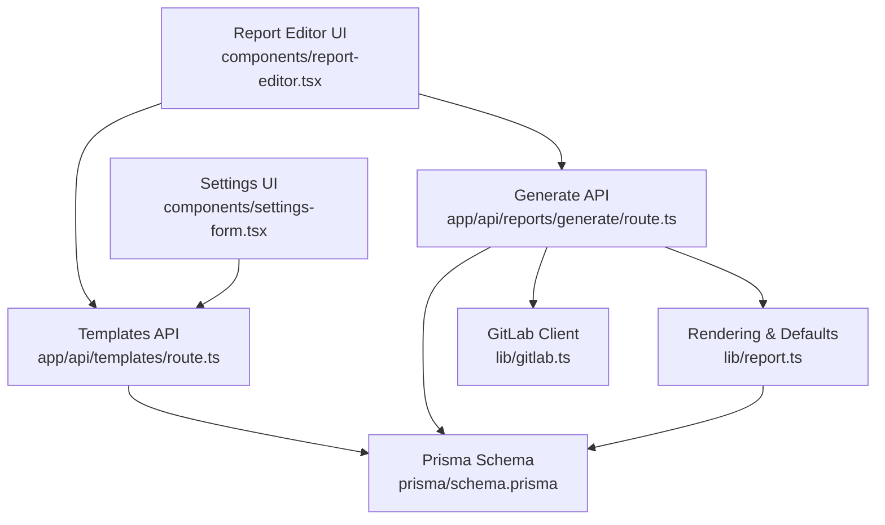
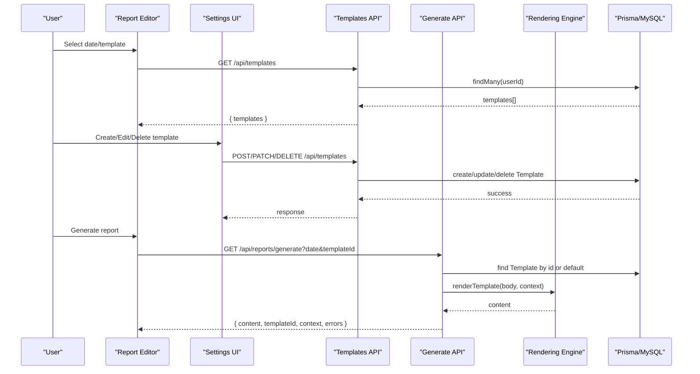
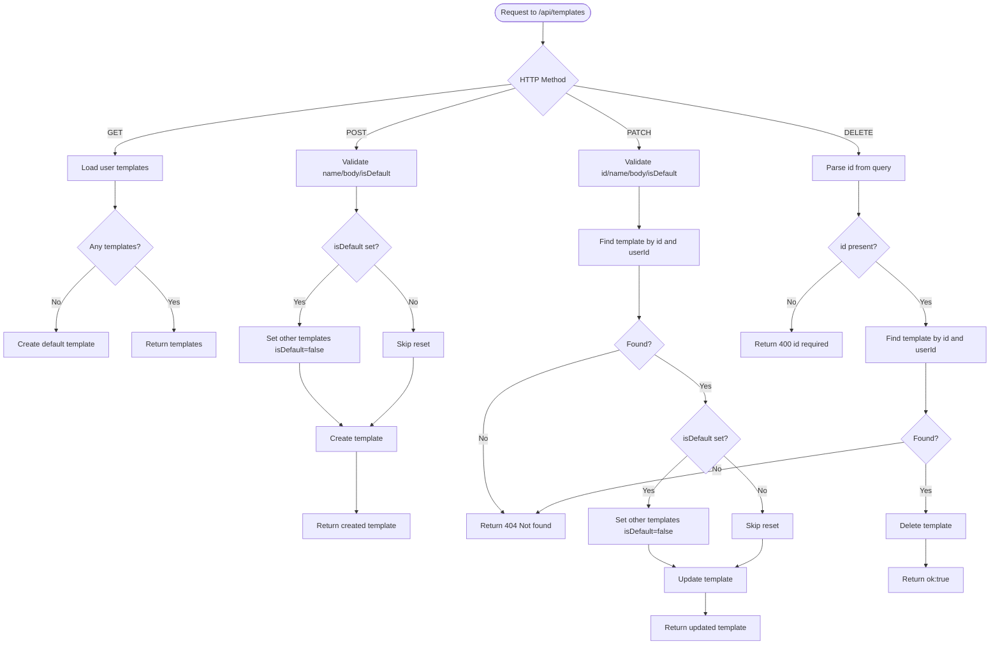
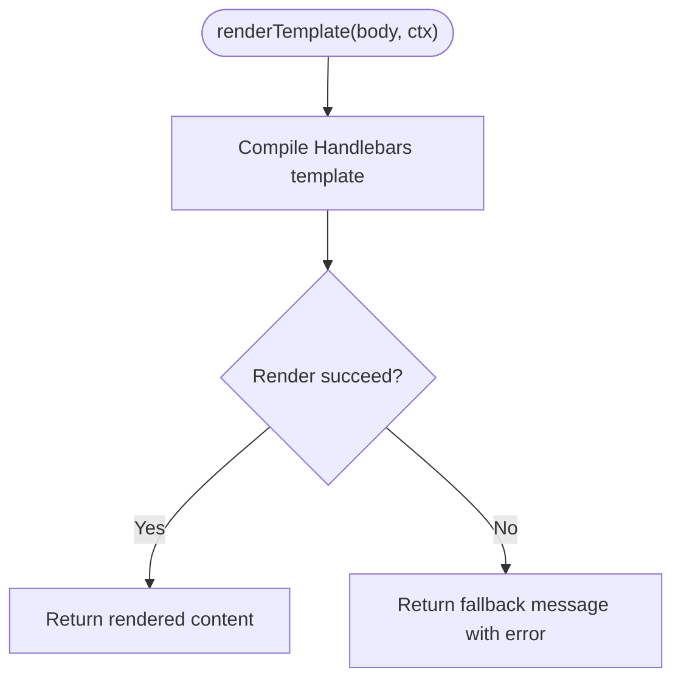
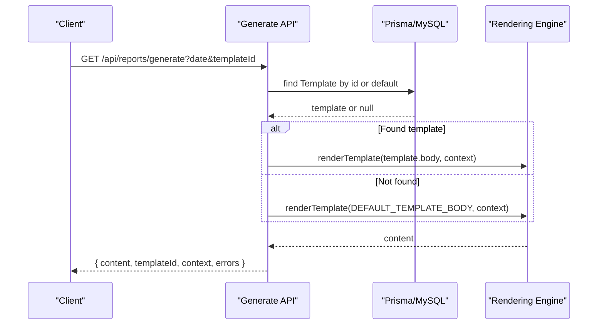
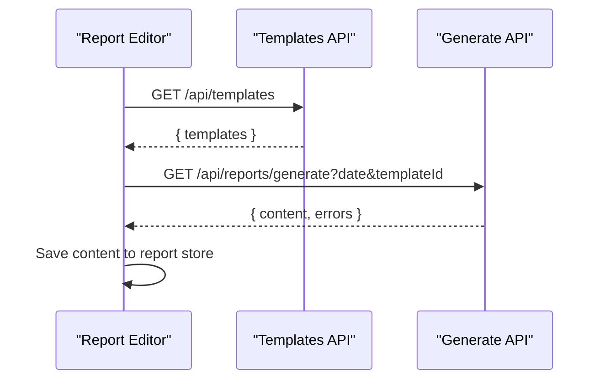
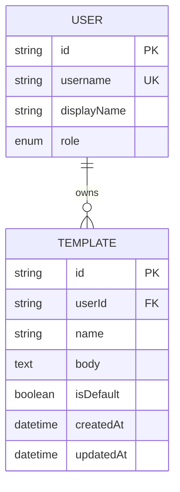
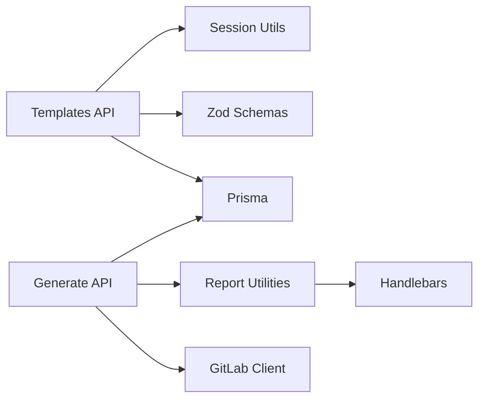

# Template Management

<cite>
**Referenced Files in This Document**
- [app/api/templates/route.ts](file://app/api/templates/route.ts)
- [lib/report.ts](file://lib/report.ts)
- [components/report-editor.tsx](file://components/report-editor.tsx)
- [components/settings-form.tsx](file://components/settings-form.tsx)
- [app/api/reports/generate/route.ts](file://app/api/reports/generate/route.ts)
- [lib/gitlab.ts](file://lib/gitlab.ts)
- [lib/crypto.ts](file://lib/crypto.ts)
- [prisma/schema.prisma](file://prisma/schema.prisma)
- [README.md](file://README.md)
</cite>

## Table of Contents
1. [Introduction](#introduction)
2. [Project Structure](#project-structure)
3. [Core Components](#core-components)
4. [Architecture Overview](#architecture-overview)
5. [Detailed Component Analysis](#detailed-component-analysis)
6. [Dependency Analysis](#dependency-analysis)
7. [Performance Considerations](#performance-considerations)
8. [Troubleshooting Guide](#troubleshooting-guide)
9. [Conclusion](#conclusion)
10. [Appendices](#appendices)

## Introduction
This document describes the template management system in Pingyun Report. It explains the default template structure, how templates are created, validated, and managed, and how the Handlebars-based rendering engine substitutes variables and supports conditional logic. It also covers template selection during report generation, user interface integration, and operational topics such as security, debugging, and best practices.

## Project Structure
The template system spans frontend UI components, backend API routes, and shared rendering utilities. Templates are persisted per user and can be selected when generating daily reports.

**Diagram sources**
- [components/report-editor.tsx:19-95](file://components/report-editor.tsx#L19-L95)
- [components/settings-form.tsx:44-55](file://components/settings-form.tsx#L44-L55)
- [app/api/templates/route.ts:7-25](file://app/api/templates/route.ts#L7-L25)
- [app/api/reports/generate/route.ts:23-132](file://app/api/reports/generate/route.ts#L23-L132)
- [lib/report.ts:137-144](file://lib/report.ts#L137-L144)
- [lib/gitlab.ts:45-80](file://lib/gitlab.ts#L45-L80)
- [prisma/schema.prisma:67-79](file://prisma/schema.prisma#L67-L79)

**Section sources**
- [README.md:72-86](file://README.md#L72-L86)
- [prisma/schema.prisma:67-79](file://prisma/schema.prisma#L67-L79)

## Core Components
- Template API: Provides CRUD operations for user templates and ensures a default template exists.
- Rendering engine: Uses Handlebars to compile and render templates with a structured context.
- Report generation pipeline: Builds a context from GitLab data and renders the selected template.
- Frontend integrations: Two UI surfaces allow selecting templates and performing CRUD operations.

Key responsibilities:
- Validation: Zod schemas enforce field constraints for create/update requests.
- Default template: On first access, a default template is provisioned automatically.
- Selection precedence: Explicit templateId parameter takes priority; otherwise the user’s default template is used.
- Error handling: Render failures are caught and surfaced as a fallback message.

**Section sources**
- [app/api/templates/route.ts:27-31](file://app/api/templates/route.ts#L27-L31)
- [app/api/templates/route.ts:13-23](file://app/api/templates/route.ts#L13-L23)
- [lib/report.ts:137-144](file://lib/report.ts#L137-L144)
- [app/api/reports/generate/route.ts:87-106](file://app/api/reports/generate/route.ts#L87-L106)

## Architecture Overview
The template lifecycle integrates UI, API, persistence, and rendering:

**Diagram sources**
- [components/report-editor.tsx:39-53](file://components/report-editor.tsx#L39-L53)
- [components/settings-form.tsx:136-185](file://components/settings-form.tsx#L136-L185)
- [app/api/templates/route.ts:7-25](file://app/api/templates/route.ts#L7-L25)
- [app/api/reports/generate/route.ts:23-132](file://app/api/reports/generate/route.ts#L23-L132)
- [lib/report.ts:137-144](file://lib/report.ts#L137-L144)

## Detailed Component Analysis

### Template API (CRUD)
- Endpoint: GET /api/templates lists templates ordered by default-first and recency.
- Behavior: If no templates exist, a default template is created automatically.
- Creation: Validates name length and body presence; optional isDefault flag resets other defaults.
- Update: Supports partial updates; setting isDefault resets other defaults.
- Deletion: Requires id query param; returns ok on success.

**Diagram sources**
- [app/api/templates/route.ts:7-95](file://app/api/templates/route.ts#L7-L95)

**Section sources**
- [app/api/templates/route.ts:7-25](file://app/api/templates/route.ts#L7-L25)
- [app/api/templates/route.ts:27-31](file://app/api/templates/route.ts#L27-L31)
- [app/api/templates/route.ts:53-58](file://app/api/templates/route.ts#L53-L58)
- [app/api/templates/route.ts:84-95](file://app/api/templates/route.ts#L84-L95)

### Rendering Engine and Context
- Template body is compiled with Handlebars and rendered against a structured context.
- Context keys include date, projects, total, and user profile.
- The renderer catches compilation/runtime errors and returns a fallback message.

**Diagram sources**
- [lib/report.ts:137-144](file://lib/report.ts#L137-L144)

**Section sources**
- [lib/report.ts:22-27](file://lib/report.ts#L22-L27)
- [lib/report.ts:137-144](file://lib/report.ts#L137-L144)
- [lib/report.ts:146-159](file://lib/report.ts#L146-L159)

### Template Selection During Generation
- The generate endpoint selects a template by:
  - Using templateId query param if provided and owned by the user.
  - Otherwise using the user’s default template.
- If neither is available, the built-in default template body is used.

**Diagram sources**
- [app/api/reports/generate/route.ts:87-106](file://app/api/reports/generate/route.ts#L87-L106)
- [lib/report.ts:146-159](file://lib/report.ts#L146-L159)

**Section sources**
- [app/api/reports/generate/route.ts:87-106](file://app/api/reports/generate/route.ts#L87-L106)

### Frontend Integration
- Report Editor:
  - Loads templates and projects on mount.
  - Allows selecting a template and regenerating content.
  - Persists generated content to the report store.
- Settings:
  - Provides UI to create, set default, edit, and delete templates.

**Diagram sources**
- [components/report-editor.tsx:39-53](file://components/report-editor.tsx#L39-L53)
- [components/report-editor.tsx:67-91](file://components/report-editor.tsx#L67-L91)

**Section sources**
- [components/report-editor.tsx:19-95](file://components/report-editor.tsx#L19-L95)
- [components/settings-form.tsx:136-185](file://components/settings-form.tsx#L136-L185)

### Data Model
Templates are stored per user with name, body, and default flag.

**Diagram sources**
- [prisma/schema.prisma:67-79](file://prisma/schema.prisma#L67-L79)

**Section sources**
- [prisma/schema.prisma:67-79](file://prisma/schema.prisma#L67-L79)

## Dependency Analysis
- Template API depends on:
  - Prisma for persistence.
  - Zod for request validation.
  - Session utilities for user enforcement.
- Rendering depends on:
  - Handlebars for template compilation and rendering.
  - Report context builder for data shaping.
- Generate API depends on:
  - GitLab client for fetching commits.
  - Template selection logic.
  - Rendering engine.

**Diagram sources**
- [app/api/templates/route.ts:1-5](file://app/api/templates/route.ts#L1-L5)
- [lib/report.ts:1-1](file://lib/report.ts#L1-L1)
- [app/api/reports/generate/route.ts:1-12](file://app/api/reports/generate/route.ts#L1-L12)
- [lib/gitlab.ts:45-80](file://lib/gitlab.ts#L45-L80)

**Section sources**
- [app/api/templates/route.ts:1-5](file://app/api/templates/route.ts#L1-L5)
- [lib/report.ts:1-1](file://lib/report.ts#L1-L1)
- [app/api/reports/generate/route.ts:1-12](file://app/api/reports/generate/route.ts#L1-L12)

## Performance Considerations
- Template compilation cost: Handlebars compiles once per template body; caching occurs at runtime per compiled function.
- Rendering cost: Linear in template size and data volume; keep templates concise.
- API round trips: The editor loads templates and projects concurrently to reduce latency.
- Database queries: Template listing uses index on userId; default provisioning is O(1) on first access.

[No sources needed since this section provides general guidance]

## Troubleshooting Guide
Common issues and resolutions:
- Template rendering fails:
  - The renderer wraps errors and returns a fallback message containing the error text. Inspect the returned content for the fallback indicator and review the error message.
  - Validate Handlebars syntax and variable names against the context structure.
- No templates shown:
  - The API provisions a default template if none exists. Ensure the user is authenticated and retry the templates endpoint.
- Template not applied:
  - Verify templateId ownership and existence.
  - Confirm the templateId query parameter is included when calling the generate endpoint.
- UI actions fail:
  - Check network responses and toast messages for error details.
  - Re-fetch templates after edits to ensure UI reflects changes.

**Section sources**
- [lib/report.ts:137-144](file://lib/report.ts#L137-L144)
- [app/api/templates/route.ts:13-23](file://app/api/templates/route.ts#L13-L23)
- [components/report-editor.tsx:67-91](file://components/report-editor.tsx#L67-L91)

## Conclusion
Pingyun Report’s template system provides a robust, user-driven mechanism for creating and managing daily report templates. Templates are validated, persisted per user, and rendered using Handlebars with a well-defined context. The system supports default provisioning, explicit selection, and comprehensive CRUD operations through dedicated UI and API endpoints.

[No sources needed since this section summarizes without analyzing specific files]

## Appendices

### Default Template Structure
- The default template body is embedded in the report utilities and includes:
  - Date header.
  - Conditional blocks for projects and commits.
  - A fallback message when no commits are present.

**Section sources**
- [lib/report.ts:146-159](file://lib/report.ts#L146-L159)

### Template Validation Rules
- Create:
  - name: required, max 50 characters.
  - body: required, non-empty.
  - isDefault: optional boolean.
- Update:
  - id: required.
  - name/body/isDefault: optional, at least one present.

**Section sources**
- [app/api/templates/route.ts:27-31](file://app/api/templates/route.ts#L27-L31)
- [app/api/templates/route.ts:53-58](file://app/api/templates/route.ts#L53-L58)

### Template Variables and Conditional Logic
- Context keys available to templates:
  - date: string.
  - projects: array of project groups with name, webUrl, and commits.
  - total: number of commits after filtering.
  - user: object with displayName and optional email.
- Example constructs:
  - Variable substitution: use date and project/commit fields.
  - Conditional blocks: show content when projects exist.
  - Iteration: loop over projects and commits.

**Section sources**
- [lib/report.ts:22-27](file://lib/report.ts#L22-L27)
- [lib/report.ts:146-159](file://lib/report.ts#L146-L159)

### Template Sharing, Versioning, and Backup
- Sharing:
  - Templates are user-scoped; there is no built-in cross-user sharing mechanism.
- Versioning:
  - Templates are versioned implicitly by timestamps (createdAt/updatedAt).
- Backup:
  - Persisted in MySQL via Prisma; ensure database backups include the Template model.

**Section sources**
- [prisma/schema.prisma:67-79](file://prisma/schema.prisma#L67-L79)

### Template Debugging Techniques
- Inspect the context:
  - The generate endpoint returns context alongside content; use it to verify data availability.
- Validate syntax:
  - Test templates locally with a minimal Handlebars runner using the same context shape.
- Error messages:
  - Look for the fallback message indicating template rendering failure and inspect the error text.

**Section sources**
- [app/api/reports/generate/route.ts:125-131](file://app/api/reports/generate/route.ts#L125-L131)
- [lib/report.ts:137-144](file://lib/report.ts#L137-L144)

### Security Considerations and Best Practices
- Token handling:
  - GitLab tokens are encrypted at rest and never exposed to the client; rotate encryption keys carefully.
- API boundaries:
  - All GitLab API calls are proxied server-side; tokens remain on the server.
- Template safety:
  - Avoid embedding untrusted content in templates.
  - Keep templates readable and maintainable; use comments sparingly in Markdown contexts.
- Environment configuration:
  - Ensure ENCRYPTION_KEY is set securely and remains constant across deployments.

**Section sources**
- [lib/crypto.ts:7-15](file://lib/crypto.ts#L7-L15)
- [lib/crypto.ts:18-38](file://lib/crypto.ts#L18-L38)
- [README.md:65-71](file://README.md#L65-L71)