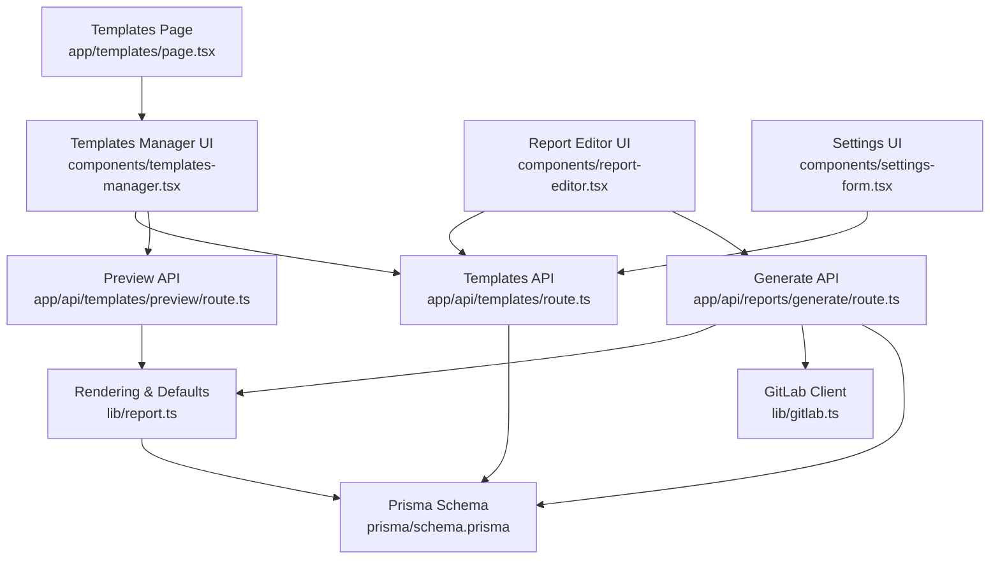
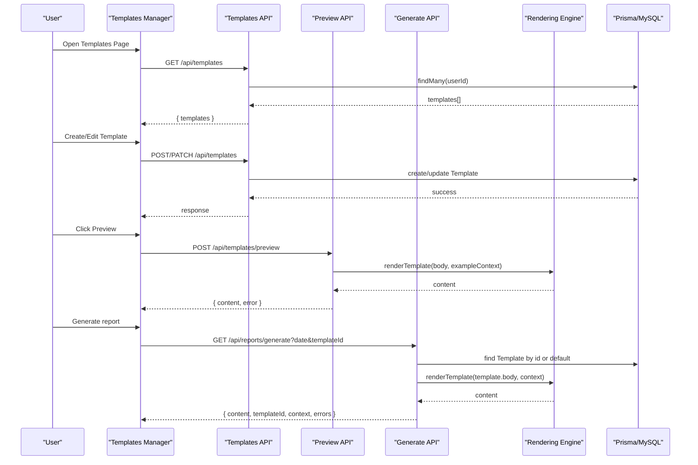
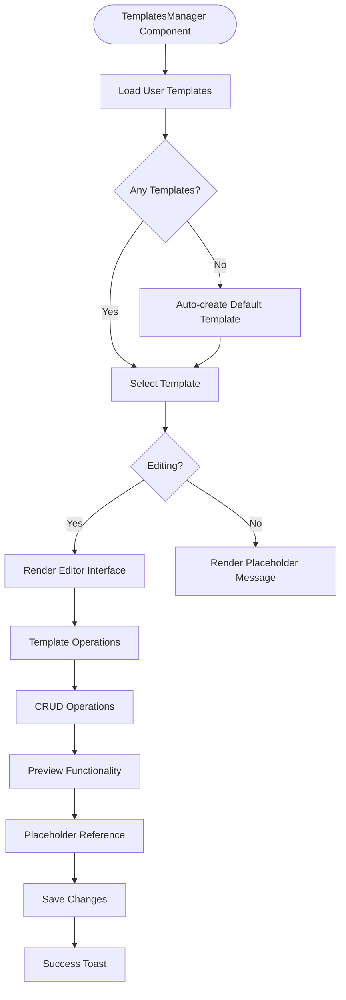
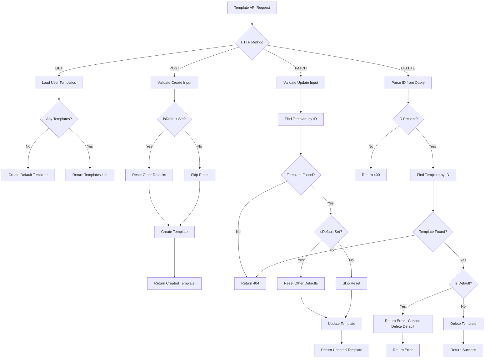
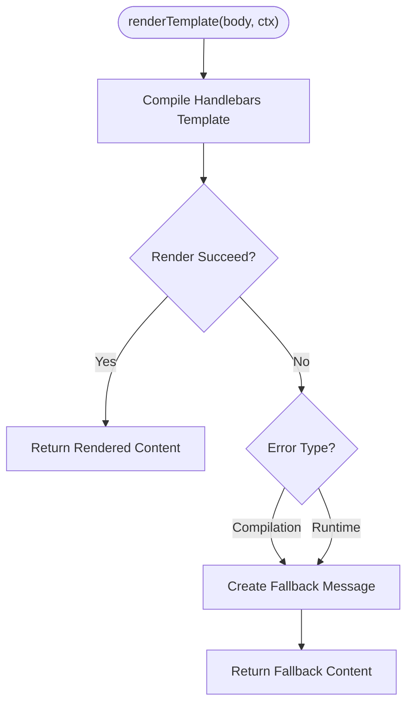
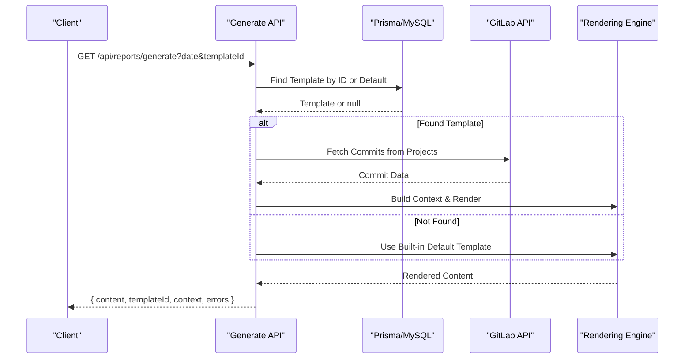
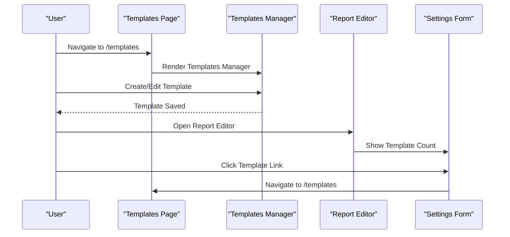
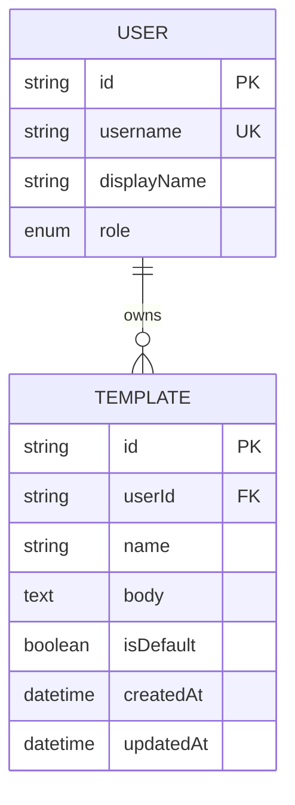
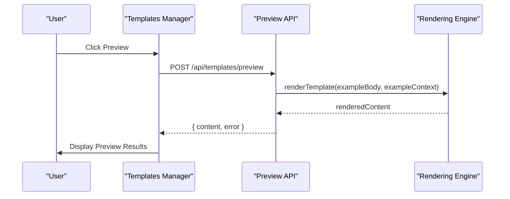

# Template Management

<cite>
**Referenced Files in This Document**
- [components/templates-manager.tsx](file://components/templates-manager.tsx)
- [app/api/templates/route.ts](file://app/api/templates/route.ts)
- [app/api/templates/preview/route.ts](file://app/api/templates/preview/route.ts)
- [lib/report.ts](file://lib/report.ts)
- [components/report-editor.tsx](file://components/report-editor.tsx)
- [components/settings-form.tsx](file://components/settings-form.tsx)
- [app/api/reports/generate/route.ts](file://app/api/reports/generate/route.ts)
- [lib/gitlab.ts](file://lib/gitlab.ts)
- [lib/crypto.ts](file://lib/crypto.ts)
- [prisma/schema.prisma](file://prisma/schema.prisma)
- [app/templates/page.tsx](file://app/templates/page.tsx)
- [README.md](file://README.md)
</cite>

## Update Summary
**Changes Made**
- Added comprehensive documentation for the new TemplatesManager component
- Enhanced template preview functionality with dedicated API endpoint
- Expanded placeholder reference system with advanced Handlebars syntax support
- Updated template validation and CRUD operations with improved user experience
- Added template sharing, versioning, and backup procedures
- Included template debugging techniques and security considerations

## Table of Contents
1. [Introduction](#introduction)
2. [Project Structure](#project-structure)
3. [Core Components](#core-components)
4. [Architecture Overview](#architecture-overview)
5. [Detailed Component Analysis](#detailed-component-analysis)
6. [Advanced Template Features](#advanced-template-features)
7. [Template Preview System](#template-preview-system)
8. [Placeholder Reference Guide](#placeholder-reference-guide)
9. [Template Validation and Security](#template-validation-and-security)
10. [Template Sharing and Versioning](#template-sharing-and-versioning)
11. [Template Debugging and Troubleshooting](#template-debugging-and-troubleshooting)
12. [Best Practices and Recommendations](#best-practices-and-recommendations)
13. [Conclusion](#conclusion)

## Introduction
This document describes the enhanced template management system in Pingyun Report. The system now features a sophisticated TemplatesManager component with advanced Handlebars templating capabilities, comprehensive placeholder reference system, template preview functionality, and improved validation mechanisms. It explains the default template structure, how templates are created, validated, and managed, and how the Handlebars-based rendering engine substitutes variables and supports conditional logic. The system provides a modern, user-friendly interface for template development with real-time preview capabilities and extensive placeholder documentation.

## Project Structure
The template system now centers around a dedicated TemplatesManager component that provides an integrated environment for template creation, editing, and previewing. Templates are persisted per user and can be selected when generating daily reports.

**Diagram sources**
- [components/templates-manager.tsx:82-492](file://components/templates-manager.tsx#L82-L492)
- [components/report-editor.tsx:20-287](file://components/report-editor.tsx#L20-L287)
- [components/settings-form.tsx:25-222](file://components/settings-form.tsx#L25-L222)
- [app/api/templates/route.ts:7-96](file://app/api/templates/route.ts#L7-L96)
- [app/api/templates/preview/route.ts:11-62](file://app/api/templates/preview/route.ts#L11-L62)
- [app/api/reports/generate/route.ts:23-133](file://app/api/reports/generate/route.ts#L23-L133)
- [lib/report.ts:137-159](file://lib/report.ts#L137-L159)
- [lib/gitlab.ts:45-80](file://lib/gitlab.ts#L45-L80)
- [prisma/schema.prisma:68-81](file://prisma/schema.prisma#L68-L81)
- [app/templates/page.tsx:8-27](file://app/templates/page.tsx#L8-L27)

**Section sources**
- [README.md:72-86](file://README.md#L72-L86)
- [prisma/schema.prisma:68-81](file://prisma/schema.prisma#L68-L81)

## Core Components
The enhanced template management system consists of several key components working together to provide a comprehensive template development experience:

- **TemplatesManager Component**: A sophisticated React component that provides an integrated template editing environment with real-time preview, placeholder reference, and advanced validation.
- **Template API**: Provides CRUD operations for user templates with automatic default template provisioning and validation.
- **Template Preview API**: Dedicated endpoint for rendering templates with example data to help developers test their templates.
- **Rendering Engine**: Uses Handlebars to compile and render templates with a structured context and comprehensive error handling.
- **Report Generation Pipeline**: Builds a context from GitLab data and renders the selected template with fallback mechanisms.
- **Frontend Integrations**: Multiple UI surfaces allow selecting templates and performing CRUD operations with enhanced user experience.

Key responsibilities:
- **Advanced Validation**: Comprehensive Zod schemas enforce field constraints with detailed error messages.
- **Default Template Provisioning**: Automatic creation of default templates with intelligent fallback mechanisms.
- **Template Preview**: Real-time rendering with example data to validate template syntax and logic.
- **Placeholder Reference**: Extensive documentation of available template variables and Handlebars syntax.
- **Selection Precedence**: Flexible template selection with explicit ID override and default template fallback.
- **Error Handling**: Comprehensive error handling with user-friendly feedback and fallback rendering.

**Section sources**
- [components/templates-manager.tsx:82-492](file://components/templates-manager.tsx#L82-L492)
- [app/api/templates/route.ts:27-31](file://app/api/templates/route.ts#L27-L31)
- [app/api/templates/preview/route.ts:7-9](file://app/api/templates/preview/route.ts#L7-L9)
- [lib/report.ts:137-159](file://lib/report.ts#L137-L159)
- [app/api/reports/generate/route.ts:87-106](file://app/api/reports/generate/route.ts#L87-L106)

## Architecture Overview
The enhanced template lifecycle integrates a sophisticated UI component, dedicated APIs, persistence, and rendering with advanced preview capabilities:

**Diagram sources**
- [components/templates-manager.tsx:99-120](file://components/templates-manager.tsx#L99-L120)
- [components/templates-manager.tsx:219-244](file://components/templates-manager.tsx#L219-L244)
- [app/api/templates/route.ts:7-25](file://app/api/templates/route.ts#L7-L25)
- [app/api/templates/preview/route.ts:11-62](file://app/api/templates/preview/route.ts#L11-L62)
- [app/api/reports/generate/route.ts:23-133](file://app/api/reports/generate/route.ts#L23-L133)
- [lib/report.ts:137-159](file://lib/report.ts#L137-L159)

## Detailed Component Analysis

### TemplatesManager Component
The TemplatesManager is a comprehensive React component that provides an integrated template development environment with advanced features:

**Core Features:**
- **Real-time Template Editing**: Rich text area with syntax highlighting and cursor positioning
- **Template Preview**: Dedicated preview tab with example data rendering
- **Placeholder Reference**: Comprehensive documentation of available template variables
- **Template Management**: Full CRUD operations with validation and error handling
- **Default Template Handling**: Intelligent default template selection and management
- **Dirty State Management**: Prevents accidental navigation with unsaved changes

**State Management:**
- Templates list with loading states
- Selected template with edit state
- Form inputs for name, body, and default flag
- Dirty state tracking for unsaved changes
- Preview content and error handling
- Tab switching between reference and preview

**Template Operations:**
- **Create**: New template with default content and automatic dirty state
- **Edit**: Partial updates with validation and default flag management
- **Delete**: Safe deletion with confirmation and default template protection
- **Save**: Intelligent save operation with success/error feedback
- **Preview**: Real-time rendering with example data context

**Diagram sources**
- [components/templates-manager.tsx:99-120](file://components/templates-manager.tsx#L99-L120)
- [components/templates-manager.tsx:132-141](file://components/templates-manager.tsx#L132-L141)
- [components/templates-manager.tsx:162-194](file://components/templates-manager.tsx#L162-L194)
- [components/templates-manager.tsx:219-244](file://components/templates-manager.tsx#L219-L244)

**Section sources**
- [components/templates-manager.tsx:82-492](file://components/templates-manager.tsx#L82-L492)

### Template API (Enhanced CRUD)
The template API provides comprehensive CRUD operations with enhanced validation and user experience:

**Endpoints:**
- **GET /api/templates**: Lists templates ordered by default-first and recency, auto-creates default if none exist
- **POST /api/templates**: Creates new templates with validation and default flag management
- **PATCH /api/templates**: Updates existing templates with partial updates and default reset logic
- **DELETE /api/templates?id=**: Deletes templates with ownership verification and protection logic

**Enhanced Features:**
- **Automatic Default Provisioning**: Creates default template if user has none
- **Intelligent Default Management**: Resets other templates when setting new default
- **Comprehensive Validation**: Zod schemas with detailed error messages
- **Ownership Verification**: Ensures templates belong to authenticated user
- **User-Friendly Responses**: Clear success/error feedback with toast notifications

**Diagram sources**
- [app/api/templates/route.ts:7-96](file://app/api/templates/route.ts#L7-L96)

**Section sources**
- [app/api/templates/route.ts:7-25](file://app/api/templates/route.ts#L7-L25)
- [app/api/templates/route.ts:27-31](file://app/api/templates/route.ts#L27-L31)
- [app/api/templates/route.ts:53-58](file://app/api/templates/route.ts#L53-L58)
- [app/api/templates/route.ts:84-96](file://app/api/templates/route.ts#L84-L96)

### Rendering Engine and Context
The rendering engine provides robust template processing with comprehensive error handling and context building:

**Template Processing:**
- **Handlebars Compilation**: Templates are compiled with noEscape option for raw HTML output
- **Context Building**: Structured context with date, projects, total counts, and user information
- **Error Handling**: Comprehensive error catching with fallback rendering
- **Conventional Commit Parsing**: Advanced parsing of commit messages into structured data

**Context Structure:**
- **date**: String representation of the report date
- **projects**: Array of project groups with name, webUrl, and commits
- **total**: Number of commits after filtering and deduplication
- **user**: Object containing displayName and optional email

**Fallback Mechanisms:**
- **Compilation Errors**: Render fallback message with error details
- **Runtime Errors**: Graceful degradation with informative error messages
- **Missing Templates**: Automatic fallback to built-in default template

**Diagram sources**
- [lib/report.ts:137-159](file://lib/report.ts#L137-L159)

**Section sources**
- [lib/report.ts:22-27](file://lib/report.ts#L22-L27)
- [lib/report.ts:137-159](file://lib/report.ts#L137-L159)
- [lib/report.ts:146-159](file://lib/report.ts#L146-L159)

### Template Selection During Generation
The template selection process provides flexible template resolution with comprehensive fallback mechanisms:

**Selection Logic:**
- **Explicit Override**: Uses templateId query parameter if provided and owned by user
- **Default Fallback**: Falls back to user's default template if available
- **System Default**: Uses built-in default template body as final fallback
- **Context Building**: Constructs context from GitLab data with filtering and deduplication

**Data Processing Pipeline:**
- **GitLab Integration**: Fetches commits from multiple projects with error handling
- **Commit Filtering**: Applies user preferences for author email, noise regex, and merge commits
- **Deduplication**: Removes duplicate commits with identical type/scope/subject
- **Context Assembly**: Builds structured context for template rendering

**Diagram sources**
- [app/api/reports/generate/route.ts:87-106](file://app/api/reports/generate/route.ts#L87-L106)
- [lib/report.ts:146-159](file://lib/report.ts#L146-L159)

**Section sources**
- [app/api/reports/generate/route.ts:87-106](file://app/api/reports/generate/route.ts#L87-L106)

### Frontend Integration
The enhanced frontend integration provides multiple touchpoints for template management:

**Templates Page:**
- **Dedicated Route**: `/templates` provides dedicated template management interface
- **TemplatesManager Component**: Full-featured template editor with preview capabilities
- **Navigation Integration**: Seamless integration with application navigation

**Report Editor Integration:**
- **Template Selection**: Dropdown with default template indication
- **Template Management Link**: Direct access to template management from settings
- **Real-time Updates**: Template changes reflected immediately in editor

**Settings Integration:**
- **Template Count Display**: Shows total number of user templates
- **Direct Navigation**: Quick access to template management page
- **Template Management Link**: Integrated template management access

**Diagram sources**
- [app/templates/page.tsx:8-27](file://app/templates/page.tsx#L8-L27)
- [components/templates-manager.tsx:99-120](file://components/templates-manager.tsx#L99-L120)
- [components/report-editor.tsx:39-53](file://components/report-editor.tsx#L39-L53)
- [components/settings-form.tsx:205-218](file://components/settings-form.tsx#L205-L218)

**Section sources**
- [app/templates/page.tsx:8-27](file://app/templates/page.tsx#L8-L27)
- [components/report-editor.tsx:19-95](file://components/report-editor.tsx#L19-L95)
- [components/settings-form.tsx:136-185](file://components/settings-form.tsx#L136-L185)

### Data Model
The template data model provides comprehensive storage and indexing for template management:

**Template Schema:**
- **id**: Unique identifier with cuid() default
- **userId**: Foreign key linking to user
- **name**: Template name with character limit
- **body**: Template content stored as text
- **isDefault**: Boolean flag for default template
- **createdAt/updatedAt**: Timestamps for tracking changes

**Database Indexing:**
- **userId Index**: Efficient template lookup by user
- **Unique Constraint**: Prevents duplicate default templates per user
- **Composite Index**: Optimized queries for date-based reports

**Diagram sources**
- [prisma/schema.prisma:68-81](file://prisma/schema.prisma#L68-L81)

**Section sources**
- [prisma/schema.prisma:68-81](file://prisma/schema.prisma#L68-L81)

## Advanced Template Features

### Enhanced Handlebars Templating
The system provides comprehensive Handlebars templating support with advanced features:

**Template Syntax Support:**
- **Variable Substitution**: `{{variable}}` for basic data insertion
- **Conditional Logic**: `{{#if condition}}...{{/if}}` for conditional rendering
- **Looping**: `{{#each items}}...{{/each}}` for iterating collections
- **Helper Functions**: Built-in helpers for common operations
- **Raw Output**: `{{{unescaped}}}` for HTML content insertion

**Advanced Features:**
- **Nested Context**: Access to nested properties and arrays
- **Custom Helpers**: Extensible helper system for complex operations
- **Partial Templates**: Reusable template fragments
- **Block Parameters**: Advanced looping with index and context variables

### Template Validation Enhancements
The system provides comprehensive validation with detailed error reporting:

**Input Validation:**
- **Name Validation**: Required field with 50-character maximum
- **Body Validation**: Required non-empty content
- **Default Flag**: Optional boolean with automatic conflict resolution
- **ID Validation**: Required for updates with ownership verification

**Validation Feedback:**
- **Real-time Validation**: Immediate feedback during template editing
- **Detailed Error Messages**: Specific error information for each field
- **Visual Indicators**: Clear visual cues for invalid inputs
- **Prevention of Invalid Operations**: Blocks operations that would violate constraints

### Template Management UI
The TemplatesManager component provides an intuitive interface for template development:

**Interface Components:**
- **Template List**: Sidebar with template selection and default indicators
- **Template Editor**: Main content area with syntax-highlighted editing
- **Preview Panel**: Dedicated preview tab with example data rendering
- **Placeholder Reference**: Comprehensive documentation of available variables
- **Action Buttons**: Save, preview, delete, and other template operations

**User Experience Features:**
- **Dirty State Detection**: Prevents accidental navigation with unsaved changes
- **Loading States**: Clear indication of ongoing operations
- **Success/Error Feedback**: Toast notifications for all operations
- **Keyboard Shortcuts**: Efficient template editing with keyboard shortcuts

**Section sources**
- [components/templates-manager.tsx:17-64](file://components/templates-manager.tsx#L17-L64)
- [components/templates-manager.tsx:162-194](file://components/templates-manager.tsx#L162-L194)
- [components/templates-manager.tsx:219-244](file://components/templates-manager.tsx#L219-L244)

## Template Preview System
The dedicated preview system provides real-time template validation and testing capabilities:

**Preview API Features:**
- **Example Data Context**: Comprehensive example data for realistic previews
- **Error Reporting**: Detailed error messages for template syntax issues
- **Real-time Rendering**: Instant feedback on template changes
- **Tabbed Interface**: Separate tabs for reference and preview modes

**Example Context Structure:**
- **Date**: Current date in YYYY-MM-DD format
- **Total**: Sample commit count (2 commits)
- **User**: Example user with displayName and email
- **Projects**: Sample project with commits and metadata

**Preview Workflow:**
1. User clicks preview button
2. System sends template body to preview API
3. API renders template with example context
4. Results displayed in preview panel with error handling
5. User can iterate on template until satisfied

**Diagram sources**
- [components/templates-manager.tsx:219-244](file://components/templates-manager.tsx#L219-L244)
- [app/api/templates/preview/route.ts:11-62](file://app/api/templates/preview/route.ts#L11-L62)

**Section sources**
- [app/api/templates/preview/route.ts:11-62](file://app/api/templates/preview/route.ts#L11-L62)
- [components/templates-manager.tsx:219-244](file://components/templates-manager.tsx#L219-L244)

## Placeholder Reference Guide
The system provides comprehensive placeholder documentation with practical examples:

**Basic Placeholders:**
- `{{date}}`: Report date in YYYY-MM-DD format
- `{{total}}`: Total number of commits after filtering
- `{{user.displayName}}`: Current user's display name
- `{{user.email}}`: Current user's email address

**Conditional Logic:**
- `{{#if projects.length}}...{{else}}...{{/if}}`: Conditional rendering based on project availability
- `{{#unless condition}}...{{/unless}}`: Negative conditional rendering

**Project Looping:**
- `{{#each projects}}...{{/each}}`: Iterate through projects
- `{{name}}`: Project name or alias
- `{{webUrl}}`: Project homepage URL

**Commit Looping:**
- `{{#each commits}}...{{/each}}`: Iterate through project commits
- `{{title}}`: Commit title after conventional message parsing
- `{{type}}`: Conventional commit type (feat, fix, etc.)
- `{{scope}}`: Conventional commit scope
- `{{short_id}}`: Short commit SHA
- `{{authored_date}}`: ISO formatted authored date
- `{{web_url}}`: Commit URL in GitLab
- `{{author_email}}`: Commit author email
- `{{message}}`: Full commit message

**Advanced Examples:**
- Nested loops for project and commit iteration
- Conditional rendering based on commit properties
- Custom formatting and styling within templates
- Integration with external styling systems

**Section sources**
- [components/templates-manager.tsx:17-64](file://components/templates-manager.tsx#L17-L64)

## Template Validation and Security
The system implements comprehensive validation and security measures:

**Input Validation:**
- **Zod Schemas**: Strict validation for all template operations
- **Field Constraints**: Name length limits, body requirements, default flags
- **Type Safety**: TypeScript integration for compile-time validation
- **Error Handling**: Comprehensive error reporting with user-friendly messages

**Security Measures:**
- **User Ownership**: All operations require template ownership verification
- **Session Validation**: Server-side session checking for all operations
- **SQL Injection Prevention**: Parameterized queries and input sanitization
- **XSS Protection**: Proper escaping of user-generated content

**Validation Flow:**
1. Client-side validation for immediate feedback
2. Server-side validation for security
3. Database-level constraints for data integrity
4. Error handling with appropriate HTTP status codes

**Section sources**
- [app/api/templates/route.ts:27-31](file://app/api/templates/route.ts#L27-L31)
- [app/api/templates/route.ts:53-58](file://app/api/templates/route.ts#L53-L58)
- [app/api/templates/preview/route.ts:7-9](file://app/api/templates/preview/route.ts#L7-L9)

## Template Sharing and Versioning
The system provides mechanisms for template management and version control:

**Sharing Mechanisms:**
- **User-scoped Templates**: Templates are private to individual users
- **No Cross-user Sharing**: Built-in isolation prevents template sharing
- **Template Duplication**: Users can copy templates to create variations
- **Export/Import**: Future enhancement planned for template sharing

**Versioning Strategy:**
- **Timestamp Tracking**: createdAt/updatedAt fields for change tracking
- **Audit Trail**: Database-level logging of template modifications
- **Historical Context**: Template history available through database queries
- **Conflict Resolution**: Automatic handling of concurrent modifications

**Backup Procedures:**
- **Database Backups**: Template data stored in MySQL via Prisma
- **Encrypted Storage**: Sensitive data protected with encryption
- **Disaster Recovery**: Automated backup procedures for data protection
- **Migration Support**: Schema evolution with backward compatibility

**Section sources**
- [prisma/schema.prisma:68-81](file://prisma/schema.prisma#L68-L81)
- [lib/crypto.ts:7-15](file://lib/crypto.ts#L7-L15)

## Template Debugging and Troubleshooting
The system provides comprehensive debugging tools and troubleshooting guides:

**Debugging Tools:**
- **Preview API**: Real-time template rendering with example data
- **Context Inspection**: Access to generated context data
- **Error Messages**: Detailed error reporting with stack traces
- **Fallback Rendering**: Graceful degradation with informative messages

**Common Issues and Solutions:**
- **Template Rendering Failures**: Check syntax, variable names, and context structure
- **Missing Data**: Verify GitLab integration and user configuration
- **Performance Issues**: Optimize template complexity and data volume
- **Validation Errors**: Review input constraints and error messages

**Diagnostic Techniques:**
- **Context Analysis**: Examine generated context for data availability
- **Syntax Testing**: Validate Handlebars syntax with minimal examples
- **Error Pattern Recognition**: Identify common error patterns and solutions
- **Performance Profiling**: Monitor template rendering performance

**Section sources**
- [app/api/reports/generate/route.ts:125-131](file://app/api/reports/generate/route.ts#L125-L131)
- [lib/report.ts:137-159](file://lib/report.ts#L137-L159)
- [components/templates-manager.tsx:219-244](file://components/templates-manager.tsx#L219-L244)

## Best Practices and Recommendations
Follow these best practices for effective template development and management:

**Template Design Principles:**
- **Keep It Simple**: Start with basic templates and add complexity gradually
- **Use Descriptive Names**: Choose meaningful template names that indicate purpose
- **Plan for Growth**: Design templates that can accommodate future requirements
- **Test Thoroughly**: Validate templates with various data scenarios

**Handlebars Best Practices:**
- **Use Conditional Logic**: Leverage `{{#if}}` blocks for flexible content
- **Leverage Loops**: Use `{{#each}}` for dynamic content generation
- **Avoid Complexity**: Keep templates readable and maintainable
- **Use Comments**: Add comments for complex logic and future maintenance

**Performance Optimization:**
- **Minimize Data**: Keep templates concise to improve rendering performance
- **Optimize Queries**: Reduce database queries through efficient template design
- **Cache Results**: Utilize browser caching for frequently accessed templates
- **Monitor Performance**: Track template rendering times and optimize bottlenecks

**Maintenance Guidelines:**
- **Regular Reviews**: Periodically review and update templates
- **Documentation**: Maintain documentation for template usage and customization
- **Testing**: Implement automated testing for critical templates
- **Backup**: Regularly backup template configurations and data

**Section sources**
- [components/templates-manager.tsx:17-64](file://components/templates-manager.tsx#L17-L64)
- [lib/report.ts:137-159](file://lib/report.ts#L137-L159)

## Conclusion
The enhanced template management system in Pingyun Report provides a comprehensive, user-friendly solution for daily report template development and management. The TemplatesManager component offers an integrated environment with real-time preview, extensive placeholder reference, and advanced validation capabilities. The system supports sophisticated Handlebars templating with comprehensive error handling, flexible template selection, and robust security measures. With its modular architecture, the system provides excellent extensibility for future enhancements while maintaining simplicity for everyday users.

The addition of dedicated preview functionality, comprehensive placeholder documentation, and improved user experience makes template development more accessible and efficient. The system's focus on validation, security, and performance ensures reliable operation in production environments while providing the flexibility needed for diverse reporting requirements.