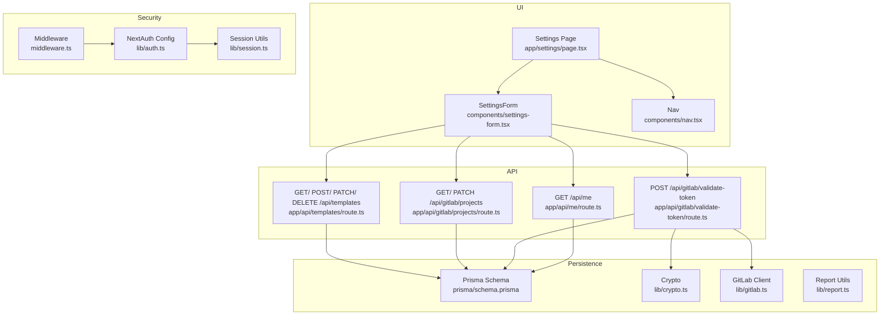
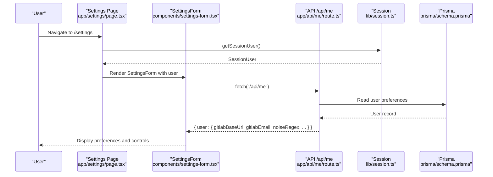
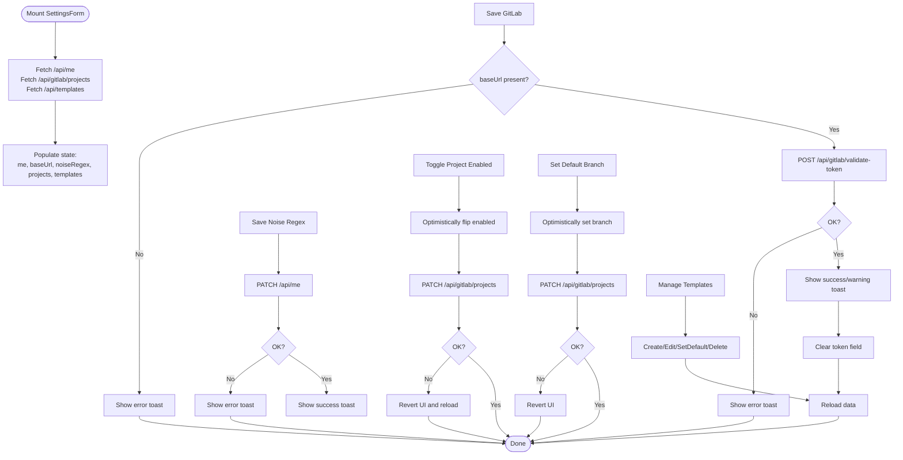
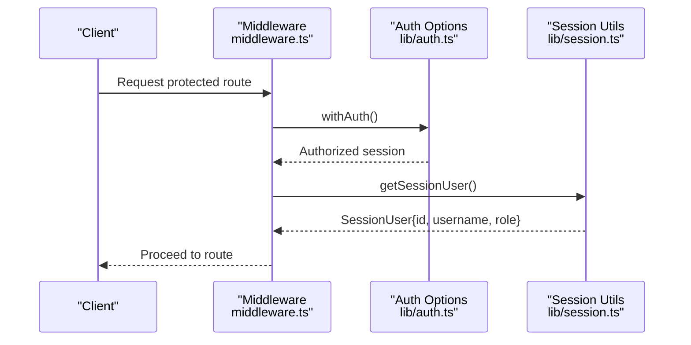
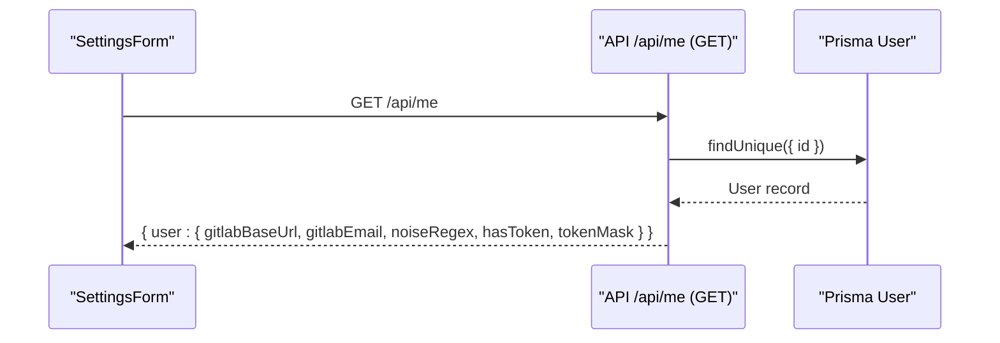
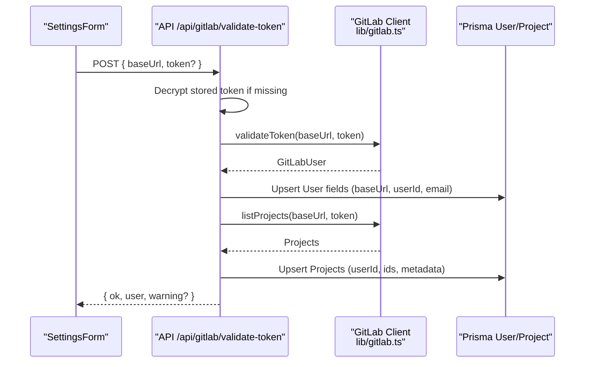
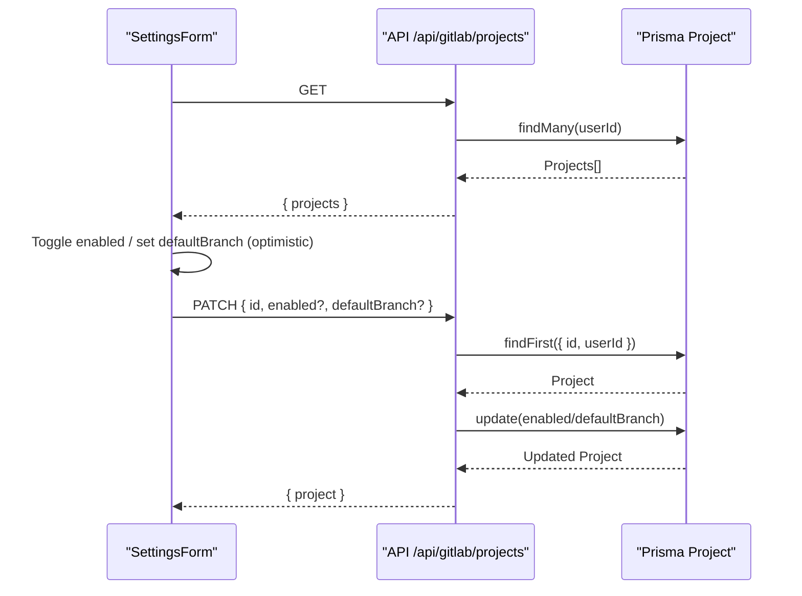
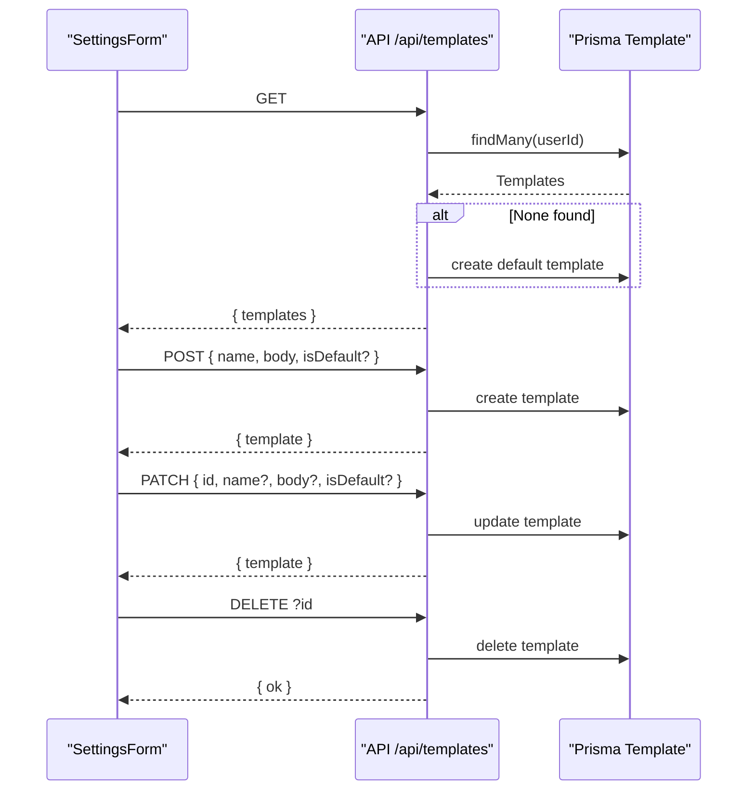
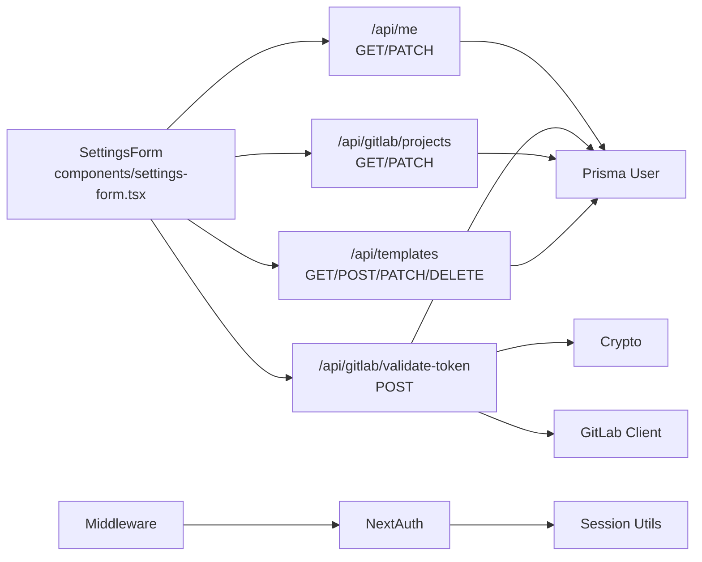
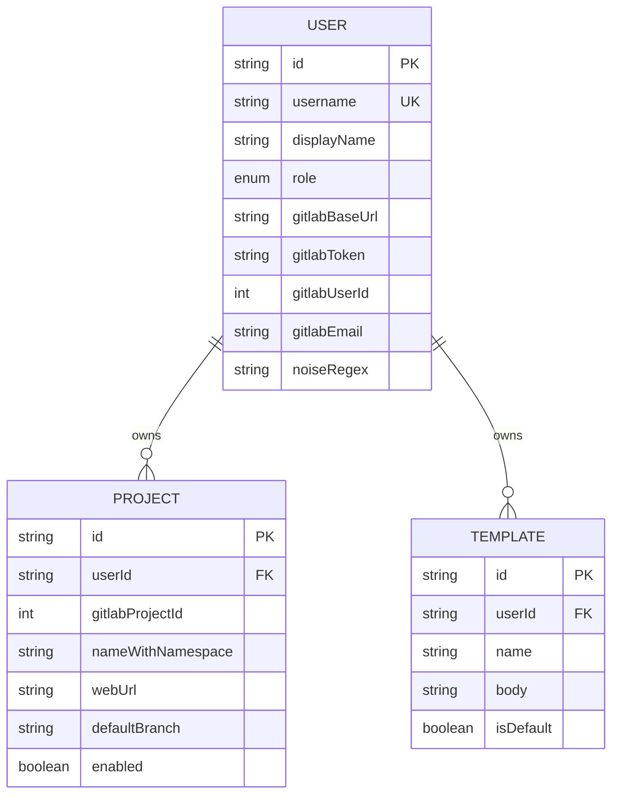

# User Preferences

<cite>
**Referenced Files in This Document**
- [app/settings/page.tsx](file://app/settings/page.tsx)
- [components/settings-form.tsx](file://components/settings-form.tsx)
- [lib/session.ts](file://lib/session.ts)
- [lib/auth.ts](file://lib/auth.ts)
- [app/api/me/route.ts](file://app/api/me/route.ts)
- [app/api/gitlab/validate-token/route.ts](file://app/api/gitlab/validate-token/route.ts)
- [app/api/gitlab/projects/route.ts](file://app/api/gitlab/projects/route.ts)
- [app/api/templates/route.ts](file://app/api/templates/route.ts)
- [lib/crypto.ts](file://lib/crypto.ts)
- [lib/gitlab.ts](file://lib/gitlab.ts)
- [lib/report.ts](file://lib/report.ts)
- [prisma/schema.prisma](file://prisma/schema.prisma)
- [middleware.ts](file://middleware.ts)
- [components/nav.tsx](file://components/nav.tsx)
- [lib/utils.ts](file://lib/utils.ts)
</cite>

## Table of Contents
1. [Introduction](#introduction)
2. [Project Structure](#project-structure)
3. [Core Components](#core-components)
4. [Architecture Overview](#architecture-overview)
5. [Detailed Component Analysis](#detailed-component-analysis)
6. [Dependency Analysis](#dependency-analysis)
7. [Performance Considerations](#performance-considerations)
8. [Troubleshooting Guide](#troubleshooting-guide)
9. [Conclusion](#conclusion)
10. [Appendices](#appendices)

## Introduction
This document explains how Pingyun Report manages user preferences. It covers how users configure personal settings such as GitLab connection, commit filtering via noise regular expressions, project enablement and default branches, and report templates. It documents the SettingsForm component, how user data is fetched and updated, the session-based user context, and how preferences are persisted and accessed. It also includes examples of preference validation, default value handling, and UI patterns, along with preference inheritance and customization options.

## Project Structure
The user preference system spans UI, API routes, and persistence:
- UI: Settings page renders SettingsForm, which fetches and updates preferences.
- API: Routes under /api handle retrieval and mutation of user preferences.
- Persistence: Prisma models store user preferences and related data.
- Security: NextAuth-based session ensures only authenticated users can access preferences.

**Diagram sources**
- [app/settings/page.tsx:1-21](file://app/settings/page.tsx#L1-L21)
- [components/settings-form.tsx:1-368](file://components/settings-form.tsx#L1-L368)
- [lib/auth.ts:1-77](file://lib/auth.ts#L1-L77)
- [lib/session.ts:1-56](file://lib/session.ts#L1-L56)
- [middleware.ts:1-10](file://middleware.ts#L1-L10)
- [app/api/me/route.ts:1-67](file://app/api/me/route.ts#L1-L67)
- [app/api/gitlab/validate-token/route.ts:1-81](file://app/api/gitlab/validate-token/route.ts#L1-L81)
- [app/api/gitlab/projects/route.ts:1-42](file://app/api/gitlab/projects/route.ts#L1-L42)
- [app/api/templates/route.ts:1-96](file://app/api/templates/route.ts#L1-L96)
- [lib/crypto.ts:1-46](file://lib/crypto.ts#L1-L46)
- [lib/gitlab.ts:1-149](file://lib/gitlab.ts#L1-L149)
- [lib/report.ts:1-159](file://lib/report.ts#L1-L159)
- [prisma/schema.prisma:1-80](file://prisma/schema.prisma#L1-L80)

**Section sources**
- [app/settings/page.tsx:1-21](file://app/settings/page.tsx#L1-L21)
- [components/settings-form.tsx:1-368](file://components/settings-form.tsx#L1-L368)
- [lib/session.ts:1-56](file://lib/session.ts#L1-L56)
- [lib/auth.ts:1-77](file://lib/auth.ts#L1-L77)
- [middleware.ts:1-10](file://middleware.ts#L1-L10)

## Core Components
- Settings page: Renders the SettingsForm and injects the current user into the navigation.
- SettingsForm: Client-side form that loads user preferences, validates inputs, and persists changes via API calls.
- Session utilities: Provide the current user identity and enforce authentication.
- API routes: Expose endpoints to fetch and update user preferences, manage GitLab integration, project lists, and templates.
- Persistence: Prisma models store user preferences and related data.
- Crypto: Encrypts tokens before storage; masks tokens for safe display.
- GitLab client: Validates tokens and caches project lists server-side.
- Report utilities: Apply user’s noise regex to filter commits during report generation.

**Section sources**
- [app/settings/page.tsx:1-21](file://app/settings/page.tsx#L1-L21)
- [components/settings-form.tsx:1-368](file://components/settings-form.tsx#L1-L368)
- [lib/session.ts:1-56](file://lib/session.ts#L1-L56)
- [app/api/me/route.ts:1-67](file://app/api/me/route.ts#L1-L67)
- [app/api/gitlab/validate-token/route.ts:1-81](file://app/api/gitlab/validate-token/route.ts#L1-L81)
- [app/api/gitlab/projects/route.ts:1-42](file://app/api/gitlab/projects/route.ts#L1-L42)
- [app/api/templates/route.ts:1-96](file://app/api/templates/route.ts#L1-L96)
- [lib/crypto.ts:1-46](file://lib/crypto.ts#L1-L46)
- [lib/gitlab.ts:1-149](file://lib/gitlab.ts#L1-L149)
- [lib/report.ts:1-159](file://lib/report.ts#L1-L159)
- [prisma/schema.prisma:1-80](file://prisma/schema.prisma#L1-L80)

## Architecture Overview
The user preference system follows a clear separation of concerns:
- UI layer (client component) orchestrates data fetching and user actions.
- API layer enforces authentication and authorization, validates requests, and interacts with the database.
- Persistence layer stores user preferences and related entities.
- Security layer ensures only authenticated users can access preferences and that sensitive data (tokens) is handled securely.

**Diagram sources**
- [app/settings/page.tsx:1-21](file://app/settings/page.tsx#L1-L21)
- [components/settings-form.tsx:1-368](file://components/settings-form.tsx#L1-L368)
- [app/api/me/route.ts:1-67](file://app/api/me/route.ts#L1-L67)
- [lib/session.ts:1-56](file://lib/session.ts#L1-L56)
- [prisma/schema.prisma:1-80](file://prisma/schema.prisma#L1-L80)

## Detailed Component Analysis

### SettingsForm Component
SettingsForm is a client component responsible for:
- Loading user data, project list, and templates on mount.
- Validating and saving GitLab connection (base URL and optional token).
- Saving user-level preferences (e.g., noise regex).
- Managing project enablement and default branch.
- Creating, editing, setting default, and deleting templates.

Key behaviors:
- Fetches data concurrently via /api/me, /api/gitlab/projects, and /api/templates.
- Uses zod schemas on the server to validate incoming requests.
- Masks tokens for safe display and avoids returning raw tokens.
- Applies optimistic UI updates and reverts on failure.

**Diagram sources**
- [components/settings-form.tsx:1-368](file://components/settings-form.tsx#L1-L368)
- [app/api/me/route.ts:1-67](file://app/api/me/route.ts#L1-L67)
- [app/api/gitlab/validate-token/route.ts:1-81](file://app/api/gitlab/validate-token/route.ts#L1-L81)
- [app/api/gitlab/projects/route.ts:1-42](file://app/api/gitlab/projects/route.ts#L1-L42)
- [app/api/templates/route.ts:1-96](file://app/api/templates/route.ts#L1-L96)

**Section sources**
- [components/settings-form.tsx:1-368](file://components/settings-form.tsx#L1-L368)

### Session-Based User Context
- Authentication strategy uses JWT via NextAuth.
- getSessionUser extracts the current user from the session.
- requireUser throws a 401 response when unauthenticated.
- Middleware enforces authentication for protected routes.

**Diagram sources**
- [middleware.ts:1-10](file://middleware.ts#L1-L10)
- [lib/auth.ts:1-77](file://lib/auth.ts#L1-L77)
- [lib/session.ts:1-56](file://lib/session.ts#L1-L56)

**Section sources**
- [lib/session.ts:1-56](file://lib/session.ts#L1-L56)
- [lib/auth.ts:1-77](file://lib/auth.ts#L1-L77)
- [middleware.ts:1-10](file://middleware.ts#L1-L10)

### Preference Retrieval and Updates

#### User Profile and Noise Regex
- GET /api/me returns user fields including gitlabBaseUrl, gitlabEmail, gitlabUserId, and noiseRegex.
- PATCH /api/me updates noiseRegex and optionally displayName; supports nulling out values.

Validation and defaults:
- PATCH body schema enforces optional noiseRegex and displayName length limits.
- Server-side logic converts empty string to null for noiseRegex when explicitly provided as empty.

**Diagram sources**
- [components/settings-form.tsx:44-55](file://components/settings-form.tsx#L44-L55)
- [app/api/me/route.ts:1-67](file://app/api/me/route.ts#L1-L67)
- [prisma/schema.prisma:16-33](file://prisma/schema.prisma#L16-L33)

**Section sources**
- [app/api/me/route.ts:1-67](file://app/api/me/route.ts#L1-L67)
- [components/settings-form.tsx:90-107](file://components/settings-form.tsx#L90-L107)

#### GitLab Connection and Token Validation
- POST /api/gitlab/validate-token validates the token against GitLab and persists base URL, user ID, and email.
- Optional token handling: if omitted, the stored encrypted token is decrypted and used.
- On success, attempts to upsert project cache for the user (limited batch).
- Returns warnings if token is valid but project list fails to load.

**Diagram sources**
- [components/settings-form.tsx:61-88](file://components/settings-form.tsx#L61-L88)
- [app/api/gitlab/validate-token/route.ts:1-81](file://app/api/gitlab/validate-token/route.ts#L1-L81)
- [lib/gitlab.ts:1-149](file://lib/gitlab.ts#L1-L149)
- [prisma/schema.prisma:16-49](file://prisma/schema.prisma#L16-L49)

**Section sources**
- [app/api/gitlab/validate-token/route.ts:1-81](file://app/api/gitlab/validate-token/route.ts#L1-L81)
- [lib/crypto.ts:1-46](file://lib/crypto.ts#L1-L46)
- [lib/gitlab.ts:1-149](file://lib/gitlab.ts#L1-L149)

#### Project Enablement and Default Branch
- GET /api/gitlab/projects returns user-scoped projects ordered by enabled and name.
- PATCH /api/gitlab/projects toggles enabled and sets defaultBranch; supports nulling branch.

**Diagram sources**
- [components/settings-form.tsx:109-134](file://components/settings-form.tsx#L109-L134)
- [app/api/gitlab/projects/route.ts:1-42](file://app/api/gitlab/projects/route.ts#L1-L42)
- [prisma/schema.prisma:35-49](file://prisma/schema.prisma#L35-L49)

**Section sources**
- [app/api/gitlab/projects/route.ts:1-42](file://app/api/gitlab/projects/route.ts#L1-L42)
- [components/settings-form.tsx:109-134](file://components/settings-form.tsx#L109-L134)

#### Templates Management
- GET /api/templates returns user templates; if none exist, creates a default template.
- POST /api/templates creates a new template and optionally clears existing default.
- PATCH /api/templates updates name/body/isDefault; setting isDefault clears others.
- DELETE /api/templates removes a template by id.

**Diagram sources**
- [components/settings-form.tsx:136-185](file://components/settings-form.tsx#L136-L185)
- [app/api/templates/route.ts:1-96](file://app/api/templates/route.ts#L1-L96)
- [prisma/schema.prisma:67-79](file://prisma/schema.prisma#L67-L79)

**Section sources**
- [app/api/templates/route.ts:1-96](file://app/api/templates/route.ts#L1-L96)
- [components/settings-form.tsx:136-185](file://components/settings-form.tsx#L136-L185)

### Preference Validation, Defaults, and UI Patterns
- Validation:
  - /api/me PATCH enforces optional noiseRegex and displayName length.
  - /api/gitlab/validate-token requires a valid URL and minimum token length when provided.
  - /api/gitlab/projects PATCH accepts optional booleans and nullable strings.
  - /api/templates POST/PATCH enforce name/body lengths and optional isDefault.
- Defaults:
  - GET /api/templates creates a default template if none exists.
  - Project defaultBranch can be cleared to null.
  - PATCH /api/me converts empty string to null for noiseRegex.
- UI patterns:
  - Optimistic updates followed by revert on failure.
  - Masked token display with optional placeholder guidance.
  - Searchable project list with filter input.
  - Template list with default badge and action buttons.

**Section sources**
- [app/api/me/route.ts:49-66](file://app/api/me/route.ts#L49-L66)
- [app/api/gitlab/validate-token/route.ts:8-11](file://app/api/gitlab/validate-token/route.ts#L8-L11)
- [app/api/gitlab/projects/route.ts:15-19](file://app/api/gitlab/projects/route.ts#L15-L19)
- [app/api/templates/route.ts:27-31](file://app/api/templates/route.ts#L27-L31)
- [components/settings-form.tsx:187-191](file://components/settings-form.tsx#L187-L191)
- [components/settings-form.tsx:212-224](file://components/settings-form.tsx#L212-L224)

### Preference Inheritance and Customization
- Per-user customization:
  - Users maintain their own gitlabBaseUrl, gitlabToken (encrypted), gitlabUserId, gitlabEmail, and noiseRegex.
  - Project enablement and default branches are scoped to the user.
  - Templates are user-specific with a default template created automatically.
- Default configurations:
  - Default template created on first access.
  - Project defaultBranch defaults to enabled with optional branch override.
- Inheritance:
  - No cross-user inheritance; preferences are isolated per user account.

**Section sources**
- [prisma/schema.prisma:16-79](file://prisma/schema.prisma#L16-L79)
- [app/api/templates/route.ts:13-24](file://app/api/templates/route.ts#L13-L24)
- [app/api/gitlab/projects/route.ts:8-12](file://app/api/gitlab/projects/route.ts#L8-L12)

## Dependency Analysis
The SettingsForm depends on several APIs and utilities. The following diagram highlights key dependencies and their roles.

**Diagram sources**
- [components/settings-form.tsx:1-368](file://components/settings-form.tsx#L1-L368)
- [app/api/me/route.ts:1-67](file://app/api/me/route.ts#L1-L67)
- [app/api/gitlab/validate-token/route.ts:1-81](file://app/api/gitlab/validate-token/route.ts#L1-L81)
- [app/api/gitlab/projects/route.ts:1-42](file://app/api/gitlab/projects/route.ts#L1-L42)
- [app/api/templates/route.ts:1-96](file://app/api/templates/route.ts#L1-L96)
- [lib/crypto.ts:1-46](file://lib/crypto.ts#L1-L46)
- [lib/gitlab.ts:1-149](file://lib/gitlab.ts#L1-L149)
- [prisma/schema.prisma:1-80](file://prisma/schema.prisma#L1-L80)
- [lib/auth.ts:1-77](file://lib/auth.ts#L1-L77)
- [lib/session.ts:1-56](file://lib/session.ts#L1-L56)
- [middleware.ts:1-10](file://middleware.ts#L1-L10)

**Section sources**
- [components/settings-form.tsx:1-368](file://components/settings-form.tsx#L1-L368)
- [lib/crypto.ts:1-46](file://lib/crypto.ts#L1-L46)
- [lib/gitlab.ts:1-149](file://lib/gitlab.ts#L1-L149)
- [prisma/schema.prisma:1-80](file://prisma/schema.prisma#L1-L80)
- [lib/auth.ts:1-77](file://lib/auth.ts#L1-L77)
- [lib/session.ts:1-56](file://lib/session.ts#L1-L56)
- [middleware.ts:1-10](file://middleware.ts#L1-L10)

## Performance Considerations
- Concurrent loading: SettingsForm fetches three resources in parallel to reduce latency.
- Optimistic UI: Immediate UI updates for toggles and branch changes improve perceived responsiveness; roll back on failure.
- Token handling: Encryption/decryption occurs server-side; client avoids storing raw tokens.
- Project caching: Server-side upserts limit writes to a capped number of projects and uses transactions for efficiency.
- Filtering: Noise regex compilation happens client-side in report utilities; ensure regex is valid and efficient.

[No sources needed since this section provides general guidance]

## Troubleshooting Guide
Common issues and resolutions:
- Unauthorized access to settings:
  - Ensure middleware protection and session presence. The middleware redirects unauthenticated users to the login page.
- GitLab token errors:
  - Verify base URL correctness and token permissions. The validator requires read_api and read_repository scopes.
  - If token validation fails, the endpoint returns an error; if successful but project list fails, a warning is returned.
- Project list not appearing:
  - Confirm GitLab connection is saved and validated. The project list is populated after successful token validation.
- Template operations failing:
  - Ensure name/body meet length requirements. Setting isDefault clears previous defaults.
- Noise regex not applied:
  - Confirm the regex is valid and not empty. Empty string is normalized to null server-side.

**Section sources**
- [middleware.ts:1-10](file://middleware.ts#L1-L10)
- [app/api/gitlab/validate-token/route.ts:13-27](file://app/api/gitlab/validate-token/route.ts#L13-L27)
- [app/api/templates/route.ts:27-31](file://app/api/templates/route.ts#L27-L31)
- [app/api/me/route.ts:49-66](file://app/api/me/route.ts#L49-L66)
- [lib/report.ts:52-75](file://lib/report.ts#L52-L75)

## Conclusion
Pingyun Report’s user preference system centers on a secure, per-user model with clear validation and defaults. The SettingsForm provides a cohesive UI for managing GitLab connectivity, filtering preferences, project selection, and templates. Robust server-side validation, encryption of sensitive data, and optimistic UI updates deliver a reliable and responsive experience.

[No sources needed since this section summarizes without analyzing specific files]

## Appendices

### Data Model Overview
The following ER diagram outlines the relevant models and relationships for user preferences.

**Diagram sources**
- [prisma/schema.prisma:16-79](file://prisma/schema.prisma#L16-L79)

### UI Patterns Reference
- Masked token display: Shows a safe preview of the stored token.
- Conditional controls: Branch input disabled when project is not enabled.
- Action buttons: Dedicated buttons for set default, edit, and delete in the template list.
- Searchable lists: Filter projects by namespace/name.

**Section sources**
- [components/settings-form.tsx:212-224](file://components/settings-form.tsx#L212-L224)
- [components/settings-form.tsx:303-311](file://components/settings-form.tsx#L303-L311)
- [components/settings-form.tsx:340-360](file://components/settings-form.tsx#L340-L360)